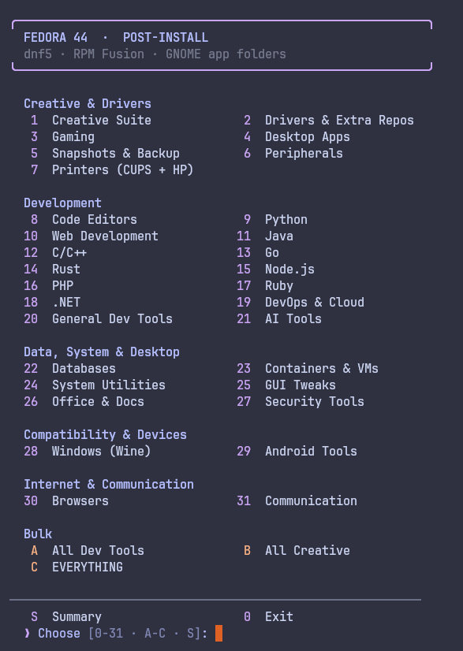
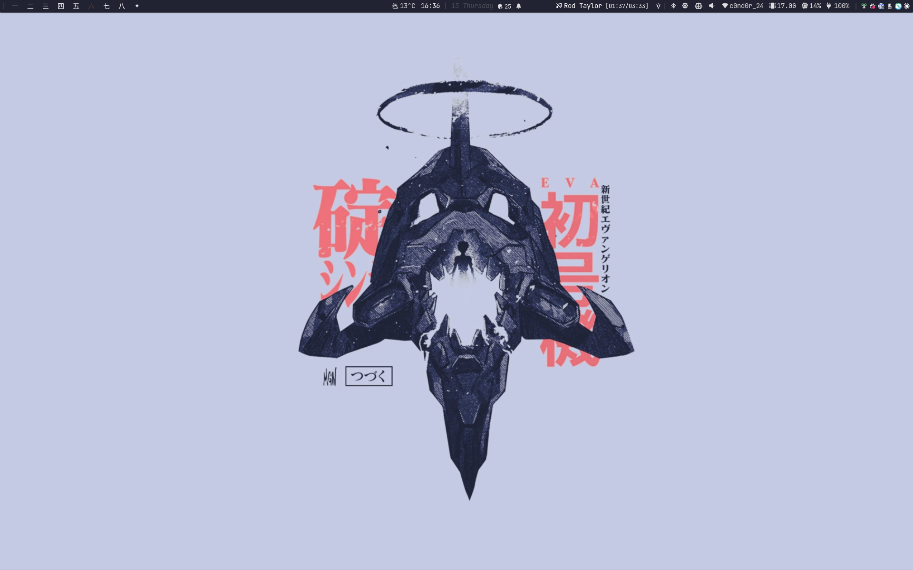
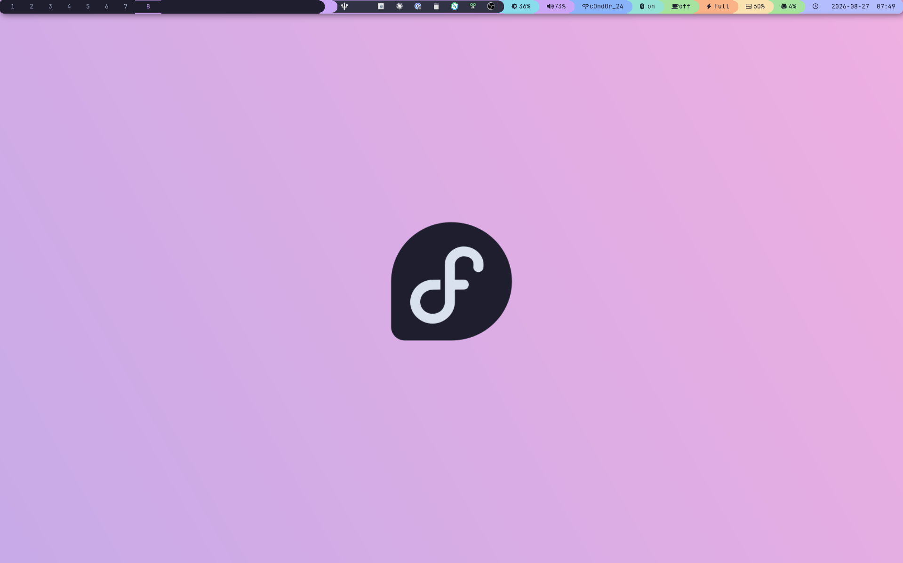

# 🐧🎩 Linux Post-Install Scripts

> **Menu-driven post-installation scripts with verified packages, error handling, installation checks, and automatic GNOME Shell app-folder creation.**



This repo ships **independent, distro-specific scripts** — pick the one that matches your machine:

- **[`post-install-fedora.sh`](post-install-fedora.sh)** — for **Fedora Workstation**, built on `dnf5`/RPM Fusion.
- **[`post-install-openmandriva.sh`](post-install-openmandriva.sh)** — for **OpenMandriva (Rock/Rolling)**, built on `dnf`.

Both scripts share the same Catppuccin-themed menu-driven UX, the same installed/skipped/failed tracking, and the same GNOME Shell app-folder feature — but every install path (package names, repos, drivers, codecs) is re-sourced per distro rather than being a single script with `if`-branches. Neither depends on or modifies the other; run whichever matches your system.

The repo's flagship rice today is the Wayland setup: **[`fedora-sway-setup.sh`](fedora-sway-setup.sh)** — a complete **Sway desktop for Fedora 44**, themed by the 89-theme [HANCORE-linux/waybar-themes](https://github.com/HANCORE-linux/waybar-themes) collection (fetched and adapted at install time), where **one theme pick retints waybar, rofi, kitty, dunst, starship, the sway window borders, GTK 2/3/4, Neovim and VS Code together**. It supersedes the i3 rices below on Fedora. See [Sway + HANCORE Rice Script](#-sway--hancore-rice-script-fedora) below.

A **scrolling-tiling sibling** exists for the [niri](https://github.com/YaLTeR/niri) compositor: **[`fedora-niri-setup.sh`](fedora-niri-setup.sh)** builds the same rice on niri (from the upstream `yalter/niri` COPR), **reusing the identical HANCORE theme engine** — one pick retints the whole desktop including niri's focus-ring accent — and adds **[NiriMod](https://github.com/srinivasr/NiriMod)** (a GTK4 settings editor) for `config.kdl`. See [Niri + HANCORE Rice Script](#-niri--hancore-rice-script-fedora) below.

There are also standalone i3+Catppuccin rice scripts — the predecessors of the Sway rice — that aren't part of that set: **[`fedroa-setup-i3-cattpuccin.sh`](fedroa-setup-i3-cattpuccin.sh)** (Fedora) and **[`openmandriva-setup-i3-cattpuccin.sh`](openmandriva-setup-i3-cattpuccin.sh)** (OpenMandriva) each build a full Catppuccin Mocha–themed **i3 tiling window manager** desktop on top of their respective distro — single-purpose rice scripts, not menu-driven package browsers. Run one after (or independently of) its matching post-install script. See [i3 + Catppuccin Rice Script](#-i3--catppuccin-rice-script-fedora--openmandriva) below.

---

## 📋 Table of Contents

- [🎩 Fedora Post-Install Script](#-fedora-post-install-script)
  - [🚀 Fedora Overview](#-fedora-overview)
  - [✨ Fedora Features](#-fedora-features)
  - [📥 Fedora Installation](#-fedora-installation)
  - [🎯 Fedora Usage](#-fedora-usage)
  - [🗂️ Fedora GNOME App Folders (Super Key Groups)](#️-fedora-gnome-app-folders-super-key-groups)
  - [📦 Fedora Package Categories](#-fedora-package-categories)
    - [Fedora: Creative Suite](#fedora-creative-suite)
    - [Fedora: Code Editors](#fedora-code-editors)
    - [Fedora: Python](#fedora-python)
    - [Fedora: Web Development](#fedora-web-development)
    - [Fedora: Java](#fedora-java)
    - [Fedora: C/C++](#fedora-cc)
    - [Fedora: Go](#fedora-go)
    - [Fedora: Rust](#fedora-rust)
    - [Fedora: Node.js](#fedora-nodejs)
    - [Fedora: PHP](#fedora-php)
    - [Fedora: Ruby](#fedora-ruby)
    - [Fedora: Databases](#fedora-databases)
    - [Fedora: Containers & VMs](#fedora-containers--vms)
    - [Fedora: Gaming](#fedora-gaming)
    - [Fedora: Office & Productivity](#fedora-office--productivity)
    - [Fedora: System Utilities](#fedora-system-utilities)
    - [Fedora: General Development Tools](#fedora-general-development-tools)
    - [Fedora: AI Tools](#fedora-ai-tools)
    - [Fedora: GUI Tweaks](#fedora-gui-tweaks)
    - [Fedora: Windows Software Support](#fedora-windows-software-support)
    - [Fedora: Android Tools](#fedora-android-tools)
    - [Fedora: Security Tools](#fedora-security-tools)
    - [Fedora: .NET](#fedora-net)
    - [Fedora: DevOps & Cloud](#fedora-devops--cloud)
    - [Fedora: Desktop Apps](#fedora-desktop-apps)
    - [Fedora: Browsers](#fedora-browsers)
    - [Fedora: Communication](#fedora-communication)
    - [Fedora: Drivers & Extra Repos](#fedora-drivers--extra-repos)
    - [Fedora: Printers (CUPS + HP)](#fedora-printers-cups--hp)
  - [🔀 Fedora Bulk Options (A / B / C)](#-fedora-bulk-options-a--b--c)
  - [🔧 Fedora Error Handling &amp; Installation Checks](#-fedora-error-handling--installation-checks)
  - [📊 Fedora Installation Summary &amp; Logging](#-fedora-installation-summary--logging)
  - [🔒 Fedora Security Notes](#-fedora-security-notes)
  - [⚠️ Fedora Known Limitations](#-fedora-known-limitations)
  - [⚙️ Fedora Customization](#-fedora-customization)
  - [🐛 Fedora Troubleshooting](#-fedora-troubleshooting)
- [🪟 Sway + HANCORE Rice Script (Fedora)](#-sway--hancore-rice-script-fedora)
  - [🚀 Sway Script Overview](#-sway-script-overview)
  - [📦 What Gets Installed (Sway)](#-what-gets-installed-sway)
  - [🎨 Desktop-wide Theming (HANCORE)](#-desktop-wide-theming-hancore)
  - [📥 Sway Script Installation & Usage](#-sway-script-installation--usage)
  - [⌨️ Sway Keybinds](#️-sway-keybinds)
  - [🔧 Maintaining the Script (sway-build)](#-maintaining-the-script-sway-build)
  - [⚠️ Sway Script Known Limitations](#️-sway-script-known-limitations)
  - [🟠 OpenMandriva Port: `openmandriva-sway-setup.sh`](#-openmandriva-port-openmandriva-sway-setupsh)
- [🌊 Niri + HANCORE Rice Script (Fedora)](#-niri--hancore-rice-script-fedora)
  - [🚀 Niri Script Overview](#-niri-script-overview)
  - [📦 What Gets Installed (Niri)](#-what-gets-installed-niri)
  - [⚙️ NiriMod & Settings](#️-nirimod--settings)
  - [📥 Niri Script Installation & Usage](#-niri-script-installation--usage)
  - [⌨️ Niri Keybinds](#️-niri-keybinds)
  - [🔧 Maintaining the Script (niri-build)](#-maintaining-the-script-niri-build)
  - [🟠 OpenMandriva Port: `openmandriva-niri-setup.sh`](#-openmandriva-port-openmandriva-niri-setupsh)
  - [⚠️ Niri Script Known Limitations](#️-niri-script-known-limitations)
- [🎨 i3 + Catppuccin Rice Script (Fedora & OpenMandriva)](#-i3--catppuccin-rice-script-fedora--openmandriva)
  - [🚀 i3 Script Overview](#-i3-script-overview)
  - [📦 What Gets Installed](#-what-gets-installed)
  - [📥 i3 Script Installation & Usage](#-i3-script-installation--usage)
  - [⌨️ Keybinding Cheat Sheet](#️-keybinding-cheat-sheet)
  - [🖥️ Multi-Monitor Setup](#️-multi-monitor-setup)
  - [🛟 Rollback Safety Net](#-rollback-safety-net)
  - [⚠️ i3 Script Known Limitations & Caveats](#️-i3-script-known-limitations--caveats)
- [📜 License](#-license)
- [🙏 Acknowledgments](#-acknowledgments)

---

# 🎩 Fedora Post-Install Script

### 🚀 Fedora Overview

`post-install-fedora.sh` is a from-scratch Fedora Workstation port of this project — same Catppuccin-themed menu-driven UX, same installed/skipped/failed tracking, same GNOME app-folder feature as the Ubuntu script above, but every install path re-sourced for **`dnf5`** and RPM-based Fedora instead of apt/Nala. It's a separate, independent script (not a fork controlled by a flag) — run whichever file matches your distro.

On startup the script **detects the running release** by reading `/etc/os-release` directly (`ID=fedora`, `VERSION_ID`) rather than `lsb_release`, which isn't installed by default on Fedora. Running on an unsupported release isn't blocked — the script warns and asks whether to continue, same as the Ubuntu script.

It then **bootstraps RPM Fusion** (free + nonfree) and the Cisco OpenH264 repo right after the first metadata refresh — this is the Fedora equivalent of the Ubuntu script installing Nala, except here it's load-bearing rather than cosmetic: almost every proprietary codec, driver, and third-party app below assumes RPM Fusion is already enabled.

**Startup sequence** (before the menu appears), in order:

1. **Root check** — must be run with `sudo`.
2. **Version detection** — supports the current and previous Fedora release; warns and asks to continue on anything else.
3. **Metadata refresh** (`dnf makecache`).
4. **`bootstrap_repos`** — enables RPM Fusion free + nonfree, installs their AppStream metadata, enables the Cisco OpenH264 repo.
5. **Base utilities** — `curl`, `git`, `gnupg2`, `dnf5-plugins`, `dbus-x11`, etc.
6. **Interactive menu.**

Beyond just installing packages, after each category finishes it can also **create a real GNOME Shell app folder** for the apps it just installed — identical mechanism to the Ubuntu script (`org.gnome.desktop.app-folders`), just resolving `.desktop` files via `rpm -ql` instead of `dpkg -L`. See [Fedora GNOME App Folders](#️-fedora-gnome-app-folders-super-key-groups) below.

**Key Design Decisions (how this differs from a literal 1:1 port):**

- ✅ **No per-domain metapackages, so Ubuntu Studio becomes "Creative Suite"**: Fedora has nothing like `ubuntustudio-video/audio/graphics/...`. Instead, **Creative Suite** uses Fedora's own comps groups — `dnf group install audio` (Fedora Jam) and `dnf group install design-suite` — plus a hand-curated Video Editing list and small Photography/Publishing picks. See [Fedora: Creative Suite](#fedora-creative-suite).
- ✅ **"Ultramarine" → Terra, "Nobara" → nothing**: Ultramarine Linux has no repo installable on stock Fedora (it's a full OS spin); its parent project Fyra Labs' **Terra** repo is the practical substitute, scoped to its `extras` subrepo only. Nobara's own repo is **deliberately not added** — its maintainers document it as unsafe on a non-Nobara install, and its gaming-relevant packages are all natively available via RPM Fusion/Fedora anyway.
- ✅ **Flatpak minimized**: every category was individually re-researched against vendor RPM repos, RPM Fusion, and COPR before falling back to Flatpak. It's used only for Signal, Floorp, Zen Browser, Spotify, Bruno, and Jan — confirmed via live research to be the only real option for each.
- ✅ **Zero Snap usage**: both of the Ubuntu script's Snap-only escape hatches (IntelliJ IDEA Community, LXD) have real Fedora-native equivalents here (Flathub, Incus) — nothing in this script touches Snap.
- ✅ **New: proprietary NVIDIA driver support**: the Ubuntu script has no GPU-driver category at all. Fedora's is an explicit opt-in with build-status polling and a flagged (not faked) Secure Boot step — see [Fedora: Drivers & Extra Repos](#fedora-drivers--extra-repos).
- ✅ **Robust Error Handling**: same `package_exists`-before-`safe_install` safety net as the Ubuntu script — an unavailable package is skipped and logged, never a hard failure.

---

### ✨ Fedora Features

#### Fedora Core Features

| Feature                       | Description                                                                                    |
| ------------------------------ | ------------------------------------------------------------------------------------------------ |
| **Version Detection**         | Detects the running release at startup via `/etc/os-release`, warns/prompts on anything unsupported |
| **dnf5 Front-End**             | Uses plain `dnf` (dnf5 is Fedora 41+'s default) — no alternate front-end to bootstrap the way the Ubuntu script bootstraps Nala |
| **Catppuccin-Themed Output**  | Same palette/menus/logging as the Ubuntu script, auto-disabled for non-TTY / `NO_COLOR`         |
| **Interactive Menu**          | Text-based menu with 28 categories, plus Creative Suite, Security, GUI Tweaks, Browsers, Communication, Drivers & Extra Repos, and Printers sub-menus |
| **GNOME App-Folder Creation** | Identical feature to the Ubuntu script, `rpm -ql`-based resolution                              |
| **RPM Fusion Bootstrap**       | Enables free + nonfree repos and Cisco OpenH264 automatically on first run                       |
| **NVIDIA Driver Support**      | Opt-in `akmod-nvidia` + CUDA install with build-status polling and Secure Boot detection (new — no Ubuntu-script equivalent) |
| **Error Handling**             | Skips unavailable packages, continues installation                                              |
| **Pre-Install Checks**        | Verifies if packages are already installed (`rpm -q`)                                            |
| **Package Verification**      | Checks if packages exist in enabled repos before attempting (`dnf info -q`)                      |
| **Zero Snap Usage**            | Every Snap-only case in the Ubuntu script has a Flathub or native dnf equivalent here            |
| **Installation Tracking**     | Tracks installed, skipped, and failed packages per run                                          |
| **Summary Reporting**          | Shows detailed installation summary with the "S" command                                        |
| **Log Saving**                 | Saves complete logs to `/var/log/fedora_post_install_TIMESTAMP.log`                             |

#### Fedora Statistics

- **Main Menu Categories:** 28 (plus Creative Suite, Security, GUI Tweaks, Browsers, Communication, Drivers & Extra Repos, and Printers sub-menus)
- **Package Front-End:** dnf5 (Fedora 41+'s default `dnf`)
- **Third-Party/Vendor Repos:** Brave, Vivaldi, Google Chrome, Microsoft Edge, LibreWolf, TeamViewer, 1Password, Cursor, Slack, VS Code, Sublime Text, Microsoft Azure CLI, Microsoft Teams (teams-for-linux) — all real vendor `dnf`/yum repos
- **RPM Fusion-Native Apps:** Steam, Discord, Telegram Desktop (better coverage than the Ubuntu script gets from apt for the latter two)
- **COPR-Sourced:** DBeaver CE (`copart/dbeaver`)
- **Flatpak-Only (confirmed no better source exists):** Signal, Floorp, Zen Browser, Spotify, Bruno, Jan
- **Snap-Only Tools:** 0 — zero, by design
- **Estimated Install Time:** 15 minutes – several hours (depending on selections; "EVERYTHING" is a long run)
- **Estimated Disk Space:** 5–30GB+ (depending on selections)

---

### 📥 Fedora Installation

#### Fedora Prerequisites

- **Fedora Workstation** (current or previous release — the script detects it at startup; on any other version it warns and asks whether to continue)
- **Root access** (script must be run with `sudo`)
- **Internet connection** (for downloading packages, third-party repos/installers, and Nerd Fonts)
- **An active GNOME desktop session** if you want app folders created, GNOME Shell extensions, or user-scoped GTK/icon themes installed — running over plain SSH with no desktop session still installs packages fine, it just skips those pieces
- **Minimum 10GB free disk space** (more for a full/media-heavy install)

#### Fedora Quick Start

```bash
# Make the script executable
chmod +x post-install-fedora.sh

# Run with sudo
sudo ./post-install-fedora.sh
```

---

### 🎯 Fedora Usage

#### Fedora Menu Navigation

1. **Main Menu**: Shows all 31 categories (`0`–`31`)
2. **Sub-Menus**: Creative Suite (option `1`) has a 6-item sub-menu (Full/Graphics/Video/Audio/Photography/Publishing); GUI Tweaks (option `25`), Security Tools (option `27`), Browsers (option `30`), and Communication (option `31`) each have their own sub-menu; Drivers & Extra Repos (option `2`) offers NVIDIA, Terra, and DisplayLink as separate opt-ins
3. **Bulk Options**: `A`, `B`, `C` (see [Fedora Bulk Options](#-fedora-bulk-options-a--b--c) below)
4. **`S`** — Show Installation Summary
5. **`0`** — Exit

#### Fedora Example Workflows

##### Install a Fedora Development Environment

```bash
sudo ./post-install-fedora.sh
# Select: 2 (Code Editors)   -> optionally create a "Code Editors" app folder
# Select: 3 (Python)
# Select: 4 (Web Development)
# Press 0 to exit
```

##### Install Fedora Creative Suite Tools

```bash
sudo ./post-install-fedora.sh
# Select: 1 (Creative Suite) -> 1 (Full)
# -> installs Design Suite (graphics), Video Editing, Fedora Jam (audio), Photography, Publishing
```

##### Set Up Fedora Container & VM Tooling

```bash
sudo ./post-install-fedora.sh
# Select: 13 (Containers & VMs)
# -> installs moby-engine/podman/Incus, KVM/QEMU + virt-manager/GNOME Boxes, and Cockpit
```

##### Enable NVIDIA Driver + Full System Setup

```bash
sudo ./post-install-fedora.sh
# Select: 28 (Drivers & Extra Repos) -> 1 (NVIDIA Proprietary Driver)
# Select: C (EVERYTHING)
# Wait for completion (potentially a few hours)
```

---

### 🗂️ Fedora GNOME App Folders (Super Key Groups)

After each category finishes, the script can create a real GNOME Shell app folder for the apps it just installed (D-Bus session detection, `.desktop` resolution tiers, `NoDisplay`/`Hidden` filtering, snap/flatpak directory scanning). **Tier 1** of `.desktop` resolution uses `rpm -ql <pkg>`, and the meta-package dependency walk (**tier 2**) uses `rpm -q --requires`. Flatpak-exported app resolution (for Signal, Floorp, Zen, Spotify, Bruno, Jan) works the same way.

---

### 📦 Fedora Package Categories

Below is a breakdown of what each Fedora category actually installs. **Package-name confidence note:** RPM Fusion/driver/codec packages, browsers, communication apps, desktop apps, Fedora Jam/Design Suite groups, Incus, and Flathub fallbacks were all individually verified against live vendor docs, packages.fedoraproject.org, and Flathub during development. The bulk of "ordinary" packages (editors, languages, system utilities) rely on standard Fedora naming conventions rather than a live re-check against a running Fedora system — the same `package_exists`-before-`safe_install` safety net means a wrong guess is logged "Not in repos" and skipped, not a hard failure.

---

#### Fedora: Creative Suite

The Ubuntu-Studio-metapackage replacement. Option `1` opens a 6-item sub-menu:

| # | Item | Installs |
|---|------|----------|
| 1 | **Full** | Everything below (Graphics + Video + Audio + Photography + Publishing) |
| 2 | **Graphics & Design** | `dnf group install design-suite` (GIMP, Inkscape, Krita, Blender, Darktable, Scribus, digiKam, Synfig, Pitivi) + `nomacs`, `flameshot`, `imagemagick`, `GraphicsMagick`, `optipng`, `jpegoptim`, `pngquant`, `libwebp-tools`; also binds Print Screen to Flameshot, and builds **greenshot for Linux** from source (see the Ubuntu Graphics section above — needs `dotnet-sdk-10.0`) |
| 3 | **Video Editing** | `kdenlive`, `shotcut`, `obs-studio`, `mkvtoolnix`, `mkvtoolnix-gui`, `mpv`, `vlc`, `yt-dlp`, plus the full multimedia codec batch below |
| 4 | **Audio Production** | `dnf group install audio` (Fedora Jam: Ardour9, Audacity, Carla, Hydrogen, Guitarix, LV2/LADSPA plugin stack) + `qjackctl`, `pulseaudio-utils`, `soundconverter`, `easytag`, `pavucontrol`, [`cliamp`](https://www.cliamp.stream/) (terminal Winamp-style music player/streamer — not packaged for Fedora, installed via its own release-binary `curl \| sh` installer into `~/.local/bin`) |
| 5 | **Photography** | `darktable`, `rawtherapee`, `digikam`, `hugin`, `gthumb` |
| 6 | **Publishing** | `scribus`, `fontforge`, `calibre` |

**Multimedia codecs** (installed as part of Video Editing, since real-world playback needs them): `ffmpeg-free` → `ffmpeg` swap, `gstreamer1-plugins-good/bad-free/bad-freeworld/ugly/ugly-free`, `gstreamer1-plugin-libav`, `openh264`, `gstreamer1-plugin-openh264`, `mozilla-openh264` — requires RPM Fusion + the Cisco OpenH264 repo, both enabled automatically on first run.

**Design Suite and Fedora Jam overlap by design**: Design Suite already includes several photography (Darktable, digiKam) and desktop-publishing-adjacent tools, so Photography/Publishing here are intentionally kept smaller/non-redundant picks rather than a from-scratch list — mirroring how Ubuntu Studio's own metapackages sometimes overlapped too.

---

#### Fedora: Code Editors

**dnf packages:** `vim-enhanced`, `neovim`, `emacs`, `nano`, `geany`, `gnome-text-editor`, `gedit`, `kate` (both `gnome-text-editor` and `gedit` are listed since which one ships depends on the exact Fedora release — GNOME replaced gedit with gnome-text-editor in GNOME 42+)

**Third-party (official vendor repos):**

- **Visual Studio Code** — Microsoft's official yum repo (`packages.microsoft.com/yumrepos/vscode`)
- **Sublime Text** — Sublime HQ's official rpm repo (`download.sublimetext.com/rpm/stable`)

**Bruno** — installed via Flathub (`com.usebruno.Bruno`); confirmed no stable rpm or COPR exists from usebruno.com.

**LazyVim + Nordic (optional prompt):** identical feature to the Ubuntu script — replaces `~/.config/nvim` (existing config backed up first), clones [LazyVim/starter](https://github.com/LazyVim/starter) + the [Nordic](https://github.com/AlexvZyl/nordic.nvim) theme.

---

#### Fedora: Python

`python3`, `python3-devel`, `python3-pip`, `python3-virtualenv`, `ipython`, `pipx`

Fedora Workstation ships `python3` by default, and there's no `python-is-python3`-style package needed — Fedora's `python3` command already *is* the system Python.

---

#### Fedora: Web Development

**Web Servers:**

- `nginx` — started normally (owns port 80)
- `httpd` (Apache) — installed for availability but not started; RPM `%post` scriptlets don't auto-start services the way Debian's do, so there's no need for the Ubuntu script's `policy-rc.d` workaround here at all

**PHP baseline:** `php-fpm`, `php-cli`, `composer`

**Node.js:** ships natively in Fedora's own repos at a current version — **no NodeSource repo needed at all**, unlike Ubuntu. `nodejs`, `npm`, plus the same global npm package set (`npm-check-updates`, `nodemon`, `pm2`, `webpack`, `webpack-cli`, `eslint`, `prettier`).

---

#### Fedora: Java

**JDK/Build Tools:** `java-latest-openjdk`, `java-latest-openjdk-devel`, `gradle`, `maven`, `ant`, `junit`

**IDE:** IntelliJ IDEA Community via **Flathub** (`com.jetbrains.IntelliJ-IDEA-Community`) — a genuine dedicated app distinct from JetBrains Toolbox, confirmed as the real replacement for the Ubuntu script's Snap install (no Fedora/RPM Fusion package exists).

---

#### Fedora: C/C++

`gcc`, `gcc-c++`, `gcc-gfortran`, `clang`, `cmake`, `make`, `ninja-build`, `ccache`, `autoconf`, `automake`, `libtool`, `m4`, `bison`, `flex`, `gettext`, `pkgconf-pkg-config`, `cppcheck`, `valgrind`, `gdb`, `ltrace`, `strace`

---

#### Fedora: Go

**dnf package:** `golang` (installed if present in repos)

**Direct install fallback** (if `golang` isn't in repos and `go` isn't already on `PATH`): downloads Go 1.22.5 from the official source to `/usr/local/go`, symlinked into `/usr/local/bin`.

---

#### Fedora: Rust

**Primary:** installs **rustup** from the official source **as the desktop user** (same as the Ubuntu script) so the toolchain lands in *their* `~/.cargo`, not root's.

**Fallback:** distro `rust`/`cargo` packages if rustup fails or there's no sudo-invoking user.

---

#### Fedora: Node.js

Calls the same Node.js installer used by [Fedora: Web Development](#fedora-web-development) — Fedora's native `nodejs`/`npm` packages, no NodeSource repo, plus the same global npm set.

---

#### Fedora: PHP

`php-cli`, `php-fpm`, `php-devel`, `php-pear`, `php-mysqlnd`, `php-pgsql`, `php-pdo`, `php-gd`, `php-curl`, `php-mbstring`, `php-xml`, `php-zip`, `composer`

---

#### Fedora: Ruby

`ruby`, `ruby-devel`, `rubygem-bundler`

---

#### Fedora: Databases

**SQL/NoSQL:** `mariadb-server`, `mariadb` (Fedora's own repos ship MariaDB, not a plain `mysql-server` — Oracle's actual MySQL is a separate `community-mysql-server` package), `sqlite`, `sqlitebrowser`, `memcached`

**Valkey (Redis-compatible):** `valkey` — Fedora dropped the `redis` package starting Fedora 40 after Redis's license change, in favor of the Linux Foundation's redis-protocol-compatible fork. This is the current Fedora path, not a downgrade.

**PostgreSQL:** `postgresql-server`, `postgresql` — with an explicit `postgresql-setup --initdb` step run automatically if the database cluster doesn't exist yet. Unlike Debian's `postgresql-common`, RPM's `postgresql-server` package does **not** auto-initialize on install.

**GUI Client:** DBeaver CE via **COPR** (`copart/dbeaver`) — no vendor rpm repo exists (dbeaver.io only ships a Debian apt repo, a standalone rpm, and Snap/Flathub, which DBeaver Corporation itself doesn't support).

---

#### Fedora: Containers & VMs

**Containers:**

- `moby-engine` (Fedora's own Docker-compatible build), `docker-compose`, `podman` — mirrors the Ubuntu script's own existing preference for the distro package over Docker Inc.'s official repo, for consistency
- If moby-engine installs successfully: the invoking user is added to the `docker` group and the service is enabled/started
- `incus` — natively packaged in Fedora since Fedora 41, the community-maintained fork that replaces the Ubuntu script's Snap-only `lxd`

**Virtualization (KVM/QEMU):** `qemu-kvm`, `libvirt`, `virt-install`, `virt-manager`, `virt-viewer`, `gnome-boxes`, `cockpit`, `cockpit-machines`, `cockpit-podman`. If libvirt installs successfully: the invoking user is added to the `libvirt` group, `libvirtd` is enabled/started, and the Virtio-Win Windows-guest drivers are installed.

**Virtio-Win drivers (Windows guests):** Fedora doesn't carry these Windows driver RPMs in its own repos, so the script adds the upstream-maintained [virtio-win repo](https://fedorapeople.org/groups/virt/virtio-win/repo/) (via `dnf config-manager addrepo --from-repofile=...`) and installs the `virtio-win` package, then symlinks its ISO from `/usr/share/virtio-win/virtio-win.iso` into `/var/lib/libvirt/images/virtio-win.iso` for easy pickup when creating a VM. If the repo or package install doesn't go through, it falls back to downloading upstream's "latest stable" ISO directly to the same path. Skipped if that file already exists.

> Fedora handles 32-bit/multilib packages natively via `.i686` builds — there's no Ubuntu-style "add the i386 architecture" step needed anywhere in this script.

---

#### Fedora: Gaming

`steam` (from RPM Fusion nonfree — proprietary EULA), `lutris`, `gamemode`, `mangohud` (all three from Fedora's **own** repos, no RPM Fusion needed).

RPM Fusion's native Steam package is fully functional for Proton/Steam Play and controller support (pulls in `steam-devices` udev rules + system Vulkan/Mesa libs that Lutris/MangoHud also share) — the Fedora community's own recommended default over the Flatpak version.

---

#### Fedora: Office & Productivity

`libreoffice`, `okular`, `evince`, `gnome-papers`, `zathura`, `pandoc`

Both `evince` and `gnome-papers` are listed since which one ships depends on the exact Fedora release — GNOME is transitioning from Evince to Papers.

---

#### Fedora: System Utilities

**Process Monitoring:** `htop`, `iotop`, `sysstat`, `glances`

**Network Monitoring:** `nethogs`, `iftop`, `nload`, `vnstat`, `tcpdump`, `wireshark`

**System Inspection:** `lsof`, `strace`, `ltrace`, `valgrind`, `gdb`

**Shells & Terminal:** `tmux`, `screen`, `zsh`, `fish`, `fzf`, `ripgrep`, `tree`, `ncdu`, `rsync`, `unzip`, `bat`

**Markdown:** `glow` ([charmbracelet/glow](https://github.com/charmbracelet/glow), a terminal markdown renderer) — no Fedora COPR/official build exists, so the script adds Charm's own yum repo first (`/etc/yum.repos.d/charm.repo`, the exact stanza from their install docs), idempotently skipped if that repo file is already there.

> Unlike Ubuntu's `bat` package (which installs as `/usr/bin/batcat` due to a Debian name collision), Fedora's `bat` package installs straight to `/usr/bin/bat` — no alias needed.

---

#### Fedora: General Development Tools

`jq`, `tig`, `subversion`, `make`, `cmake`, `autoconf`, `automake`, `bison`, `flex`, `gettext`, `pkgconf-pkg-config`, `man-db`, `man-pages`, `less`, plus Bruno (Flathub, see [Fedora: Code Editors](#fedora-code-editors))

---

#### Fedora: AI Tools

Same tool set as the Ubuntu script — almost entirely package-manager-agnostic (vendor curl-installer scripts, npm globals, Flathub), ported near-verbatim:

| Tool | Installation Method |
|------|---------------------|
| **Ollama** | Official install script |
| **Jan** | Flathub (`ai.jan.Jan`) |
| **Claude Code** | Official native installer, npm fallback |
| **Gemini CLI** | `npm install -g @google/gemini-cli` |
| **Antigravity CLI** | Official native installer (`antigravity.google/cli/install.sh`) into `~/.local/bin` |
| **Mistral Vibe CLI** | Official installer script |
| **OpenCode** | Official native installer, npm fallback |
| **Cursor** | Official yum repo (`downloads.cursor.com/yumrepo`) — real vendor repo as of ~2025, simpler than the Ubuntu script's `.deb`/AppImage download-API dance |

---

#### Fedora: GUI Tweaks

Option `19` has its own sub-menu: **All GUI Tweaks**, **Icon Sets**, **Themes**, **Cursor Themes**, **Nerd Fonts**, **Chris Titus mybash**, **GUI Tools**, **GNOME Shell Extensions** — same shape as the Ubuntu script's. **Themes** opens a further sub-menu so you can pick a single theme instead of installing all of them.

**Icon Sets:**

- **dnf packages** (all ship directly in Fedora's own repos — no PPA equivalent needed for any of them): `papirus-icon-theme`, `numix-icon-theme`, `numix-icon-theme-circle`, `breeze-icon-theme`, `adwaita-icon-theme`, `obsidian-icon-theme`
- **Built from source, straight to `/usr/share/icons`**: [Qogir](https://github.com/vinceliuice/Qogir-icon-theme), [WhiteSur](https://github.com/vinceliuice/WhiteSur-icon-theme), [Vimix](https://github.com/vinceliuice/Vimix-icon-theme) — same mechanism as the Ubuntu script (their destination logic is `$UID`-aware, so this runs directly as root, no `su`-as-desktop-user needed)
- **Ready-made, no build step**: [Newaita](https://github.com/cbrnix/Newaita) (light + dark)

**GTK Themes:** [Nordic](https://github.com/EliverLara/Nordic) and [Colloid](https://github.com/vinceliuice/Colloid-gtk-theme) (Colloid cloned + `install.sh`, same mechanism as the Qogir/WhiteSur/Vimix icon themes above but landing in `~/.themes`), [Material GNOME](https://github.com/SakibShahariar/material-gnome-theme) (no installer — cloned straight into `~/.themes/Material-Gnome` with its GTK4/Libadwaita stylesheets symlinked into `~/.config/gtk-4.0`), and [Lycia](https://github.com/Aevstiel/Lycia-Theme) (its interactive `install.sh` is fed "yes" to the GTK4/Libadwaita files and "no" to the GDM login-screen theme — that step overwrites a system `gnome-shell-theme.gresource`, too invasive for an unattended installer; needs `gtk-murrine-engine`, `sassc`, and `gnome-themes-extra` as runtime deps).

**GNOME Shell Extensions:** same curated set as the Ubuntu script (GSConnect, Window State Manager, Bluetooth Battery Meter, Auto Move Windows, User Themes, Clipboard History, Dash to Dock, Compact Quick Settings), installed via `gext`/pipx identically.

**Chris Titus mybash:** same clone + `setup.sh` flow; upstream's `setup.sh` itself detects `dnf` and calls `sudo dnf install ...` internally rather than apt.

---

#### Fedora: Windows Software Support

`wine`, `winetricks`, `zenity` — same hand-written `winetricks.desktop` launcher as the Ubuntu script (Fedora's winetricks package also ships no `.desktop` file of its own).

---

#### Fedora: Android Tools

`android-tools` (Fedora bundles adb+fastboot into one package, unlike Ubuntu's separate `adb`/`fastboot`), `scrcpy`

---

#### Fedora: Security Tools

Option `22` opens the same two-variant sub-menu as the Ubuntu script (Full / Defensive-only). **Caveat flagged more prominently here than other categories**: several classic pentest tools have historically been thin or absent in Fedora's own repos (no PPA-equivalent to pull them from) — expect more "Not in repos" skips here than elsewhere. Real GUI tools (`firewall-config`, `keepassxc`) get folder icons.

**Firewall:** uses `firewalld` + `firewall-config` — Fedora's own default firewall manager, replacing the Ubuntu script's `ufw`/`gufw` pairing (there's no Fedora equivalent of `ufw`; firewalld already fills that role).

Package sets otherwise mirror the Ubuntu script's Full/Defensive split closely: network scanning (`nmap`, `masscan`, `nmap-ncat`, `hping3`, `bind-utils`), web testing (`nikto`, `sqlmap`, `gobuster`, `whatweb`, `wfuzz`), cracking/wireless (`john`, `hashcat`, `hydra`, `aircrack-ng`, `macchanger`), forensics/RE (`radare2`, `binwalk`, `sleuthkit`, `steghide`, `yara`, `perl-Image-ExifTool`), hardening (`lynis`, `chkrootkit`, `rkhunter`, `clamav`, `clamav-update`, `fail2ban`, `aide`), and — Defensive-only adds `audit`, `suricata`.

---

#### Fedora: .NET

`dotnet-sdk-9.0`, `dotnet-sdk-8.0`, `aspnetcore-runtime-9.0` — ships **natively in Fedora's own repos**, no Microsoft repo needed at all (mixing Microsoft's repo with Fedora's own dotnet packages is explicitly discouraged upstream). Simpler than the Ubuntu script's `packages.microsoft.com` dance.

---

#### Fedora: DevOps & Cloud

- **Docker (standalone)** — `moby-engine` + `docker-compose`, same distro-native choice as [Fedora: Containers & VMs](#fedora-containers--vms)
- **Azure CLI** — Microsoft's official yum repo (`packages.microsoft.com/yumrepos/azure-cli`)
- **lazygit** — ships natively in Fedora's own repos (simpler than the Ubuntu script's `go install` build, which is kept only as a fallback if the package isn't found)
- **rclone + fuse3** — WM-agnostic cloud storage mounting (Google Drive, etc.), both native Fedora packages. Creates `~/GoogleDrive` and a `~/.config/systemd/user/rclone-gdrive.service` unit gated on `default.target` (not `graphical-session.target`, which i3 never activates) so it starts on login under any WM. `rclone config` is interactive OAuth and isn't run for you — the script prints the follow-up steps. Google's shared rclone client_id retires during 2026, so you'll need your own — see [docs/rclone-google-drive-client-id.md](docs/rclone-google-drive-client-id.md) for up-to-date Google Cloud Console steps.

---

#### Fedora: Desktop Apps

- **Spotify** — Flathub (`com.spotify.Client`); confirmed no rpm/repo exists from Spotify (their own page lists only Snap + a Debian apt repo, and states Linux isn't actively supported)
- **Slack** — official but **undocumented** vendor repo via `packagecloud.io` (not linked from slack.com's own downloads page, which shows only a standalone rpm + Snap)
- **Remmina** — ships directly in Fedora's own repos at a current version, no PPA equivalent needed the way Ubuntu needs `remmina-ppa-team`
- **Windows App for Linux** — same standalone Flatpak-bundle-from-GitHub-releases mechanism as the Ubuntu script
- **TeamViewer** — official yum repo (`linux.teamviewer.com/yum/stable`), Fedora explicitly listed as supported
- **1Password** — official yum repo (`downloads.1password.com/linux/rpm/stable`); simpler than the Ubuntu apt path since rpm needs no `debsig-verify`-style extra policy step, just the repo + gpgkey

---

#### Fedora: Browsers

Option `26` opens the same All/individual sub-menu shape as the Ubuntu script:

| Browser | Source |
|---------|--------|
| Brave | Official yum repo |
| Vivaldi | Official yum repo |
| Google Chrome | Self-registering official rpm |
| Microsoft Edge | Official yum repo |
| LibreWolf | Official yum repo (supersedes older community COPRs) |
| Zen Browser | Flathub — confirmed no vendor rpm/COPR exists |
| Floorp | Flathub — Ablaze's own docs point to Flathub as the Linux path, no rpm/yum equivalent to `ppa.ablaze.one` |

---

#### Fedora: Communication

Option `27` opens a 5-item sub-menu (**Zoom is not included** — dropped entirely per explicit request during development, unlike the Ubuntu script which doesn't have this category split out this way either):

| App | Source |
|-----|--------|
| Signal | Flathub (`org.signal.Signal`) — confirmed no rpm/yum repo exists anywhere; the commonly-cited `updates.signal.org/desktop/yum/` URL 404s |
| Discord | RPM Fusion nonfree, natively — better than a Flatpak fallback |
| Telegram Desktop | RPM Fusion free, natively — more consistently available than Ubuntu's own `telegram-desktop` apt package |
| Teams (teams-for-linux) | Its own real dnf repo (`repo.teamsforlinux.de/rpm`) |

---

#### Fedora: Drivers & Extra Repos

The Ubuntu script has its own, much smaller Drivers & Extra Repos category (DisplayLink only — no GPU-driver or extra-repo concept beyond that).

| # | Item | What it does |
|---|------|---------------|
| 1 | **NVIDIA Proprietary Driver** | Installs `akmod-nvidia` + `xorg-x11-drv-nvidia-cuda` from RPM Fusion nonfree, then polls `modinfo -F version nvidia` for up to 5 minutes (the kernel module compiles in the background — RPM Fusion's own docs say to expect this). If Secure Boot is detected as enabled, prints the exact `kmodgenca`/`mokutil --import`/reboot-into-MOKManager commands rather than attempting to automate them — enrolling a Secure Boot key is a hardware-firmware-level interactive step no script can complete unattended. |
| 2 | **Terra Repo** | Enables [Terra](https://github.com/terrapkg/packages) (Ultramarine Linux's parent project's general-purpose repo), scoped to the `terra-release-extras` subrepo only — deliberately **not** its alternate Mesa/NVIDIA subrepos, which conflict with RPM Fusion's own and would fight with option 1 above. Prompted opt-in either way. |
| 3 | **DisplayLink Driver** | Fedora carries no DisplayLink RPM in its own repos, so the script downloads the community [displaylink-rpm](https://github.com/displaylink-rpm/displaylink-rpm) project's prebuilt `fedora-<version>-displaylink-*.rpm` GitHub release asset matching the running Fedora version/arch and `dnf install`s it directly — its `%post` handles the DKMS `evdi` build and starts `displaylink-driver.service` itself, nothing left for the script to do afterward. Falls back to a warning pointing at the project's releases page if no matching build exists yet for the running Fedora version. Prompted opt-in, same shape as NVIDIA/Terra — only useful with actual DisplayLink hardware (USB docks/monitors, DL-3xxx–DL-7xxx chipsets). |

---

#### Fedora: Printers (CUPS + HP)

| # | Item | What it does |
|---|------|---------------|
| 1 | **Printer Support** | Installs `cups`, `hplip`, and `system-config-printer`, then `systemctl enable --now cups.service`. |
| 2 | **HP Proprietary Plugin** | Several HP models — especially older "host-based" LaserJets/inkjets like the LaserJet P1006/P1005/P1018 — need a proprietary HP-supplied plugin on top of HPLIP's open-source `hpcups` driver for actual rasterization; without it, jobs sit in the queue and silently fail with `hplip.plugin-error` / `m_Job initialization failed with error = 48` in `/var/log/cups/error_log`, with no error surfaced anywhere else (confirmed directly against a real LaserJet P1006). This option checks `/var/lib/hp/hplip.state` (an `installed = 1` line under `[plugin]` means it's already done) and, if an HP device is actually detected — either in CUPS's discovered devices or by USB vendor ID `03f0` — runs the interactive `hp-plugin -i`, which downloads the plugin from HP, prompts to accept its license, and installs it. Skipped entirely (with a message) if no HP device is detected, since most printers never need this. |

---

### 🔀 Fedora Bulk Options (A / B / C)

| Option | Runs | Notes |
| ------ | ---- | ----- |
| **A** | Code Editors, Python, Web Development, Java, C/C++, Go, Rust, Node.js, PHP, Ruby, .NET, General Development Tools, AI Tools | "All Dev Tools" |
| **B** | Creative Suite (Full) | "All Creative" |
| **C** | Everything in A and B, plus Database Tools, Containers & VMs, Gaming, Office & Productivity, System Utilities, GUI Tweaks, Windows Software Support, Android Tools, Security Tools (Full), DevOps & Cloud, Desktop Apps, Browsers, Communication | "EVERYTHING" |

**App folders:** identical behavior to the Ubuntu script — A/B/C **auto-create** a GNOME app folder per category (no prompts); individual numbered categories *ask* first. NVIDIA driver / Terra repo (option `2`) are intentionally **not** part of any bulk option — both are meaningful, semi-interactive opt-ins that shouldn't fire unattended during "EVERYTHING".

---

### 🔧 Fedora Error Handling & Installation Checks

Same three-step check flow as the Ubuntu script (already installed? → exists in repos? → attempt install), just backed by `rpm -q` / `dnf info -q` / `dnf install -y` instead of `dpkg -l` / `apt-cache policy` / `pm_install`. No Nala-style front-end split — `dnf` is `dnf` either way.

| Function | Purpose |
|----------|---------|
| `is_installed(pkg)` | Checks if a package is installed via `rpm -q` |
| `package_exists(pkg)` | Verifies a package exists via `dnf info -q` (checks both installed and available) |
| `bootstrap_repos` | Enables RPM Fusion free+nonfree, AppStream data, and Cisco OpenH264 — runs once, early |
| `add_copr(project, tag)` | Enables a COPR project, degrading gracefully (like `add_ppa`) if it has no build for this release |
| `safe_install(pkgs...)` / `batch_install(category, pkgs...)` | Same shape as the Ubuntu script |
| `create_menu_category(...)` | Same GNOME app-folder feature, `rpm -ql`-based resolution |
| `install_nvidia_driver` | Installs the NVIDIA driver, polls for the akmod build to finish, detects and flags Secure Boot |
| `install_terra_repo` | Opt-in Terra repo setup, scoped to the `extras` subrepo only |

---

### 📊 Fedora Installation Summary & Logging

Identical Catppuccin-themed summary/logging to the Ubuntu script. The only difference is the log path:

```
/var/log/fedora_post_install_TIMESTAMP.log
```

---

### 🔒 Fedora Security Notes

- **Package integrity:** dnf packages are signed by Fedora's own archive keys and RPM Fusion's. Third-party **yum/dnf repos** (VS Code, Brave, Vivaldi, Chrome, Edge, LibreWolf, TeamViewer, 1Password, Cursor, Azure CLI, Slack, Teams) pin their GPG key via `gpgkey=`/`rpm --import`. **COPR** (DBeaver CE) trusts the COPR project owner, whose packages run maintainer scripts as root — same trust model as an Ubuntu PPA.
- **Remote install scripts run as root, trusted over HTTPS only:** Ollama's `install.sh`. Same trust model as the Ubuntu script — TLS + the vendor, no independent checksum.
- **Claude Code, Mistral Vibe CLI, OpenCode, and rustup** are installed **as your user** (via `su - $SUDO_USER`), not root — same reasoning as the Ubuntu script (their installers assume a real `$HOME`).
- **NVIDIA proprietary driver:** a real out-of-tree kernel module (`akmod-nvidia`), signed for Secure Boot only if you complete the MOK enrollment yourself (the script prints the steps but cannot automate the reboot-into-firmware-UI part).
- **Docker/libvirt group = root-equivalent:** installing Docker or libvirt adds your user to the `docker`/`libvirt` group, which grants effective root over that daemon's socket — same caveat as the Ubuntu script.
- **No secrets handled:** the script never asks for or stores passwords/tokens, and menu input (a single character) can't reach a shell.

---

### ⚠️ Fedora Known Limitations

- **Package-name confidence varies by category** — see the note at the top of [Fedora Package Categories](#-fedora-package-categories). The "hard" categories were individually researched and verified; the bulk of ordinary packages weren't re-checked against a live Fedora system (none was available during development), and rely on the `package_exists` safety net instead of a pre-verified list.
- **NVIDIA + Secure Boot needs a manual step**: the script detects Secure Boot and prints the exact commands, but enrolling the MOK key genuinely requires an interactive reboot into a firmware-level UI — no script can complete this unattended.
- **Bulk options don't include Drivers & Extra Repos or Printers**: NVIDIA driver, Terra repo, the DisplayLink driver, and the HP proprietary plugin are deliberately excluded from `A`/`B`/`C` since they're meaningful, semi-interactive opt-ins (the HP plugin in particular downloads from HP and requires accepting a license), not safe to fire unattended.
- **"Ubuntu Studio" categories are consolidated**: the Ubuntu script has separate top-level Graphics/Video/Audio categories *in addition to* its Ubuntu Studio sub-menu (a deliberate overlap there). Fedora has no per-domain metapackage split to mirror that duplication meaningfully, so this port folds all of it into one **Creative Suite** category — a simplification, not an oversight.

---

### ⚙️ Fedora Customization

#### Adding New Packages (Fedora)

```bash
batch_install "Category Name" \
    package1 \
    package2 \
    package3
```

**Important:** verify new packages exist in Fedora's repos (`dnf info -q <pkg>`) before adding them.

#### Creating New Categories (Fedora)

1. Add an install function:
   ```bash
   install_my_category() {
       batch_install "My Category" package1 package2
   }
   ```
2. Add a menu line in `show_main_menu`.
3. Add a case branch in `main()`:
   ```bash
   29) reset_tracking; install_my_category; display_summary; prompt_menu_category "My Category" "icon" "Comment" "${INSTALLED_PACKAGES[@]}" "${SKIPPED_PACKAGES[@]}";;
   ```
4. Optionally add the new function to the `A`/`B`/`C` bulk chains in `main()`.

---

### 🐛 Fedora Troubleshooting

| Issue | Solution |
| ----- | -------- |
| **Script exits immediately** | Run with `sudo` |
| **Package not found** | May not be in Fedora's repos yet — check the package name or install manually |
| **Dependency errors** | Run `sudo dnf distro-sync` or `sudo dnf install --allowerasing <pkg>` to resolve conflicts |
| **NVIDIA driver installed but the module won't load** | Check Secure Boot status: `mokutil --sb-state`. If enabled, the MOK key must be enrolled manually — see the exact commands the script prints, or [Fedora: Drivers & Extra Repos](#fedora-drivers--extra-repos) above |
| **`akmods --status` shows a failed build** | Usually means kernel headers are missing or out of sync after a kernel update — `sudo akmods --force` after a reboot into the new kernel often fixes it |
| **App folder not created** | Same requirement as the Ubuntu script — needs an active GNOME desktop session as the target user |
| **"Designed for Fedora NN/NN, detected: …"** | You're on a release the script isn't validated against — answer `y` to continue anyway, or add your version to `SUPPORTED_VERSIONS` at the top of the script |

#### Checking Fedora Logs

```bash
# View a specific log
cat /var/log/fedora_post_install_*.log

# Tail the most recent
ls -lt /var/log/fedora_post_install_*.log | head -1 | awk '{print $NF}' | xargs cat
```

---

# 🪟 Sway + HANCORE Rice Script (Fedora)



### 🚀 Sway Script Overview

[`fedora-sway-setup.sh`](fedora-sway-setup.sh) is this repo's flagship rice: a complete **Sway (Wayland) tiling desktop for Fedora 44** — the successor of the i3 rice below, rebuilt around the 89-theme [HANCORE-linux/waybar-themes](https://github.com/HANCORE-linux/waybar-themes) collection instead of a fixed embedded Catppuccin set. It installs the full Wayland stack and then wires every app into one theme system: **a single pick in the Desktop Theme menu retints waybar, rofi, kitty, dunst, starship, the sway window borders, GTK 2/3/4, Neovim and VS Code together.**

It is a single-purpose, idempotent-ish script meant to run once on a fresh Fedora install: it takes a **snapper snapshot of `/` first** (a rollback point), installs everything via `dnf`, adapts the HANCORE collection from its Omarchy/Hyprland home to plain Sway at install time, and writes all configs into `$HOME` (`~/.config/sway`, `waybar`, `rofi`, `kitty`, `dunst`, `starship`, `nvim`, a `Rice-*` GTK theme per HANCORE theme in `~/.themes`, helper scripts in `~/.local/bin`, and a VS Code color-theme extension). At startup it asks whether to **wipe all existing desktop themes first**, which is the recommended path when moving to the collection.

**Run it as your own user, never with sudo** — it calls sudo itself where needed and installs into `$HOME`; under sudo every config would land in root's home.

An **OpenMandriva port** exists alongside it: [`openmandriva-sway-setup.sh`](openmandriva-sway-setup.sh), generated from the Fedora script by [`sway-build/port_openmandriva.py`](sway-build/port_openmandriva.py). Everything distro-independent (all heredoc configs, the HANCORE theme pipeline, every helper script) carries over unchanged; the port handles OpenMandriva's repo tree (rock/rolling) plus extra/restricted/non-free enabling, verified package renames (`networkmanager-applet`, `imagemagick`, `pipewire-pulse`, `fonts-ttf-nerd-jetbrains-mono`, ...), and source-builds what OpenMandriva lacks or ships too old: **Wayland rofi** (OM's packaged rofi 1.7.8 is X11-only), current **dunst** (OM ships 2021's 1.6.1), **gammastep** on Rock, and **udiskie** via pipx.

---

### 📦 What Gets Installed (Sway)

**Core stack:** `sway`, `swaybg` (wallpaper, restored on every login/reload), `swayidle` + `swaylock` (idle lock at 20min, displays off at 50min) - with **swaylock-effects** built from source into `/usr/local` (no usable Fedora package or COPR exists), the lock gets a live clock, a blurred screenshot background, and the [Catppuccin Mocha indicator scheme](https://github.com/catppuccin/swaylock) from `~/.config/swaylock/config`, `waybar`, `kanshi` (monitor profiles), **`wdisplays`** (the Wayland/wlroots display GUI — the ARandR replacement for arranging/toggling monitors; ARandR itself is X11-only and fails on Sway) plus `wlr-randr` (CLI), `rofi` (Wayland app launcher, run dialog and menus), `dunst`, `kitty`, `grim`/`slurp` (screenshots and the pixel colorpicker), `wl-clipboard`, and the xdg-desktop-portal stack (`wlr` + `gtk`) so Flatpaks and browsers get native file dialogs.

**Session helpers:** NetworkManager/PipeWire/Bluetooth managed through waybar's own widgets (the tray applets are deliberately suppressed), `copyq` clipboard history, `udiskie` USB automount, `gammastep` night light, `pcmanfm` file manager, `gnome-calendar` (themed per active theme), the CUPS/HP printer stack, `fastfetch`, JetBrainsMono Nerd Font, and a Qogir cursor-theme set (all 6 real variants, extracted cursor-only).

**Rice extras:** [CLIamp](https://www.cliamp.stream/) terminal music player (`Mod+m`, floating scratchpad), floating AI windows for the Mistral Vibe CLI (`Mod+a`), the Mistral Vibe web app (`Mod+shift+a`) and Claude Desktop (the Copilot/AI key, reported as `Mod+Shift+F23` on Wayland), an Omarchy-style **app menu** (`Mod+alt+space`) with one entry for every rice utility, an on-screen **keybinding cheat sheet** (`Mod+i`), a hand-rolled **caffeine** screen-blank inhibitor (`Mod+c` plus a waybar widget), **Do Not Disturb** (`Mod+n`), a **block-art screensaver** powered by `tte` (`Mod+Escape`, and automatically before an idle lock), floating volume/brightness OSD popups, a calendar-reminder daemon feeding dunst, and a floating kitty **software-update terminal** (the bar's update widget shows the pending count and opens it).

**Lock screen** (`Mod+l`, `~/.local/bin/lock.sh`): the screen is snapshotted with `grim`, blurred and darkened with ImageMagick, and a random short [fortune](https://en.wikipedia.org/wiki/Fortune_%28Unix%29) quote is baked in below the indicator - a fresh geek quote every lock (`fortune -s`, `fortune-mod`). On top of that background, swaylock-effects draws a **live clock** (`HH:MM:SS` + weekday/date, visible immediately via `--indicator-idle-visible`) and the Catppuccin Mocha ring states: green keypress dots, blue while verifying, maroon on a wrong password. The whole color scheme lives in `~/.config/swaylock/config` (32 keys, exactly how catppuccin/swaylock intends it to be used); if the swaylock-effects build is unavailable, lock.sh falls back to plain swaylock over the same backgrounds minus the live clock.

> **⚠️ This rice depends on GNOME — don't remove GNOME wholesale.** Although Sway is a standalone Wayland compositor, the rice still leans on parts of GNOME:
>
> - **Login screen:** your display manager is **GDM**, which *requires* `gnome-shell` (a dnf-**protected** package — `dnf` refuses to remove it). Removing `gnome-shell`, `gnome-session` or `gdm` **breaks your graphical login** (black screen / TTY on boot).
> - **Calendar reminders:** the rice's `calendar-reminder-daemon` reads your calendars (Google/Exchange/local) through **`evolution-data-server` + GNOME Online Accounts** and feeds reminders to dunst; `gnome-calendar` is the viewer. These are installed on purpose.
>
> So **don't** run `dnf remove gnome-*` or `dnf group remove`. To slim GNOME down safely, answer **yes** to the installer's optional *"remove optional GNOME apps"* prompt instead — it removes only the safe, unused apps (Software, Maps, Weather, Tour, Tweaks, …) and keeps the login stack, keyring and the calendar backend. A calculator is covered by **qalculate-gtk** (installed in its place).

---

### 🎨 Desktop-wide Theming (HANCORE)

All 89 HANCORE themes are adapted at install time by [`sway-build/hancore-theme-gen.py`](sway-build/hancore-theme-gen.py) (embedded in the script):

- `hyprland/*` bar modules become `sway/*`; Omarchy/Hyprland-only modules (voice typing, pacman updates, GPU usage, the Omarchy logo) are dropped, and their commands are rewritten to this rice's own tools (app menu, power menu, colorpicker, caffeine/DND toggles, the update terminal, kitty, `swaymsg`)
- each theme's CSS palette is classified against the 26 canonical Catppuccin Mocha roles in HLS space (the same algorithm as `generate-gtk-themes.py`), and matching **rofi** (launcher + power menu), **kitty**, **dunst**, **starship** and **sway client-border** themes are generated alongside the waybar config, in `~/.config/{waybar,rofi,kitty,dunst,starship,sway}/themes/`
- a `[colors]` ini per theme feeds `generate-{gtk,nvim,vscode}-themes.py`: a `Rice-<name>` GTK theme (GTK 2/3/4), `rice-<name>` Neovim colors, and a VS Code color theme via the generated `linux-postinstall-rice-themes` extension (installed into VS Code and any installed fork - Cursor, Antigravity)
- the bar's **workspace numbers** are accent-colored on the focused desktop and flagged with a bold accent pill on any workspace holding a window that wants attention (a link opening a tab on another desktop, chat pings); the **clock** left-click cycles time formats and right-click opens a per-theme-GTK `gnome-calendar`; the **caffeine widget** lights up while screen-blanking is inhibited
- the **weather widget** ([open-meteo](https://open-meteo.com), free/no-key; city via `$WEATHER_LOCATION` or `~/.config/weather/location`, default Stockholm) click-opens the current conditions + forecast — the familiar wttr.in-style ASCII art, drawn locally — in a floating, opaque kitty (`~/.local/bin/weather-float.sh`; press any key to close). (wttr.in itself is frequently down or firewall-blocked, so the data comes from open-meteo instead.) The **cpu** and **memory** widgets only turn their accent background on at **70%** load (critical red at 80%), so routine usage leaves them calm
- **Cursor Theme** and **Icon Theme** app-menu entries switch the Qogir cursor variants and the installed icon themes live — no logout
- Chromium-portal apps (e.g. Microsoft Edge) follow the theme through the xdg-desktop-portal GTK backend, which the switcher restarts on every pick; libadwaita apps get GNOME's closest preset accent color (see Known Limitations)

Switching is `~/.local/bin/waybar-theme.sh [name]` (rofi picker via the app menu's **Desktop Theme** entry); `~/.local/bin/app-theme-sync.sh` then retints the terminal apps, VS Code and the GNOME accent in one pass.

---

### 📥 Sway Script Installation & Usage

```bash
chmod +x fedora-sway-setup.sh
./fedora-sway-setup.sh     # as your own user, NOT sudo
```

Log in through the **Sway** session at your display manager. Configs land in `~/.config` and helper scripts in `~/.local/bin`; re-running the script is safe but overwrites every config it manages — back up your own dotfiles first. The sway config's **keyboard layout** is detected from your system setting (`localectl`'s X11 layout) at install time, defaulting to `us` — edit the one `input type:keyboard { xkb_layout … }` line in `~/.config/sway/config` to change it afterward.

Keybinds are the i3 rice's set with sway realities applied — see [Sway Keybinds](#️-sway-keybinds) below: `Mod+shift+c` and `Mod+shift+r` both `reload` (**sway has no i3-style `restart` command**), and `Mod+shift+e` exits through a swaynag confirmation. The app menu's equivalent entries are **Reload Sway** and **Restart Waybar** (a bar relaunch, since a compositor restart doesn't exist).

---

### ⌨️ Sway Keybinds

`Mod` = Super/Windows key. The on-screen copy of this table is `Mod+i` (`~/.local/bin/keybindings-help.sh`, kept in sync by hand).

| Binding | Action |
| --- | --- |
| `Mod+1..9` | Switch to workspace 1–9 |
| `Mod+shift+1..9` | Move window to workspace 1–9 |
| `Mod+a` | Toggle the floating “AI window” — [Mistral Vibe CLI](https://docs.mistral.ai/getting-started/quickstarts/vibe-code/install-cli) (scratchpad show/hide) |
| `Mod+shift+a` | Toggle the floating Mistral Vibe web app |
| `Mod+b` | Split horizontal (for next window) |
| `Mod+c` | Toggle caffeine (inhibit screen-lock/sleep) |
| `Mod+shift+c` | Reload Sway |
| `Mod+e` | File manager (`pcmanfm`) |
| `Mod+shift+e` | Exit Sway (swaynag confirmation) |
| `Mod+Escape` | Block-art screensaver, on demand |
| `Mod+f` | Fullscreen toggle |
| `Mod+shift+f` | Floating toggle |
| `Mod+shift+g` | Colorpicker — click any on-screen pixel, its hex color is copied to the clipboard |
| `Mod+h` | Focus left |
| `Mod+ctrl+h` | Focus monitor to the left |
| `Mod+shift+h` | Move window left |
| `Mod+ctrl+shift+h` | Move workspace to the monitor on the left |
| `Mod+i` | Show this keybinding cheat sheet in a floating window |
| `Mod+j` | Focus down |
| `Mod+shift+j` | Move window down |
| `Mod+k` | Focus up |
| `Mod+shift+k` | Move window up |
| `Mod+l` | Lock screen (`lock.sh`: screensaver first, then the password lock) |
| `Mod+ctrl+l` | Focus monitor to the right |
| `Mod+ctrl+shift+l` | Move workspace to the monitor on the right |
| `Mod+m` | Toggle CLIamp terminal music player (floating scratchpad) |
| `Mod+shift+m` | CLIamp first-time setup |
| `Mod+n` | Toggle Do Not Disturb (pauses dunst) |
| `Mod+p` | Printer setup (`system-config-printer`) |
| `Mod+shift+p` | Power menu (rofi) |
| `Print` | Screenshot — the tool picked in the App Menu's **Screenshot Tool** item (rofi): **Greenshot for Linux** (`greenshot capture region`/`fullscreen`) when it's installed and chosen, else the built-in slurp region select + grim capture + satty annotation (falls back to a plain save + clipboard copy when satty is absent) |
| `Mod+r` | Resize mode (h/j/k/l, Return/Escape to exit) |
| `Mod+shift+r` | Reload Sway (sway has no i3-style `restart`) |
| `Mod+Return` | Open kitty |
| `Mod+shift+q` | Close focused window |
| `Mod+semicolon` | Focus right |
| `Mod+shift+semicolon` | Move window right |
| `Mod+space` | Rofi app launcher (drun) |
| `Mod+alt+space` | App menu (Mod1 = Alt) |
| `Mod+ctrl+space` | Toggle tiling/floating focus |
| `Mod+shift+space` | Rofi run launcher |
| `Mod+t` | Toggle split layout direction (splith/splitv) |
| `Mod+v` | Split vertical (for next window) |
| `Mod+shift+v` | Clipboard history (copyq) |
| `Mod+shift+w` | Wallpaper picker |
| `Mod+Shift+o` | Arrange active displays left-to-right (extend, not mirror) — run after toggling a monitor; also in the app menu, and the GUI is **Display Settings** (`wdisplays`) |
| `Mod+shift+XF86Assistant` / `Mod+Shift+F23` | Toggle Claude Desktop (F23 = the Copilot key) |
| `XF86Audio Play/Next/Prev` | Media control (playerctl) |
| `XF86Audio Raise/Lower/Mute Volume` | Volume, with a dunst level popup |
| `XF86MonBrightness Up/Down` | Brightness, with a dunst level popup |

---

### 🔧 Maintaining the Script (sway-build)

The rice's helper scripts and theme generators live in [`sway-build/`](sway-build/) and are **embedded into `fedora-sway-setup.sh` as heredocs**. `sway-build/build_fedora_sway.py` re-syncs those embeds in place — it is a self-refresh, not a generator chain:

```bash
python3 -I sway-build/build_fedora_sway.py   # re-embed sway-build/* into fedora-sway-setup.sh
bash -n fedora-sway-setup.sh                 # smoke test
```

Edit `sway-build/bin/*.sh` (the `~/.local/bin` helpers), `hancore-theme-gen.py` (the theme adapter), `hancore-shims/` (the bar's helper binaries), or `rice-gen-driver.py` (the GTK/Neovim/VS Code generator driver), re-run the build, and the installer picks it up. Everything else — the sway config, the remaining heredocs, the prose — is edited directly in `fedora-sway-setup.sh`. The old i3-to-sway generation chain in `sway-build/` is kept for reference only and nothing consumes it.

---

### ⚠️ Sway Script Known Limitations

- **swaylock-effects is swaylock 1.7-era:** the maintained fork ([jirutka/swaylock-effects](https://github.com/jirutka/swaylock-effects), Dec 2023) that provides the live clock trails Fedora's swaylock 1.8.6 by two years; the installer builds it into `/usr/local` (the Fedora package stays untouched underneath, remove with `sudo rm /usr/local/bin/swaylock*`), and lock.sh falls back to plain 1.8.6 automatically if the build fails. The fork also has no separate clock color - the clock renders in the config's text color rather than the preview's lavender.
- **tuned-ppd conflict:** Fedora's `tuned-ppd` conflicts with `power-profiles-daemon` (the bar's power-profile widget backend). The install is best-effort: with tuned-ppd in place the widget stays inert; swap the packages manually to enable it.
- **libadwaita apps** (gnome-calendar and every GNOME 47+ app) deliberately block theme CSS. The rice maps the active theme's accent hue to GNOME's closest preset accent color plus `prefer-dark` — as far as GNOME permits.
- **GTK3 vs GTK4 rounding:** the generated GTK4 themes drop `@keyframes`-style rules that abort GTK3 sheets, so a few animated accents are GTK4-only.
- **Screenshots are Wayland-native:** by default the `Print` key uses slurp + grim (+ satty for annotation). Flameshot is X11-oriented and does not capture on sway, so it is not installed or bound at all. The App Menu's **Screenshot Tool** item switches the `Print` key to **Greenshot for Linux** instead — offered only when greenshot is installed (the post-install scripts build it from source) and remembered in `~/.config/sway/screenshot-tool`.

---

### 🟠 OpenMandriva Port: `openmandriva-sway-setup.sh`

**[⬆ back to top](#-linux-post-install-scripts)**

The same Sway + HANCORE rice for **OpenMandriva** — generated from the Fedora script by [`sway-build/port_openmandriva.py`](sway-build/port_openmandriva.py), a deterministic anchored-text transform. Everything distro-independent carries over **unchanged**: all heredoc configs, the HANCORE theme pipeline, every helper script, the keybinds, the lock screen, Strata/CLIamp/the app-theming sync. The port only rewrites what OpenMandriva does differently. **ROME (rolling) is the primary target**; the Rock/rolling differences below are verified against the actual repo metadata and the deployed `distro-release-repos` layout, not guessed.

**What the port actually changes:**

| Area | OpenMandriva handling |
|---|---|
| Repos | Detects the tree (rolling/ROME, rock, cooker, release) from the enabled repo IDs in `/etc/yum.repos.d` and enables `extra` (copyq, solaar, blueman, lxappearance, …), `restricted` and `non-free` — falling back from `dnf config-manager` to a direct `.repo` rewrite if the plugin is missing |
| Package renames | `networkmanager-applet`, `imagemagick`, `pipewire-pulse`, `fonts-ttf-nerd-jetbrains-mono`, `python-pipx` (Rolling), `solaar` (ships its own udev rules), plus `--setopt=strict=0` so names one tree lacks skip cleanly |
| rofi | **ROME ships rofi 2.0 with native Wayland** — used as-is. Rock's 1.7.8 is X11-only, so there the Wayland fork ([lbonn/rofi](https://github.com/lbonn/rofi) `1.7.9+wayland1`) is built from source |
| dunst | OM ships 2021's 1.6.1 — built from source with `WAYLAND=1` on both trees |
| gammastep / swappy | Packaged on Rolling (the source-build/fallback paths skip themselves); Rock still falls back |
| udiskie | Not packaged anywhere in OM — installed via `pipx --system-site-packages` |
| power-profiles-daemon | OM has no `tuned-ppd`, so the Fedora conflict doesn't exist — a clean install, the bar widget just works |
| Strata deps | Same upstream tarball install with OM package names (`gtk4.0`, `lib64poppler-glib`, `gstreamer1.0-plugins-*`, `gstreamer1.0-libav`, `ffmpegthumbs`, `lib64raw`) |
| Autostart | OM doesn't ship `dex-autostart` — systemd's `xdg-autostart-generator` takes over in the sway config |

**Installation & usage:** identical to the Fedora script — run as your own user (never sudo; it calls sudo itself where needed), it takes a snapper snapshot first, asks whether to wipe existing desktop themes, then installs, adapts the HANCORE collection and writes every config into `$HOME`:

```bash
chmod +x openmandriva-sway-setup.sh
./openmandriva-sway-setup.sh   # as your own user, NOT sudo
```

**Maintaining the port:** edit `fedora-sway-setup.sh` (or the `sway-build/` sources and re-embed with `build_fedora_sway.py`) as usual, then regenerate:

```bash
python3 -I sway-build/port_openmandriva.py   # rewrites openmandriva-sway-setup.sh
bash -n openmandriva-sway-setup.sh          # smoke test
```

The transform anchors on exact source text and prints a `WARN` if an anchor goes stale — if you see one, the source drifted and the replacement needs re-anchoring.

---

# 🌊 Niri + HANCORE Rice Script (Fedora)

### 🚀 Niri Script Overview

[`fedora-niri-setup.sh`](fedora-niri-setup.sh) is the **scrolling-tiling** sibling of the Sway rice: a complete **[niri](https://github.com/YaLTeR/niri) (Wayland) desktop for Fedora 44**, themed by the **same** 89-theme [HANCORE-linux/waybar-themes](https://github.com/HANCORE-linux/waybar-themes) collection. A single pick in the Desktop Theme menu retints **waybar, rofi, kitty, dunst, starship, the niri focus-ring, GTK 2/3/4, Neovim and VS Code together** — the identical engine the Sway rice uses, so the two rices stay visually in sync.

niri isn't in Fedora's repositories, so the script enables the upstream author's **`yalter/niri` COPR** (`sudo dnf copr enable yalter/niri`) and installs from there. Like the Sway rice it is single-purpose and idempotent-ish: it takes a **snapper snapshot of `/` first**, installs via `dnf`, reuses the shared HANCORE pipeline, and writes all configs into `$HOME` (`~/.config/niri/config.kdl`, `waybar`, `rofi`, `kitty`, `dunst`, `starship`, `nvim`, a `Rice-*` GTK theme per HANCORE theme in `~/.themes`, and helper scripts in `~/.local/bin`). niri's config is **KDL**; edits can be checked with `niri validate`, and niri **live-reloads** `config.kdl` on save.

### 📦 What Gets Installed (Niri)

**Core stack:** `niri` (from the `yalter/niri` COPR), `waybar` (using niri's native `niri/workspaces` / `niri/window` / `niri/language` modules), `swaybg` (wallpaper, restored on login), `swayidle` + `swaylock` (idle lock; swaylock works under niri), `rofi-wayland`, `dunst`, `kitty`, `grim`/`slurp`/`satty` (region screenshots + annotation), `wl-clipboard`, and the xdg-desktop-portal stack (`gnome` for screencast + `gtk` for file dialogs; niri ships its own portals.conf).

**Rice toolkit:** `cava`, `btop`, `brightnessctl`, `playerctl`, `copyq`, `udiskie`, `gammastep`, `azote` (wallpaper GUI), `fastfetch`, `ImageMagick`, `fortune-mod`, Qogir cursors, Papirus icons, JetBrainsMono Nerd Font, plus the volume/brightness OSD, power menu, Wi-Fi picker, caffeine/DND toggles, notification centre, calendar reminder daemon and battery watcher — the full Sway-rice helper set, ported to niri (`niri msg` instead of `swaymsg`).

**Apps:** **CLIamp** terminal music player (`Mod+M`), **Strata** GTK4 file manager (`Mod+E`) alongside **Yazi** as a terminal file manager (`Mod+Y`, floating scratchpad from the `lihaohong/yazi` COPR), and summon/stash windows for **Claude Desktop** (the Copilot/AI key), **Mistral Vibe** — both the CLI (`Mod+A`) and the web GUI (`Mod+Shift+A`), **Linear** (`Mod+T`, the tasks/tracker web app), and **Mooring** (the user's own PyQt6 Android phone-hub, floating — launched from the app grid).

> **⚠️ This rice depends on GNOME — don't remove GNOME wholesale.** Although Niri is a standalone Wayland compositor, the rice still leans on parts of GNOME:
>
> - **Login screen:** your display manager is **GDM**, which *requires* `gnome-shell` (a dnf-**protected** package — `dnf` refuses to remove it). Removing `gnome-shell`, `gnome-session` or `gdm` **breaks your graphical login** (black screen / TTY on boot).
> - **Calendar reminders:** the rice's `calendar-reminder-daemon` reads your calendars (Google/Exchange/local) through **`evolution-data-server` + GNOME Online Accounts** and feeds reminders to dunst; `gnome-calendar` is the viewer. These are installed on purpose.
>
> So **don't** run `dnf remove gnome-*` or `dnf group remove`. To slim GNOME down safely, answer **yes** to the installer's optional *"remove optional GNOME apps"* prompt instead — it removes only the safe, unused apps (Software, Maps, Weather, Tour, Tweaks, …) and keeps the login stack, keyring and the calendar backend. A calculator is covered by **qalculate-gtk** (installed in its place).

### ⚙️ NiriMod & Settings

The script installs **[NiriMod](https://github.com/srinivasr/NiriMod)** — a GTK4/libadwaita graphical editor for niri's `config.kdl` (outputs, layout, keybinds, animations) that validates every change through `niri validate` and preserves your comments/formatting. It's installed via NiriMod's own `install.sh` (with GTK4/libadwaita/PyGObject deps from `dnf` and `uv` for its venv) and bound to **`Mod+Shift+S`**.

### 🎨 Desktop-wide Theming (reused from Sway)

The theme engine is **shared** with the Sway rice. The niri installer runs the same [`sway-build/hancore-theme-gen.py`](sway-build/hancore-theme-gen.py), then does two niri-specific passes: (a) rewrites the generated waybar module names `sway/workspaces|window|language → niri/*` (and `swaymsg → niri msg`), and (b) converts each per-theme Sway client-border fragment into a niri **`focus-ring`** KDL fragment that the config `include`s. So `~/.local/bin/waybar-theme.sh` retints the whole desktop per pick exactly as on Sway, with the focus-ring taking the accent colour.

### 📥 Niri Script Installation & Usage

```bash
chmod +x fedora-niri-setup.sh
./fedora-niri-setup.sh     # as your own user, NOT sudo
```

Log in through the **niri** session at your display manager (or run `niri-session` from a TTY). The keyboard layout is detected from `localectl` at install time (defaults to `us`) — edit the `input { keyboard { xkb { layout … } } }` block in `~/.config/niri/config.kdl` to change it. Re-running the script is safe but overwrites the configs it manages.

### ⌨️ Niri Keybinds

`Mod` is the Super key. Press **`Mod+Shift+/`** any time for niri's built-in overlay, or **`Mod+I`** for this rice's cheat sheet.

| Keybind | Action |
| --- | --- |
| `Mod+Return` | Terminal (kitty) |
| `Mod+Space` / `Mod+Shift+Space` | App launcher (drun) / run dialog |
| `Mod+Alt+Space` | App menu (rice utilities) |
| `Mod+E` | File manager (Strata, GUI) |
| `Mod+Y` | File manager (Yazi, terminal — floating scratchpad) |
| `Mod+Shift+W` | Wallpaper picker |
| `Mod+Shift+Q` | Close window |
| `Mod+H` / `Mod+L` | Focus column left / right (also `Mod+←/→`) |
| `Mod+J` / `Mod+K` | Focus window down / up in the column |
| `Mod+Shift+H/L/J/K` | Move column / window |
| `Mod+,` / `Mod+.` | Consume / expel window into the column |
| `Mod+R` | Cycle preset column widths |
| `Mod+F` / `Mod+Shift+F` | Maximize column / fullscreen |
| `Mod+Shift+\` | Toggle floating |
| `Mod+1…9` / `Mod+Shift+1…9` | Focus / move column to workspace |
| `Mod+Tab` | Overview (all workspaces) |
| `Mod+Ctrl+H/L` | Focus monitor left / right |
| `Print` | Screenshot (slurp+grim+satty); `Ctrl/Alt+Print` = niri screen/window shot |
| `Mod+Alt+L` | Lock screen |
| `Mod+Shift+P` | Power menu |
| `Mod+Shift+G` | Colorpicker · `Mod+Shift+V` clipboard (copyq) |
| `Mod+M` / `Mod+Shift+M` | CLIamp music / CLIamp setup |
| `Mod+A` / `Mod+Shift+A` | Vibe CLI / Mistral Vibe web app |
| `Mod+T` | Linear (tasks/tracker web app) |
| `Mod+Shift+S` | NiriMod (settings) |
| `Mod+Shift+E` | Exit niri |

### 🔧 Maintaining the Script (niri-build)

The niri rice's sources live in [`niri-build/`](niri-build/) and are embedded into `fedora-niri-setup.sh` as heredocs, re-synced in place by `niri-build/build_fedora_niri.py`:

```bash
python3 -I niri-build/build_fedora_niri.py   # re-embed niri-build/* into fedora-niri-setup.sh
bash -n fedora-niri-setup.sh                 # smoke test
niri validate --config niri-build/config/niri.kdl   # on a machine with niri
```

Edit `niri-build/config/niri.kdl` (the compositor config) or `niri-build/bin/*.sh` (the `~/.local/bin` helpers), then re-run the build. The HANCORE **theme generator and its shims are shared** with the Sway rice — the builder embeds them straight from [`sway-build/`](sway-build/), so there is only one copy to maintain. Everything else (package list, the small app configs, NiriMod install, prose) is edited directly in `fedora-niri-setup.sh`.

### 🟠 OpenMandriva Port: `openmandriva-niri-setup.sh`

An **OpenMandriva port** exists alongside the Fedora script: [`openmandriva-niri-setup.sh`](openmandriva-niri-setup.sh), generated from `fedora-niri-setup.sh` by [`niri-build/port_openmandriva_niri.py`](niri-build/port_openmandriva_niri.py). Everything distro-independent (the niri config, all heredoc configs, the HANCORE theme pipeline, every helper script) carries over unchanged. To keep one source of truth, the port **imports** the OpenMandriva repo preamble and source-build blocks from [`sway-build/port_openmandriva.py`](sway-build/port_openmandriva.py) (the Sway port), then layers on the niri-specific deltas:

- **niri is packaged on OpenMandriva Rolling (ROME) and Cooker** — no COPR is needed (unlike Fedora's `yalter/niri`). The port drops the COPR block entirely; `dnf install niri` comes from OM's own repos. An older edition (Rock) without the package is caught by the mandatory-niri check, which bails with a clear "switch to ROME/Cooker" message.
- Autostart: the niri config's `spawn-sh-at-startup … dex-autostart` becomes a **systemd `xdg-desktop-autostart.target` spawn** (OM ships no `dex-autostart`).
- **satty** is installed from its upstream **GitHub release binary** (not packaged on OM), and **nwg-displays** via **pipx**; `screenshot.sh` / `arrange-displays.sh` degrade gracefully if either fails.
- Shared with the Sway port: `--setopt=strict=0` installs, the repo-tree detection, source-builds for **Wayland rofi** / current **dunst** / **gammastep** (Rock) / **udiskie**, and the verified renames (`networkmanager-applet`, `imagemagick`, `pipewire-pulse`, `python-pipx`, `python-gobject3`, `gtk4.0`, `fonts-ttf-nerd-jetbrains-mono`, …). The Sway-only `wdisplays` build is dropped (niri uses nwg-displays).

```bash
python3 -I niri-build/build_fedora_niri.py       # 1. refresh the Fedora script from sources
python3 -I niri-build/port_openmandriva_niri.py  # 2. re-port it to OpenMandriva
bash -n openmandriva-niri-setup.sh               # smoke test
```

### ⚠️ Niri Script Known Limitations

- **No true scratchpad:** niri has no hidden/minimized state — every window lives on some workspace. The summon/stash apps (cliamp, Claude, Mistral Vibe, the vibe CLI) therefore "hide" onto the **trailing workspace** past your desktops; they stay off the bar but can be reached by scrolling right. (A named stash workspace would be pinned to the front/desktop 1 and clutter the bar, so trailing is the least-intrusive option.)
- **Weather is local, not wttr.in:** the bar weather widget and the click-to-open window source **[open-meteo](https://open-meteo.com)** (free, no key) instead of wttr.in, which is frequently down or blocked on corporate networks. The report window draws the familiar wttr.in-style ASCII art locally. Set a city with `WEATHER_LOCATION` or `~/.config/weather/location` (default: Stockholm).
- **GlobalShortcuts portal disabled:** a user portal override (`~/.config/xdg-desktop-portal/niri-portals.conf`) routes `GlobalShortcuts=none`, so apps like Claude Desktop don't trigger GNOME's "Add Keyboard Shortcuts" confirmation dialog on every launch (you summon them via niri keybinds instead). Screencast/file-chooser stay on the gnome/gtk backends.
- **Floating windows anchor top-left on resize:** apps that open small and then resize to their content (e.g. the Greenshot editor) are given a fixed proportional size so they open centred instead of growing off to one side.
- The long tail that is X11/i3-only (the `polybar-*` widget backends, `snixembed`) is dropped — waybar has a native tray; `arrange-displays.sh` opens `nwg-displays`/NiriMod since niri has no runtime output-move IPC.

---

# 🎨 i3 + Catppuccin Rice Script (Fedora & OpenMandriva)

### 🚀 i3 Script Overview

[`fedroa-setup-i3-cattpuccin.sh`](fedroa-setup-i3-cattpuccin.sh) (Fedora) and [`openmandriva-setup-i3-cattpuccin.sh`](openmandriva-setup-i3-cattpuccin.sh) (OpenMandriva) are standalone, single-purpose scripts — separate from `post-install-fedora.sh`/`post-install-openmandriva.sh` above — that build a complete **Catppuccin Mocha–themed i3 tiling window manager** desktop: gapped tiling with always-visible borders (2px, mauve on the focused window), picom blur/shadows/rounded corners, a per-monitor powerline-style polybar status bar (with a native bluetooth widget and a modern-tray-icon proxy so apps like 1Password/Discord/OBS actually show a tray icon), rofi launcher, dunst notifications, kitty terminal, copyq clipboard history, a click-to-grab colorpicker, udiskie USB automount, pcmanfm file manager, gammastep night light, nitrogen wallpaper picker, a Catppuccin GTK2/3/4 theme, and a full keybinding set covering window management, media/volume/brightness (with on-screen level popups), screenshots, locking, power, and multi-monitor control. Each is meant to be run once on a fresh install (or after its matching post-install script) to go from "bare X11" to "usable themed i3 session."

**The OpenMandriva script is a near-identical port of the Fedora one** — built by mirroring `fedroa-setup-i3-cattpuccin.sh` to OpenMandriva, not a redesign. Everything described in this section (all 70 polybar/rofi/kitty/starship/dunst themes, the calendar-reminder daemon, cliamp integration, the i3 config itself, every helper script) is **identical between the two** unless called out otherwise — see [OpenMandriva Port: What's Actually Different](#-openmandriva-port-whats-actually-different) below for the complete list of what changed and why. Everywhere this section says "Fedora" alone, assume OpenMandriva behaves the same way unless that subsection says otherwise.

Each script targets **its own distro only** — both check for `dnf` at startup and abort otherwise. Both are **idempotent-ish**: safe to re-run, but each *overwrites* every config file it manages (`~/.config/i3`, `picom`, `polybar`, `rofi`, `dunst`, `kitty`, `fastfetch`, `gtk-3.0`/`gtk-4.0`, `autorandr/postswitch`) without prompting — back up your own dotfiles first if you've customized any of them. (Each also drops in one `~/.config/wireplumber/wireplumber.conf.d/` file for the Jabra audio fix described below, but only that single named drop-in — it doesn't touch the rest of your WirePlumber config.)

---

### 📦 What Gets Installed

**Core stack:** `xorg-x11-server-Xorg`, `xorg-x11-xinit`, `xorg-x11-xauth`, `xrandr`, `xset`, `i3`, `i3lock`, `picom`, `polybar`, `rofi`, `dunst`, `kitty`

**Session/tray helpers:** `xss-lock`, `network-manager-applet`, `pasystray`, `blueman`, `lxqt-policykit`, `pipewire-pulseaudio`, `copyq` (clipboard history — runs as a floating window, toggled with `Mod+shift+v`), `udiskie` (auto-mounts USB drives/SD cards on insert, tray icon for eject), `gammastep` (auto-adjusts screen color temperature by time of day, via geoclue2 if available), `nitrogen` (wallpaper picker, `Mod+shift+w`), `gnome-calendar` (opened by clicking the polybar clock, pulls in `evolution-data-server` — the same real calendar data `~/.local/bin/calendar-reminder-daemon.py` polls directly to fire themed reminders instead of Evolution's own fixed-Mocha popup, see "Desktop-wide theming" below), `system-config-printer` (CUPS printer setup GUI, `Mod+p` — a plain GTK3 app, no GNOME Settings dependency; `cups` itself ships with Fedora Workstation already), `hplip` (HP's printer driver stack — if an HP device is detected without its proprietary plugin installed, the script automatically runs the interactive `hp-plugin -i` for you; see [Known Limitations](#️-i3-script-known-limitations--caveats) below). There's also a hand-rolled **caffeine** (idle/sleep inhibitor) toggle — no packaged equivalent exists for Fedora on dnf or Flathub — bound to `Mod+c` and a polybar widget: left-click toggles `xset`'s screensaver/DPMS off plus a backgrounded `systemd-inhibit --what=idle:sleep:handle-lid-switch` lock (so lid-close won't suspend either), right-click fires `xset s activate` to trigger the screensaver/lock immediately. State is tracked via a PID file at `$XDG_RUNTIME_DIR/caffeine.pid`; nothing changes system-wide while it's off, and toggling it back on/off is fully symmetric (no leftover inhibitor locks or altered timeouts). There's also a **Do Not Disturb** toggle (`Mod+n` and a polybar widget) that pauses/resumes `dunst` via `dunstctl set-paused true|false` — a native dunst feature, no custom state file needed like caffeine's, since `dunstctl is-paused` already reports it. The confirmation notification fires *before* pausing rather than after, since a notification sent after wouldn't display — that's the entire point of pausing. The widget's own on/off text describes notification state, not dunst's pause-mode state — "on" means notifications are flowing, "off" means they're silenced (dunst paused). GNOME Calendar/Evolution's own reminder popup (`evolution-alarm-notify`) is disabled outright rather than handled as a separate mechanism — calendar/task reminders now go through `~/.local/bin/calendar-reminder-daemon.py` as regular dunst notifications instead (see "Desktop-wide theming" below), so this one `dunstctl set-paused` toggle already covers both. The `network-manager-applet`/`pasystray`/`blueman` *packages* are installed for `NetworkManager`/`PulseAudio`/`bluetoothd` themselves, but their tray-icon *applets* (`nm-applet`, `pasystray`, `blueman-applet`) are deliberately never autostarted — polybar's own wifi/volume/bluetooth widgets replace that display, and their `/etc/xdg/autostart` entries are overridden with `Hidden=true` in `~/.config/autostart/` so nothing brings them back. There's also a hand-rolled **colorpicker** (`Mod+shift+g`) — no single package does exactly this on either distro, so it's `slop` (click to pick a point) piped into `import`'s (ImageMagick) `-crop 1x1` to sample that one root-window pixel, formatted as plain text to pull out its `#RRGGBB` hex, which is copied straight to the clipboard with `xclip`. The confirmation notification's icon is a small solid-color swatch generated on the fly with `convert`, so the popup shows the actual color rather than just its hex text.

**[CLIamp](https://www.cliamp.stream/)** (`Mod+m`) — a terminal Winamp-style music player/streamer (Spotify, Qobuz, YouTube Music, Plex, Jellyfin, 30,000+ radio stations). Not packaged for Fedora, so it's installed via its own release-binary `curl | sh` installer into `~/.local/bin` — best-effort like the Nerd Font/snixembed installs, a failed download just logs a warning. Launches in its own floating kitty window (`kitty --class Cliamp -e cliamp`, matched by the `for_window` rule above), same pattern as the screensaver and copyq.

**App menu** (`Mod+alt+space`, `~/.local/bin/app-menu.sh`) — a floating rofi menu for reaching this rice's own utility scripts in one place, inspired by [Omarchy](https://omarchy.org)'s Super-key menu system but scoped down to actions that actually exist here (Omarchy's own menu is much larger — package install/remove, etc. — with no equivalent in this plain i3 setup). Reuses `current.rasi` (the same active theme as the app launcher, kept in sync by `polybar-theme.sh` — see "Desktop-wide theming" above) rather than a dedicated theme, so it stays visually consistent and gets the search-filter-as-you-type behavior for free. The list is two parallel bash arrays (`LABELS`/`COMMANDS`, matched by index) rather than an associative array keyed by label text — trivial to extend, and avoids any risk of a label/command pair drifting apart under refactoring. Every rofi theme's `listview` is sized to `lines: 14` specifically because this menu's own item count grew to 14 over the course of building this rice — the shared theme file is also what sizes the app launcher (`drun`) and the Desktop Theme picker, so all three grew a little taller together rather than giving this menu its own one-off theme just for the row count. Entries that need interactive input — **Set Screensaver Text/Image**, **Set AI Window Folder** (`set-ai-window-folder.sh`, see below), and **Keybinding Help** (`keybindings-help.sh`, see below) — open in their own floating kitty window (`class=AppMenuTask`/`class=KeybindingsHelp`, matched by `for_window` rules the same way copyq/Cliamp/the screensaver are); everything else (switching the polybar theme, toggling caffeine/DND, opening the music player or clipboard history, locking, the power menu, reloading/restarting i3) just runs directly. Icons are plain Nerd Font glyphs (not pango markup, unlike the power menu) since only one text color is needed here.

**Set AI Window Folder** (app menu, `~/.local/bin/set-ai-window-folder.sh`) — prompts (via `read -e -i`, so the current value is pre-filled and tab-completes) for the folder `Mod+a`'s AI window should start Mistral Vibe CLI in, and saves it to `~/.config/ai-window/workdir`. `ai-window-toggle.sh` reads that file on every *fresh* launch and passes it to `vibe --workdir` (Vibe's own documented flag for scoping its project root, not a plain `cd` before exec). Same "applies at creation time, not retroactively" rule as everything else window-related here — changing the folder doesn't affect an AI window that's already running until you close and reopen it. Defaults to `$HOME` if never set.

**Keybinding Help** (`Mod+i`, the app menu, or standalone via `~/.local/bin/keybindings-help.sh`) — prints the same cheat sheet as the [Keybinding Cheat Sheet](#️-keybinding-cheat-sheet) table below in a floating, Catppuccin Mocha–colored kitty window, dismissed by any keypress. `Mod+k`/`Mod+shift+k` were already taken (focus/move window up), so `Mod+i` is the direct shortcut instead. It's a small curated `binding|action` array in the script itself, not something parsed out of the live `i3/config` — same shape as `app-menu.sh`'s own `LABELS`/`COMMANDS`, kept in sync with the README table by hand rather than generated, since the README's descriptions are written for a reader and a raw `bindsym` dump wouldn't be.

**Note on `Mod1` vs `alt` in `i3/config`:** the app menu binding is written as `bindsym $mod+Mod1+space`, not the more readable `$mod+alt+space` — the latter parses without error (`i3 -C` stays silent) but silently produces a dead grab that never fires on this i3 build, confirmed via `i3-msg -t subscribe -m '["binding"]'` showing zero events for any `alt`-based bindsym while `Mod1`-based ones fire correctly. Every other modifier in the config (`shift`/`ctrl`/`$mod`) works fine as a bare word — it's specifically the word `alt` as a modifier name that's the trap. Physically it's still Super+Alt+Space.

**Polybar themes** (reachable from the app menu's **Desktop Theme** entry, or standalone via `~/.local/bin/polybar-theme.sh [name]`) — each `~/.config/polybar/themes/*.ini` is a **complete, standalone `config.ini`**, not a `[colors]`-block fragment or a `modules-left`/`-center`/`-right` override. Two earlier iterations tried the fragment approach — a "theme" as just a color palette, then a separate "layout" as just module arrangement, applied via a splicing script that edited pieces of the live `config.ini` in place — and kept converging on the same complaint: recoloring or reordering the *same* segmented-powerline-pill structure only ever produces variations on one look, no matter how different the hex codes are, and a centered module reusing a pill built for the end of a chain (a filled box floating alone in empty space) reads as visually broken regardless of which colors fill it. A real theme is more than a palette: module arrangement, which widgets get a filled background vs. plain text, whether powerline arrows connect segments at all, are all part of what makes e.g. Dracula's actual i3 setup (flat, no boxes anywhere) look nothing like Catppuccin's (segmented pills), even before any color is considered — so a theme now owns all of it, and `polybar-theme.sh` applies one with a plain file copy over the live `config.ini`, no splicing to keep in sync.

70 theme entries ship by default: 21 themes that each have a rounded-corner-free `-square` counterpart (42 — see [Square variants](#square-variants-no-rounded-corners) further down), plus `forest-numbered`/`forest-numbered-square`, `hidrot`, `murz`, `murz-alt`, the nine `sedo-*` themes (see [Numbered Forest, Murzchnvok, and sedo-wm themes](#numbered-forest-murzchnvok-and-sedo-wm-themes) further down), and the 14 `gh0stzk-*` themes (see [gh0stzk-* themes](#gh0stzk--themes-faithful-gh0stzkdotfiles-imports)). Only `catppuccin-mocha` is meant to stay exactly as originally shipped — the rice's own reference theme, since rofi/i3lock/GTK/dunst all already match it regardless of which polybar theme is active. The core set below is built from scratch in genuinely different visual languages, each modeled on an actual reference setup rather than invented, and deliberately *structurally* different from each other too — not just Mocha vs. one alternative flat style repeated for every other theme with different colors, which is what the first pass at this actually shipped (see the correction note below). An additional 13 themes from rices in [gh0stzk/dotfiles](https://github.com/gh0stzk/dotfiles) (a real bspwm/polybar collection) follow in their own table further down, as do the [Murzchnvok/polybar-collection](https://github.com/Murzchnvok/polybar-collection) and [sum4n/sedo-wm](https://gitlab.com/sum4n/sedo-wm) ports.

**Removed by request:** `blocks`, `cristina`, `dracula` (not `sedo-dracula`), `h4ck3r`, `karla`, `nord` (not `sedo-nord`), `yucklys` and `yucklys-light`, each with its `-square` variant. Re-running the setup script deletes their leftover files from `~/.config/{polybar,rofi,kitty,starship,dunst,i3}/themes/`, so they also disappear from the theme picker on machines that had them. `hidrot` keeps the Nord rofi/kitty/starship/dunst/i3-border files it used to copy from `nord` — they're now written directly as `hidrot`'s own.

- **`catppuccin-mocha`** — segmented powerline pills, tray and clock each their own filled capsule, angled separators (a single glyph, `U+E0B4`, reused for every transition — not two different glyph styles) connecting every segment into one continuous ribbon. Unchanged from the very first version of this script.
- **`archcraft`** — rounded-cap "capsule" clusters: `LD`/`RD` decorator modules (the same `U+E0B6`/`U+E0B4` half-circle pair Mocha's separators use, just bracketing a *group* instead of connecting every segment) whose foreground color matches the bracketed widgets' own background, so the two caps and the content between them fuse into one seamless pill — the workspace switcher, the tray, and the clock each get their own capsule this way. Everything *outside* a capsule (backlight, volume, network, bluetooth, caffeine, DND, battery, memory, CPU) stays completely flat — plain text with only a colored icon prefix, no background at all — separated by a small dot glyph (`U+F444`) instead of a divider line. Each i3 workspace state pops its own individual accent color against the shared capsule background (focused = blue, visible = green, urgent = red) rather than one shared fill for the whole cluster. Modeled directly on [archcraft-os/archcraft-i3wm](https://github.com/archcraft-os/archcraft-i3wm)'s real `files/theme/polybar/{decor,modules,colors}.ini`, fetched and read directly via the GitHub API rather than guessed — including its exact `LD`/`RD`/`dot` glyph codepoints and its own `format-background` pairing between the decor modules and the widgets they bracket. Colors are Archcraft's real One-Dark-adjacent palette (`colors.ini`), not reused from any other theme here.

#### The gh0stzk/dotfiles batch (13 themes)

16 of the 18 rices in [gh0stzk/dotfiles](https://github.com/gh0stzk/dotfiles), ported after cloning the whole repo locally — 774 files — rather than fetching pieces through the GitHub API, and reading each rice's own real `config.ini`/`modules.ini` directly (`andrea` and `melissa` were built the same way but removed after live-testing feedback — see the correction note below). `cristina`, `h4ck3r` and `karla` were later removed by request too, leaving 13. 15 of the 16 are genuine polybar configs; `z0mbi3` turned out to be [EWW](https://github.com/elkowar/eww)-based instead (checked per-rice, not assumed from one example after an earlier check was wrong), so it translates the source's real colors and layout into polybar syntax rather than porting an actual config. Several rices also ship as 2–6 *separate* bars, or (`z0mbi3`) a true vertical sidebar, rather than one horizontal top bar — every one of those was consolidated into this rice's usual single top bar, the same simplification already applied to Nord/Dracula/Archcraft's own unportable pieces.

| Theme | Real identity | Notes |
|---|---|---|
| `aline` | Light pastel (Rosé-Pine-Dawn-adjacent), shared-group brackets, per-number circled workspace icons | Only non-dark theme in the whole set |
| `brenda` | Everforest-adjacent, two-part vivid-icon + cream-value chips, Pac-Man/ghost workspace icons | |
| `cynthia` | Deliberately monochrome near-black, workspace state is the *only* real color | Circled-number icons, same family as `aline` |
| `daniela` | Flat colored **word** prefixes ("CPU", "RAM") instead of icons, no backgrounds anywhere | Real palette was Catppuccin Mocha's exact hex — substituted a Tokyo-Night-adjacent palette |
| `emilia` | Individually-bracketed capsules, all one muted hue (vs. Cristina's rainbow) | Real palette was Tokyo Night (clashed with Daniela's substitute) — warm copper/amber used instead |
| `isabel` | No chip backgrounds or state colors at all — icon shape alone tells workspaces apart; vertical 3-dot bullet separators | |
| `jan` | Genuine Synthwave-adjacent neon (hot pink/electric blue/neon green) | Focused workspace wrapped in literal `[ ]` brackets |
| `marisol` | One shared, rounded-cap-bracketed chip for the whole workspace cluster, everything else fully flat | Real palette was the official Dracula palette — substitute used; bar background is ~90% opaque rather than the real source's full transparency (see correction note) |
| `pamela` | Vivid indigo-navy, no chip, colored workspace icons only | Real bar background comes from a different color key (`bg-alt`, ~75% opaque) than the one first read — corrected after re-checking the source |
| `silvia` | Official Gruvbox Dark, used as-is (no clash) — concentric-ring workspace icons, bullet-dot separators | |
| `varinka` | Near-monochrome grayscale, workspace numbers are literal **letters** (A, B, C…) | |
| `yael` | Vivid IBM-Carbon-adjacent, solid chip only for the focused workspace | |
| `z0mbi3` | Nord-adjacent but distinct dark navy, subtle blue-gray workspace-state shades | EWW source and a true **vertical sidebar** layout — colors/state-treatment translated into this rice's horizontal bar |

Several real source palettes turned out to be exact copies of other themes already in this set (`daniela` and `emilia`'s real colors were both Tokyo Night — identical to each other, not just to something already here; `marisol`'s was the official Dracula palette; `melissa`'s was the official Nord palette). Reusing them as-is would have made those pairs look color-identical, so those four use fresh substitute palettes instead, kept close to the original's mood where practical, while their real *structure* — workspace icon choice, bracket/chip/flat treatment, separator style — is preserved exactly.

A live contrast audit across the whole batch — computing actual WCAG contrast ratios between every foreground/background pair from each theme's own `[colors]` block, not eyeballing it — caught real readability bugs before they shipped: `aline`'s yellow/teal icon accents were unreadable against its own light cream chip (tuned for a dark theme's contrast profile, ported without adjusting for the switch to a light background); `brenda`'s Pac-Man-icon workspace colors had the same problem for the same reason; `nord` and `silvia`'s muted DND/urgent reds were too close in luminance to their own dark backgrounds to read as an alert color at all. Fixed by adding separate darker/lighter *text-safe* variants alongside the original accent tokens (still correct elsewhere in the same file as vivid chip backgrounds) rather than changing shared tokens wholesale.

Transparency was a real, easy-to-miss detail: several sources set their bar's own background with a genuine alpha channel, not a flat opaque color. Re-checking every source's real background line (not just its RGB) found `marisol` and `melissa` are **fully transparent** in the real source (only their own widget chips are ever visible, floating directly over the wallpaper), `jan`/`karla`/`varinka` are subtly transparent (98%/90%/85% opaque), and `pamela`'s real background color comes from a completely different key (`bg-alt`, not `bg`) than the one first read. All five corrected and live-screenshot-verified against this rice's own picom setup (which already excludes polybar from shadow/rounded-corners/blur, so a real alpha channel renders through cleanly) before being ported here.

A second round of direct, hands-on-the-actual-desktop feedback (not just automated contrast math) caught what the audit above couldn't: `marisol`'s literal full transparency read as genuinely illegible white text against an actual (light) wallpaper — a live screenshot with a specific real desktop behind it is the only way to catch that, since it depends on wallpaper content the theme file itself has no way to predict. Fixed by walking back to a ~90%-opaque background (favoring readability over literal source fidelity for this one theme) and adding the same rounded-cap bracket (`U+E0B6`/`U+E0B4`) around its workspace cluster that Archcraft/Aline/Cynthia already use, per a direct request for rounded corners there. The same feedback pass also caught that `aline` and `brenda`'s system tray had no dedicated backdrop of its own — most tray icons (Discord, 1Password, etc.) are drawn in white/light colors expecting a dark bar, and inherited each theme's own light cream chip color instead, effectively disappearing. Fixed by giving tray its own dark, opaque background independent of the rest of the theme's palette — a check worth applying to every future theme's tray module regardless of whether the rest of the bar is light, dark, or transparent. A follow-up on `aline` specifically found that fix alone still read as "ugly" — a literal drop-shadow (the first thing asked for) isn't achievable at all here: polybar has no shadow rendering of its own, and picom's shadows only apply to top-level windows, not to tray icons reparented inside polybar's own window (which is also deliberately excluded from shadows, to avoid one around the whole bar). The real problem turned out to be simpler: `aline` wraps every *other* group in a rounded `bi`/`bd` capsule, but tray's new dark chip was left with hard square edges, the only unrounded rectangle on an otherwise all-pill bar. Fixed with a second, tray-colored cap pair (`bi-tray`/`bd-tray`, foreground matching `tray-bg` instead of the light cream `surface0` the shared caps use) so tray reads as one more capsule instead of a leftover patch. `brenda` and `marisol` were checked for the same inconsistency and don't have it — `brenda` uses flat rectangular chips for *every* widget (tray included), and `marisol` only brackets its workspace, leaving everything else (tray included) flat by design — so a plain rectangle is what those two are supposed to look like. `jan`, `varinka`, and (reported separately) `cynthia`'s workspace-indicator text/icons were too small at default size, and `karla`'s had no padding between them at all (reading as one cluttered blob) — both are one-line fixes (a larger `label-*-font` slot, an explicit `label-*-padding`) easy to get wrong by omission on any theme with plain digit/letter workspace labels. After the third report of the same font-size issue, the rest of the set was checked proactively rather than waiting for a fourth: `cristina`, `daniela`, `yael`, and `z0mbi3` use that same plain-digit workspace style (`ws-label = %index%`) at the same unset default size, so all four got the same fix pre-emptively; the Pac-Man/ghost/reticle/ring icon-based workspace themes (`brenda`, `emilia`, `h4ck3r`, `isabel`, `marisol`, `pamela`, `silvia`) were checked too and left alone, since their bold filled icon glyphs already render at a clearly legible size in every screenshot taken of them — the size problem is specific to thin plain-digit/letter glyphs at default size, not a blanket rule for every workspace style. `andrea` and `melissa` were dropped by request rather than iterated on further.

**Correction (worth reading if you're building your own theme):** the first version of Dracula and Nord both used the exact same fully-flat structure — same module list, same `|` dividers, same single-shared-background-per-widget-group-of-none approach — and only the hex codes differed. They read as "the same theme, different colors" at a glance, which is a real bug: recoloring one structural template repeatedly doesn't produce distinct themes any more than recoloring Mocha's pills did in an even earlier pass. Nord's "grouped islands" structure above only exists because of that feedback. Separately, hand-typing Nerd Font icon/separator glyphs directly into a theme file's content (rather than copying verified bytes from an existing working file, or injecting them programmatically) silently dropped them entirely in both `catppuccin-mocha.ini` and the first `dracula.ini`/`nord.ini` — Mocha's pills rendered as flat squares (no separator glyph at all) and half the widgets across all three themes were missing their icons, with no error anywhere since polybar treats a missing glyph exactly like an intentionally-empty label. Caught by comparing a live screenshot against what was expected, not by any config validation - always verify Nerd Font glyphs byte-for-byte (`ord(char)` in Python, not by eye) after writing one into a file. Archcraft's own first pass repeated a *different* version of the same class of mistake structurally rather than glyph-wise: its `LD`/`RD` caps were given a real, verified glyph and a real color, but the widgets they bracketed were left with no background at all, so the caps rendered as two disconnected, barely-visible smudges with nothing between them instead of one pill — caught the same way, by screenshotting the live bar rather than trusting the config to be correct because it parsed without error, then confirmed against Archcraft's own real `modules.ini`, which does set a matching `format-background` on every module its own `decor.ini` brackets.

A 5th theme, `summer-heat` (two-tone rainbow segments modeled on [Jfeatherstone/i3-themes](https://github.com/Jfeatherstone/i3-themes)' real `summer-heat` config, CJK-numeral workspace icons included), was built, fixed through two rounds of background-color feedback, and later removed by request — mentioned here only because rebuilding something similar means re-adding `google-noto-sans-cjk-vf-fonts` to the package list, which was removed along with it.

**If you're adding your own theme:** don't assume the existing pill/separator structure is what a new theme should build on — real i3/polybar setups vary a lot in overall visual approach, not just palette. [Jfeatherstone/i3-themes](https://github.com/Jfeatherstone/i3-themes)' Bebop theme (`bebop_busy.png`) uses flat grouped blocks with no connecting powerline arrows and almost no per-widget background color — icons alone carry the accent; [stav121/i3wm-themer](https://github.com/stav121/i3wm-themer)'s own theme screenshots (`themes/screenshots/*.png`) show the same "floating block islands with real gaps between them" approach with several different color treatments; [Archcraft](https://wiki.archcraft.io/docs/window-managers/tiling-wm/i3wm/) ships dozens of Polybar rices as fully independent, self-contained configs rather than one documented "correct" style — each theme there is quite literally its own complete `config.ini`, the same shape used here; [catppuccin/i3](https://github.com/catppuccin/i3) turned out to be i3's own border-color variables only (`set $mauve #cba6f7` etc. for `client.focused`), no polybar/bar styling at all — useful for confirming this rice's own Mocha hex values are the official ones, not for bar-layout inspiration. Compare an actual screenshot of the applied bar against every existing theme before committing to a new one, not just a swatch of the palette or a text description of one — a technically distinct color scheme can still read as "the same bar" if the underlying structure (pills vs. flat vs. grouped islands, which widgets get backgrounds) doesn't change too, and a research summary can miss visual details a real screenshot catches immediately (see the correction note above).

#### Numbered Forest, Murzchnvok, and sedo-wm themes

**`forest-numbered` / `forest-numbered-square`** — Forest and Forest-square with each workspace's number (`%index%`) instead of Forest's dot glyphs; identical in every other respect. Not written as full heredocs: the setup script derives them from the already-written Forest files right after writing those (a `sed` over the three workspace label lines, plain copies of the rofi/kitty/starship/dunst files), so any later edit to Forest carries over automatically.

**`hidrot`** and **`murz`** — ported from [Murzchnvok/polybar-collection](https://github.com/Murzchnvok/polybar-collection) (pinned to commit `c4819cb`). Each original's colorscheme, `fonts.ini`, and per-module `.ini` files are inlined verbatim into one standalone config, with the colorscheme, bar background, and `modules-left`/`-center`/`-right` taken from the repo README's own **Examples** section for that theme (`hidrot`: Nord, `semi-trans`; `murz`: gruvbox, `full-trans`) — the repo's own `config.ini`/`enabled-modules.ini` only carry whichever theme its author last had enabled, and `hidrot` never had one. Deliberate differences from the originals, each listed in the theme file's own header:
- the bar sits at the **top** instead of the bottom, with a **system tray** (on `top-primary` only) and the original's own **wireless** widget added after battery, wired to the same left/middle/right click actions as every other theme's wifi widget (wifi menu / `nm-connection-editor` / radio toggle) via inline action tags, since `internal/network` has no `click-*` keys of its own
- `wm-restack = i3`, and the i3 module's `occupied`/`empty` labels renamed to i3's real `unfocused`/`visible` states (those are bspwm-only state names — polybar's i3 module silently ignores them)
- `hidrot`'s bar background is Nord `bg0` at 60% opacity (`bar-trans`) instead of the source's `#ee` (93%, which reads as solid on any light wallpaper); `murz` keeps `full-trans` but gives its workspace group and right-hand widget group each a 60%-opaque rounded pill
- battery/adapter hardcoded to `BAT0`/`AC` and wireless found via `interface-type = wireless` instead of the source's `$POLYBAR_*` environment variables
- weather via `~/.local/bin/polybar-weather.py` — your own [weatherapi.com](https://www.weatherapi.com) key if set (`$POLYBAR_WEATHER_API` or `~/.config/polybar/weather-api-key`), otherwise keyless [wttr.in](https://wttr.in). The source's own script silently falls back to its author's *personal* API key, which isn't reused here.

Both draw their icons with the repo's bundled Material Icons font, which the setup script downloads (pinned to the same commit). `hidrot` reuses this rice's existing Nord rofi/kitty/starship/dunst/i3-border files outright (the source's Nord is the standard palette); `murz` gets Forest's companion files recolored to the source's gruvbox palette.

**`murz-alt`** — `murz` with a short content tag per workspace instead of circles: `WEB` `SLK` `EML` `1PW` `VSC` `WIN` `MED` `TRM` `MSC` (web browser, Slack, email, 1Password, VS Code, Windows App, media, terminal, misc) via polybar's own `ws-icon-N`, in JetBrainsMono Medium 9. Tags follow the workspace *number*, not whatever is actually open there; workspace 10+ falls back to murz's circle. Shares every non-polybar file with `murz` — `polybar-theme.sh` strips an `-alt` suffix (like `-square` and `-numbered`) before looking up the shared i3-border/GTK/Neovim files.

**`sedo-*`** (`sedo-dracula`, `-everblush`, `-everforest`, `-gotham`, `-gruvbox`, `-nightfox`, `-nord`, `-onedark`, `-tokyo-night`) — the nine polybar styles from [sum4n/sedo-wm](https://gitlab.com/sum4n/sedo-wm) (commit `3be319a`), prefixed because `nord` and `dracula` already exist here. **The original files are not modified at all**: each style's `config.ini`/`colors.ini`/`modules.ini`(/`decor.ini`) is installed byte-for-byte under `~/.config/polybar/sedo/<style>/` (all 29 files verified identical to the repo), and `themes/sedo-<name>.ini` is a thin wrapper that `include-file`s it and adds only what running a bspwm bar under this i3 rice needs. Every wrapper's header lists exactly what it adds; in short:
- `top-primary`/`top-secondary` bars (what `polybar-launch.sh` starts) inheriting the original bar unchanged, full screen width (most originals float at 98% with a 1% side offset)
- an i3 workspace module carrying the bspwm module's own labels/colors/icons (bspwm only had desktops 1–6, so plain-number styles continue to 10); `sedo-dracula`/`sedo-tokyo-night`'s icon workspaces instead get one Material Design icon per `murz-alt` tag (web, Slack, email, 1Password, VS Code, Windows, media, terminal, more)
- this distro's own update count (`~/.local/bin/sedo-updates.sh`, same count as `polybar-updates.sh`) and this rice's updater on click, instead of Arch's `checkupdates`/`yay` and `alacritty … pacman -Syyu`; the original's `weather`/`distro` commands, which aren't in the sedo-wm repo at all, replaced by `polybar-weather.py` and `~/.local/bin/polybar-distro.sh` (a Nerd Font logo per distro)
- a dedicated tray module instead of the original's legacy `tray-position` tray — polybar 3.7 ignores the bar's `border-size` when placing the legacy tray, so it landed that many pixels *below* the bar
- text in JetBrainsMono Nerd Font Regular 9 (Medium 9 for workspace labels — the same fonts `murz-alt` uses) instead of the originals' bold 10–16pt; icon and separator fonts stay as they are. Text that an original draws through a Font Awesome slot (three `updates` widgets) is moved to the text font, since Font Awesome's own digit glyphs come out larger and bolder
- round ends on the date/time block in every theme — half-circle caps (`U+E0B6`/`U+E0B4`) in the block's own edge colors, sized to the bar height and vertically offset per bar height after measuring the caps against the block on screen; slanted powerline decorations around the date (`gruvbox`, `gotham`) are replaced, and `gotham`'s network block gets a round end of its own where it used to slant into the date
- `sedo-dracula`'s distro logo is drawn in the *Propo* variant of JetBrainsMono Nerd Font: Nerd Font icons are 1000 units wide on a 600-unit advance in the mono/normal variants, so on dracula's solid yellow block the next bit of background was drawn over the overhang and clipped the logo
- Font Awesome 6 Pro (paid) → Font Awesome 6 Free, Cartograph CF (paid) → VictorMono Nerd Font

`polybar-launch.sh` exports `NET_INTERFACE` (first wifi interface, else the default-route one), `LBATTERY`, and `LADAPTER` before starting the bars — the variables the sedo bars read, the way their original bspwm setup exported them; every other theme ignores them. The setup script also installs the free fonts the sedo bars name: Nerd Fonts v3.4.0 Iosevka/mononoki/Inconsolata/BlexMono/VictorMono/SpaceMono (the `.tar.xz` builds, trimmed to Regular/Bold/Italic/BoldItalic of the plain and Mono variants — Iosevka alone otherwise unpacks to ~1.1 GB), MesloLGS NF, Material Design Icons Desktop, and Font Awesome 6 Free (~170 MB total). Companion files come from each style's own 16-color `.txt` palette: kitty via sedo-wm's own `scripts/color_push` mapping, rofi/dunst/starship/i3 borders via Forest's files recolored with the same roles `color_push` assigns (selected = `color4`, alternate background = `color8`, urgent = `color1`).

Known quirks kept from the originals (they're the originals' own, not introduced here): several modules reference colors their `colors.ini` never defines (`${color.bg1}`, `${color.current}`, …), so polybar falls back to its default for those; `sedo-onedark` has an unescaped backslash in an unused memory module; `sedo-gotham`/`sedo-onedark` show the **mpd** widget's "Offline" text whenever mpd isn't running (the other styles' mpd widgets have an empty offline format, so they just disappear). One exception was made: `sedo-gruvbox`'s `label-occupied = %icon%'` has a stray quote that only became visible once its workspace digits moved to a text font, so the wrapper's own workspace module drops it.

#### gh0stzk-* themes (faithful gh0stzk/dotfiles imports)

**`gh0stzk-aline`, `-brenda`, `-cristina`, `-cynthia`, `-daniela`, `-emilia`, `-h4ck3r`, `-isabel`, `-jan`, `-karla`, `-pamela`, `-silvia`, `-varinka`, `-yael`** — 14 of the 16 polybar rices from [gh0stzk/dotfiles](https://github.com/gh0stzk/dotfiles) (commit `bbcd8b0`), imported to look like the originals. The older restyled ports in the [gh0stzk/dotfiles batch](#the-gh0stzkdotfiles-batch-13-themes) above are kept alongside them. `marisol` and `melissa` were removed by request; `andrea` and `z0mbi3`'s bars are EWW rather than polybar, so they aren't included either.

Same approach as the sedo themes: each rice's own `config.ini`/`modules.ini` is installed byte-for-byte under `~/.config/polybar/gh0stzk/rices/<rice>/`, and `~/.config/polybar/themes/gh0stzk-<rice>.ini` is a small wrapper that only adds what running a bspwm bar under i3 needs:

- **Every bar the original launches**, in its original place and size: bottom bars stay at the bottom (`cristina`, `isabel`, and `cynthia`/`melissa`'s second bar), and multi-bar rices start all their bars side by side (`cynthia` 2, `karla` 3, `melissa` 2, `pamela` 6). The wrapper lists them in `; launch-primary = …` / `; launch-secondary = …` comment lines, which `polybar-launch.sh` reads (other monitors get the same bars minus the tray).
- **`override-redirect = true`** on every bar. Otherwise i3 treats each bar as a dock window — full width, stacked at the screen edge, ignoring the original's width and offsets, so centered, floating and side-by-side bars all ended up left-aligned and stacked. The space the bars need is kept free the way gh0stzk's bspwm does it: the rice's own `TOP_PADDING`/`BOTTOM_PADDING`, set as i3 `gaps top`/`gaps bottom` in that theme's i3 file (switching to any other theme restores the normal gaps).
- **Workspaces drawn by `gh0stzk-i3ws`** instead of the bspwm module: a small script that reads the original module's own labels, icons, fonts, colors, padding and separator and draws them from i3's state — including empty workspaces, which polybar's i3 module can't show (bspwm's can). It shows this rice's 9 workspaces (gh0stzk's bspwm has 6); `gh0stzk-varinka` continues its A–F letters with G–I, and any theme with per-number icons for only 6 workspaces shows the workspace number for 7–9, drawn in that theme's own label font/color/pill so it matches the rest. The same script stands in for `cynthia`'s layout-mode module (tabbed/stacked shows as "Monocle").
- **The originals' helper commands**, from `~/.local/share/gh0stzk/bin` (put on polybar's PATH by `polybar-launch.sh`): `Weather` and `target` are gh0stzk's own scripts, unmodified; `bluetooth-polybar.sh` is his, reading the active rice's colors from its new location; `OpenApps`, `RiceSelector`, `NetManagerDM` and `Colorpicker` are stand-ins with the same names and options that open this rice's equivalents (app launcher, theme picker, wifi menu, colorpicker, power menu, updater, …). His EWW popups (the user card and music player) open this rice's app menu and CLIamp instead.
- **Pending updates**: his updates module is kept as-is. It reads `~/.cache/Updates.txt`, which his Arch `Updates` script fills; a stand-in `Updates` (same name) fills it with this distro's count (`sedo-updates.sh`) and pokes polybar with `polybar-msg … hook 0` like his does — once a few seconds after the bars start, then hourly, and after the updater opened from the bar closes. Battery, adapter, backlight and network interface come from what `polybar-launch.sh` detects, through a generated `system.ini` (the file gh0stzk ships for hand-editing).
- **Music controls — the one functional change**: his `mpd`/`mpd_control` modules need an MPD server. They're drawn by `gh0stzk-i3ws` from their own settings instead — the same format, icons, colors, fonts and song label (including its length limit) — but following any player through `playerctl` (Spotify, browsers, CLIamp, …), with previous/play-pause/next controlling that player. With nothing playing they show the original's own "No Music" style.

Rofi, kitty, starship, dunst and i3 border colors come from each rice's own palette in its `theme-config.bash`, and dunst also uses the rice's own font, corner radius and position. Fonts the bars name that aren't installed elsewhere are downloaded: Bebas Neue, Phosphor and Maple Mono NF from the gh0stzk repo itself, Inconsolata's Semi Condensed weights, and JetBrains Mono where the distro doesn't package it.

The weather widget uses gh0stzk's built-in OpenWeather key and IP-based location, as in the original.

#### Desktop-wide theming (polybar + rofi + kitty + starship + dunst together)

`~/.local/bin/polybar-theme.sh` (renamed in spirit, not on disk — the app menu entry is now **Desktop Theme**) applies matching **polybar, rofi, kitty, the Starship shell prompt, and dunst** together instead of just the bar. Each stays a separate, complete config per theme name — `~/.config/{polybar,rofi,kitty,starship,dunst}/themes/<name>.{ini,rasi,conf,toml,dunstrc}` (rofi ships a `<name>.rasi` and a `<name>-powermenu.rasi` pair) — applied with a plain file copy over a stable "current" file each tool actually reads (`polybar/config.ini`, `rofi/current.rasi` + `current-powermenu.rasi`, `kitty/current.conf`, `~/.config/starship.toml`, `dunst/dunstrc`), the same one-file-per-theme, no-splicing approach the polybar side already used. `~/.config/i3/config`'s own launcher/run keybindings, `app-menu.sh`, and `powermenu.sh` all point at the `current.rasi`/`current-powermenu.rasi` filenames rather than a hardcoded theme name, so they automatically follow whatever's active.

**Rofi**'s side reuses the exact 6-token structure the original `catppuccin-mocha.rasi`/`powermenu.rasi` already had (`base`, `mantle`, `text`, `subtext`, `mauve` for the accent/highlight, `surface0` for the selected-row background) — every polybar theme's own `[colors]` block already defines equivalents for four of those directly; the accent is a hand-picked, per-theme choice (usually whichever hue that theme's own focused-workspace state uses, since that's already established as each theme's signature color) rather than an automatic guess.

**Kitty**'s side needs a full 16-color ANSI palette (`color0`-`color15`) that polybar themes don't define directly, generated with fallback chains per slot (e.g. cyan tries `teal` → `sky` → `cyan` → `aqua1` → `lime` → `indigo` → `blue` before giving up) so a theme missing a dedicated token still gets a reasonable, distinct color rather than a hardcoded default. A few themes' automatic first-pass mapping still collapsed 3+ of the 6 core ANSI hues into the same literal hex (`varinka`'s deliberately near-monochrome grayscale palette, `h4ck3r`'s deliberately all-green one, `isabel`'s narrow accent set) — caught by a small script counting hex-value duplicates across the six slots per theme, fixed with a couple of manual per-theme overrides (e.g. `varinka`'s yellow slot pulls from its own `orange` token instead of falling back to the generic accent) rather than leaving basic terminal color-coding (red for errors, green for success) broken. `brenda`'s own `surface0` token is a light cream — correct for its polybar value-chips, wrong reused as a *dark* terminal's selected-row background — overridden with a proper dark shade for just the rofi/kitty side rather than propagated as a real bug. A full WCAG contrast pass across all 21 themes' text/background and accent/background pairs caught nothing else needing a fix.

**Selection-highlight bug (found and fixed after live testing, not just contrast math):** every rofi menu — the app launcher, the app menu, the Desktop Theme picker itself — relies on `element selected { background-color: @surface0; text-color: @mauve; }` to show which row is highlighted. Two separate bugs made that highlight hard or impossible to see, confirmed with pixel-level screenshot sampling rather than assumed from the `.rasi` source:
- **`cristina`, `daniela`, `isabel`, `jan`, and `karla`** never had a real `surface0` token in their source polybar `[colors]` block (unlike every other theme here, which defines one explicitly) — the generator fell back to `mantle`, which happens to equal `base` in all five of these flat/monochrome-style themes, so the selected row's background was **literally identical to the unselected background**, a zero-contrast highlight. Fixed by adding a real `surface0` — a lightened (or, for `jan`'s already-borderline-contrast pink accent, darkened instead, to raise rather than lower its text-vs-background contrast) shade of that theme's own `base`, matched to the same subtlety `catppuccin-mocha`'s own base→surface0 step already uses, and computed via the same WCAG contrast math as the earlier theme audits rather than picked by eye.
- **All 21 themes**, `catppuccin-mocha` included, had a second, more fundamental bug: `element selected`'s `text-color: @mauve` was never actually reaching the row's text at all — confirmed by screenshotting a live rofi window and sampling the selected row's actual rendered pixel color, which came back as the theme's plain `text` color, not `mauve`. rofi's `element-text` child widget doesn't automatically inherit color overrides from its parent `element`'s state (`selected`/`normal`) unless told to — it needs an explicit `text-color: inherit;` (and `background-color: inherit;`, for the same reason), which none of these theme files declared. So the accent-colored text was silently non-functional in every theme since the desktop-wide theming work above shipped, leaving only the (often quite subtle) background swap to show what's selected — exactly the "hard to see what's selected" symptom, and a much better explanation for it than the surface0 bug alone, since it affected even the well-contrasted themes. Fixed by adding `element-text, element-icon { background-color: inherit; text-color: inherit; }` to all 21 themes' main `.rasi` files (the `-powermenu.rasi` variants already had `text-color: inherit` declared correctly, which is why the power menu's own selection border was never affected).

kitty picks up a new theme in two ways: any *newly opened* window reads `~/.config/kitty/current.conf` automatically via `kitty.conf`'s own `include current.conf` line (colors are no longer set directly in `kitty.conf`, which now only holds font/opacity/window settings plus that include); *already-open* windows are retinted live via `kitty @ set-colors`, which needs `allow_remote_control yes` and a `listen_on` socket enabled in `kitty.conf`. That socket path is genuinely non-obvious: kitty **always appends the actual PID** to a unix socket path regardless of what's configured — `listen_on unix:/tmp/kitty-mgns` does not create a socket at that literal path, it creates one at `/tmp/kitty-mgns-<PID>` — confirmed empirically (a `kitty @` call against the literal configured path failed with a plain "no such file" every time) rather than assumed from the docs. Fixed by spelling out kitty's own `{kitty_pid}` placeholder explicitly in `listen_on` and having `polybar-theme.sh` glob-match `/tmp/kitty-mgns-*` and loop over every match, rather than assuming a single fixed socket — this also means multiple simultaneously-open kitty windows all retint correctly, not just one.

`powermenu.sh`'s five icons (lock/suspend/logout/reboot/shutdown) used to have their colors hardcoded to Catppuccin Mocha's own hex values directly in the `rofi -dmenu -markup-rows` markup string, independent of whatever theme was actually active — the one piece of rofi-adjacent UI a full theme switch would have visibly missed. Fixed by reading green/cyan/yellow/magenta/red straight out of kitty's own `current.conf` (`color2`/`color6`/`color3`/`color5`/`color1`) at menu-open time instead, reusing the palette that's already being kept in sync rather than inventing a second one.

**The shell prompt looked untouched by any of this, on top of a real fastfetch misreading.** A screenshot showed the terminal's `fastfetch` Fedora logo rendering a muted, un-Fedora-blue color and the powerline-style shell prompt segments staying a fixed Nord palette regardless of which desktop theme was active — reported as "the terminal theme isn't reaching the powerline prompt or the fedora logo." Live-testing (not just reading configs) separated one real bug from one non-bug:
- **fastfetch's logo was never actually broken.** Pixel-sampling a live fastfetch run showed its logo outline and field labels (`OS`, `Host`, `Kernel`, …) exactly matching the active theme's own blue ANSI slot, confirmed against the theme's real hex value. The screenshot that prompted this was actually taken on `silvia` (Gruvbox-derived), not the theme it was reported against — and `silvia`'s own blue (`#458588`) is a genuinely muted teal-blue by design, which reads as "not very blue" next to Fedora's usual vivid brand blue without being wrong. Nothing to fix here; fastfetch already tracks the active kitty theme correctly.
- **The prompt segments were a real, confirmed gap.** They come from [Starship](https://starship.rs) via Chris Titus mybash's own `~/.local/share/mybash/starship.toml`, which hardcodes a fixed Nord palette (`#3B4252`/`#434C5E`/`#4C566A`/`#86BBD8`/`#06969A`/`#33658A`) directly in its own TOML — a completely separate color system from kitty's ANSI palette, with no path for a theme switch to ever reach it. Fixed by generating a matching Starship config per theme (`~/.config/starship/themes/<name>.toml`) and having `polybar-theme.sh` swap it into `~/.config/starship.toml` (a plain file now, replacing the symlink mybash's own `setup.sh` leaves pointing at its installed copy) alongside kitty/rofi/polybar on every switch — no live-reload step needed the way kitty's remote-control socket trick was, since Starship just re-reads its config file fresh on every single prompt draw. Colors reuse each theme's *already-generated* kitty palette (`color0`/`4`/`5`/`6`/`8`) rather than re-deriving a third copy of the accent-fallback chains: the three neutral segments (username, directory, git) step through the theme's own background lightened in stages — or, for `aline`, the one light theme, *darkened* instead, decided by checking each color's real relative luminance rather than assuming every theme is dark, since lightening an already-near-white background produces three indistinguishable off-whites — and the three accent segments (language icons, docker, time) reuse that theme's cyan/magenta/blue slots, the same six-color escalating structure the original Nord config already used. Verified end to end: TOML syntax validated for all 21 themes, `starship prompt` rendered without error and its emitted RGB escape codes decoded back to the exact generated hex values, and confirmed visually in an isolated terminal window on two very different palettes (`silvia`'s warm browns, `z0mbi3`'s cool navy) before restoring the original theme.
  - **That first version shipped with every icon and the powerline connector itself silently missing** — reported back as "lost the powerline pill feel," and confirmed by diffing the actual Unicode codepoints in the generated file against the real source: 23 distinct glyphs in `~/.local/share/mybash/starship.toml` (the `` U+E0B0 arrow connecting every segment, `` U+E0B4/`` U+E0B6 end caps, plus a real per-language icon for Python/Node/Rust/Go/Java/…) came back as only 2 in the generated output. The cause was building the per-theme template by re-typing the original's *visual appearance* into a new Python string — the exact same "hand-typed Nerd Font glyph silently becomes an empty string" failure this whole rice has hit before, just newly encountered in TOML rather than an `.ini`/`.rasi` file. Fixed by throwing that approach out entirely: instead of reconstructing the template, the six known original hex colors (`#3B4252` etc.) are string-replaced directly inside the *real, unmodified bytes* of `~/.local/share/mybash/starship.toml` read straight from disk, so nothing about the file is ever retyped — confirmed this time by diffing the full Unicode codepoint set between source and every generated output (all 23 match, nothing missing or added) rather than trusting a visual read.

**Calendar/task reminders were the one notification path still stuck on a fixed Catppuccin Mocha popup, unreachable by any of the above.** GNOME Calendar/Evolution fire reminders through a separate helper process, `evolution-alarm-notify`, which pops its own dedicated GTK window rather than going through the desktop's standard notification system — so no amount of retheming dunst/kitty/rofi/starship ever touched it, and it kept showing Mocha's purple/lavender regardless of the active theme. Building a full matching GTK theme for it was judged out of proportion (GTK apps aren't part of this rice's per-theme switcher at all — see the libadwaita note below), so it's replaced outright: `~/.local/bin/calendar-reminder-daemon.py` polls every enabled calendar directly via the real `EDataServer`/`ECal`/`ICalGLib` GObject-introspection API (the same one `evolution-alarm-notify` itself is built on, confirmed working against this machine's real Google/Exchange/local calendars), expands recurring events correctly via `generate_instances_sync`, reads each event's actual `VALARM` `TRIGGER` duration (e.g. "10 minutes before" — not a hardcoded lead time), and fires a themed `notify-send` call the moment an alarm becomes due, deduplicated against a small JSON state file so a reminder never fires twice across polls. Routing through dunst instead of a separate popup means reminders automatically pick up whichever theme is active and automatically respect Do Not Disturb — `dunstctl set-paused` already suppresses every `notify-send` call the same way it suppresses everything else, no separate toggle needed. `evolution-alarm-notify`'s own popup is disabled outright rather than just left unused: a per-user `~/.config/autostart/org.gnome.Evolution-alarm-notify.desktop` override (`Hidden=true`, same pattern already used for `nm-applet`/`pasystray`/`blueman`) stops it from autostarting, but it's *also* D-Bus-activatable (its own systemd `--user` unit declares `BusName=org.gnome.Evolution-alarm-notify`), which bypasses a plain autostart override the instant anything talks to that bus name regardless of systemd enablement — `systemctl --user mask evolution-alarm-notify.service` is needed in addition to actually keep it from ever running. `dnd-toggle.sh` is correspondingly simpler now than the DND toggle described above: it used to also flip `org.gnome.evolution-data-server.calendar`'s `notify-enable-display`/`notify-enable-audio` gsettings in lockstep, since dunst's own pause state didn't used to cover calendar reminders at all (they went through the separate popup); now that reminders are just another dunst notification, `dunstctl set-paused` alone already covers both.

**Terminal apps with their own colors** (`~/.local/bin/app-theme-sync.sh`, run by `polybar-theme.sh` after every switch) — kitty's recolor doesn't reach apps that draw their own palette, so CLIamp (`Mod+m`) and Mistral Vibe (`Mod+a`) used to stay on fixed themes (catppuccin / nord) whatever the desktop theme. Now CLIamp gets a custom theme, `~/.config/cliamp/themes/rice.toml` (CLIamp's own custom-theme format), written from the active theme's kitty palette with the i3 focused-border color as accent and no background of its own (so the themed kitty background shows through), applied live to a running player with `cliamp theme rice`. Vibe is set to Textual's `ansi-dark` theme (`ansi-light` when the theme's background is light), which draws with the terminal's 16 colors, so kitty's live recolor reaches it too, even mid-session. The keybinding cheat sheet (`Mod+i`) likewise uses the terminal palette now instead of hardcoded Catppuccin Mocha colors.

#### Square variants (no rounded corners)

Every one of the 21 classic themes ships a second, `-square`-suffixed version — `aline-square`, `jan-square`, and so on — that keeps the exact same colors and module layout but removes every rounded corner: the bar window's own corner radius, every rounded pill/capsule end-cap drawn with polybar, and the matching rofi window/input-bar/selected-row corners. They sit alongside the originals in the same flat `polybar-theme.sh` list (58 of the 72 entries) rather than a separate menu, so picking `<name>-square` is just one more choice. (`hidrot`, `murz`, `murz-alt`, and the `sedo-*` themes are newer ports with no `-square` twin; `forest-numbered` has one, derived from `forest-square`.)

Polybar has no native per-widget border-radius — every "rounded corner" in this rice's themes is actually a dedicated Nerd Font glyph (`` / ``, the Powerline "half circle" pair) drawn as its own tiny module next to the widget(s) it brackets, colored to either match or transition between backgrounds so it *reads* as a curved cap. Squaring a theme means finding and removing exactly those decorative modules — nothing else — which takes a different shape per theme depending on how that theme built its brackets in the first place:

- **`aline`, `cynthia`, `marisol`** use one shared `bi`/`bd` cap pair (`aline` also has a second `bi-tray`/`bd-tray` pair for its tray backdrop) — both removed, leaving the bracketed widgets as plain flat text with just their icon-prefix color, the same style already used by every non-bracketed theme in the set (`brenda`, `jan`, `silvia`, etc.).
- **`archcraft`** uses `LD`/`RD` decorator modules around its workspace/tray group — removed the same way; the `dot` (`U+F444`) separators between its otherwise-flat widgets are untouched, since those were never part of the rounding.
- **`emilia`** individually brackets *every* widget group with its own two-letter cap pair (`bli`/`bld` for backlight, `voli`/`vold` for volume, `neti`/`netd` for network, and so on) — all 22 of them found and removed, since each is a real, separate decorative module with no other purpose.
- **`catppuccin-mocha`** is structurally different from all of the above: its "continuous ribbon" look comes from 14 `sep-<color>-<color>` transition modules connecting every single segment (not just group boundaries), each drawing the same half-circle glyph to blend one segment's background into the next. Removing all 14 turns the ribbon into a row of plain adjacent rectangles — same per-segment colors, square joints instead of curved ones, still one continuous strip since nothing but the connector itself is gone.
- **The other themes** (`brenda`, `daniela`, `isabel`, `jan`, `pamela`, `silvia`, `varinka`, `yael`, `z0mbi3`) never used the cap-glyph technique at all — their `-square` file only differs from the original in the bar's own corner radius line (`radius`/`radius-top`/`radius-bottom`), which is already `0` almost everywhere.

Every glyph module removed this way was found by scanning each theme's actual `label =`/`content =` values for the literal cap character — not guessed from module names, since the naming convention differs completely between themes (`bi`/`bd`, `LD`/`RD`, `bli`/`bld`, `sep-mauve-blue`, …) — then deleted along with its token in every `modules-left`/`-center`/`-right` line. Live-tested by applying `catppuccin-mocha-square` and screenshotting the actual running bar: every segment renders as a flat rectangle sitting directly against its neighbor, no curve anywhere, tray included.

Rofi's `-square` variant is far more uniform — `border-radius` only ever appears at 3 fixed values across every theme's main `.rasi` (window `12px`, input bar `8px`, selected-row `6px`) and 3 more in the powermenu variant (`18px`/`16px`/`14px`), confirmed identical across all 21 themes before touching anything — so the fix is a single global substitution to `0px` per file, no per-theme judgment calls needed.

Kitty has no rounded-corner concept of its own (the terminal window's shape is the compositor's job, not something `kitty.conf` controls), so each theme's `<name>-square.conf` is a byte-identical copy of the regular `<name>.conf` — it exists purely so `polybar-theme.sh`'s existing by-name file lookup finds a kitty color file when a `-square` theme is chosen, without needing any special-casing in the switcher script itself for the suffix.

**A real bug this surfaced, affecting every theme (not just the new square ones):** applying a `radius = 0` square theme still showed a visibly rounded bar corner — confirmed by cropping a screenshot down to just the corner pixels, which showed the desktop wallpaper peeking through a curve that had no source anywhere in that theme's own polybar config. The actual cause was in `picom.conf`, not polybar: `rounded-corners-exclude` (and `shadow-exclude`, and `blur-background-exclude`) tried to exempt the bar with `class_g = 'polybar'`, but `xprop WM_CLASS` on a live polybar window returns `"polybar", "Polybar"` — the *first* field (`class_i`, the instance name) is lowercase, but `class_g` (what picom's rule actually matches) is the *second* field, `"Polybar"` with a capital P. The lowercase rule silently never matched anything, so picom's own `corner-radius = 10` was clipping the real window shape on **every** theme regardless of its own configured `radius` — most obviously wrong on the 13 originally-flat (`radius = 0`) themes, which should never have shown any curve at all, but also quietly distorting the intentionally-rounded ones (`catppuccin-mocha`'s real `radius = 8`, `nord`'s `4`) into whatever picom's fixed 10px clip produced instead. Fixed by correcting all three rules to `class_g = 'Polybar'`; confirmed with the same corner-crop screenshot technique, before and after, on both a flat theme (corner went from visibly curved to pixel-square) and `catppuccin-mocha` itself (corner still rounded, now at its own configured 8px instead of picom's fixed 10px).

#### VS Code themes matching this rice

**`generate-vscode-themes.py`** (repo root, run standalone — `python3 generate-vscode-themes.py`) — generates a VS Code color theme for every base theme in its `THEMES` list (40 as of this writing), installed as a small local (unpublished) VS Code extension under `~/.vscode/extensions/linux-postinstall-rice-themes/`. Deliberately a separate, opt-in script rather than a section of `fedroa-setup-i3-cattpuccin.sh`: it isn't part of the i3 rice itself, doesn't need root, and someone who wants these themes but not the rest of this repo's i3 setup shouldn't have to run the giant setup script to get them. Only base themes are covered, not their `-square` (or `-numbered`/`-alt`) counterparts — square-vs-rounded is a polybar-bar/rofi-window concept with no VS Code equivalent (there's no "editor corner radius"), so a theme and its square twin would produce byte-identical VS Code output.

Reads each theme's `[colors]` block directly out of the already-installed `~/.config/polybar/themes/<name>.ini` — the same single source of truth rofi and kitty's own theme files are already generated from — rather than a second, hand-maintained copy of every palette. The semantic role set (which UI/syntax concepts need a color at all) was worked out by cloning and reading [catppuccin/vscode](https://github.com/catppuccin/vscode)'s real source — its actual implementation turned out to be TypeScript that *generates* JSON at release time rather than a static theme file checked into the repo, and its per-language token coverage runs to dozens of separate files, well beyond what a palette-matching exercise here needs — so this generator is an original, much smaller Python implementation covering the common UI/syntax roles directly, not a port of their code. Since VS Code needs UI/syntax roles no polybar theme defines directly (a dedicated "purple accent" or "cyan" slot, for instance), missing roles fall back through an ordered chain of the closest real token that theme *does* define (e.g. accent tries `mauve` → `purple` → `purple1` → `purple0` → `magenta` → `indigo` → `pink` before giving up) — the same fallback-chain technique already used to build this rice's kitty ANSI palettes, applied to VS Code's role set instead of a 16-slot terminal palette.

**`generate-gtk-themes.py`** (repo root, run standalone — `python3 generate-gtk-themes.py`) — generates a GTK4/libadwaita theme for every base theme in the same `THEMES` list, installed to `~/.themes/Rice-<name>/`, so that `gnome-calendar` (opened by clicking the polybar clock) follows the active desktop theme instead of always showing a fixed Catppuccin Mocha regardless of which theme is selected. Same opt-in-script rationale as `generate-vscode-themes.py` above: it needs no root and isn't part of the core i3 rice, so it stays separate rather than folded into `fedroa-setup-i3-cattpuccin.sh`. Reuses `generate-vscode-themes.py`'s own `parse_theme_colors()`/`ROLE_CHAINS`/`resolve()` (loaded by file path, since a hyphenated filename can't be `import`ed directly) rather than a second, separately-maintained copy of the same role-resolution logic.

Built from `gtk-theme-template.css` (bundled in this repo) as a structural template — a complete, real GTK4/libadwaita stylesheet (originally a separate personal "Cattish-Mocha" theme project on this machine, not part of this repo) covering libadwaita's full named-color system plus the specific overrides portal file-choosers and Chromium/Electron client-side decorations need. Generating each of the 21 variants is a plain string-replace of that template's own 13 Catppuccin Mocha hex values (`#cdd6f4`, `#11111b`, `#1e1e2e`, `#cba6f7`, `#585b70`, `#313244`, `#f9e2af`, `#f38ba8`, `#a6e3a1`, `#89dceb`, `#b4befe`, `#fab387`, `#acd9a8`) for each theme's own resolved role color — the same "known-hex string-replace inside real template bytes" technique already used for this rice's starship prompt theming, applied to a GTK4 stylesheet instead of a TOML file. Two real bugs were found and fixed in the template before bundling it: `-gtk-icon-effect` and `!important` are both invalid in GTK4 CSS (already called out in this README's own libadwaita note below) — GTK doesn't error on either, it silently drops the whole containing declaration, which had quietly voided the template's file-dialog background override (confirmed via `gnome-calendar`'s own stderr: `Theme parser error: ... Junk at end of value for background-color`) ever since the template was first written.

This rice's own palettes don't model Catppuccin's full `base`/`mantle`/`crust` three-step surface hierarchy (only `base`+`mantle`) or its `surface0`/`surface1`/`surface2` three-step border hierarchy (only up to `surface1`, and only on some themes) — the template's `crust` role maps to each theme's `mantle`, and its `borders` role maps to each theme's `subtext`, simplifications documented directly in `MOCHA_ROLE_MAP`'s comments rather than modeling surface/border depth this rice's theme files don't actually have.

Scope is deliberately GTK4/libadwaita only (`gtk-4.0/gtk.css` + `gtk-dark.css`, both identical per theme — matching the template's own dark-only, GTK_THEME-forces-a-specific-look convention) — the actual problem this fixes is `gnome-calendar` specifically; GTK2/GTK3 apps in this rice (`pcmanfm`, `nitrogen`, `system-config-printer`) weren't reported as an issue and would be a separate, larger undertaking (a `gnome-shell`/`gtk-3.0`/`gtk-2.0` template each) if ever needed. Each theme's own `~/.config/polybar/themes/<name>.ini` sets its `[module/date]` click action to `GTK_THEME=Rice-<name> gnome-calendar &` (a per-launch environment variable, not a session-wide `~/.config/environment.d/` change like this rice's existing default Catppuccin GTK theme below — a session-wide change only takes effect on the *next login*, which would make switching desktop themes require a relogin just to see gnome-calendar follow along) — so it works immediately after running the generator, no restart needed, and if the generator hasn't been run yet the click action just falls back to GTK's default theme rather than erroring (`GTK_THEME` pointing at a non-existent theme name is a silent no-op).

**A real bug caught before it shipped:** several themes (`jan`, `karla`, `marisol`, `pamela`, `varinka`) set a genuine alpha channel on their polybar `base`/`mantle` — meaningful for a bar floating over the desktop, but actively wrong for a VS Code editor: an `editor.background` with alpha renders as a literally see-through *window*, since VS Code has no compositing-overlay context to blend against the way polybar does. Caught by inspecting the generated JSON directly (`jan`'s editor background came out as `#212A4CE6`, an 8-digit color with a real alpha byte) before ever opening VS Code — fixed by stripping alpha at the source for every color pulled from `[colors]`, so every UI background this theme sets is solid by construction; a handful of specific UI affordances (selection highlight, hover backgrounds, indent guides) still get controlled translucency added back in deliberately, via a separate helper, since those are supposed to be translucent.

Live-tested in an actual VS Code window on a sample Python file (classes, functions, strings, f-strings, type hints, numbers, comments) rather than just eyeballing the JSON: confirmed proper syntax highlighting (keywords, function/class names, parameters, strings, comments all visually distinct), a fully-restyled UI (activity bar, sidebar, tabs, status bar, terminal ANSI colors) with no default-VS-Code-blue left anywhere, and correct light-theme rendering for `aline` (this rice's one light theme) — cream background, dark text, none of the contrast issues a naive dark-theme-only color mapping would produce. One rendering detail that looked like a bug at first — a solid filled block behind certain indented lines rather than a thin indent-guide line — turned out to be standard VS Code editor behavior present identically in VS Code's own built-in Dark Modern theme, confirmed by switching to it on the same file for comparison; nothing to fix.

**New themes not showing up in VS Code's picker (fixed):** the generator used to write a fixed `"version": "1.0.0"` every run, and VS Code treats an installed extension as unchanged as long as its version is — so themes added after the extension was first loaded (`hidrot`, `murz`) never appeared in the Color Theme picker, even after a full restart. It now bumps the patch version whenever any theme file or the theme list actually changes (a no-op run keeps the version) and writes the same version into VS Code's own registry, `~/.vscode/extensions/extensions.json`. It also deletes theme files for themes no longer in `THEMES`, so a removed rice doesn't linger as an orphaned file.

Wrapper themes (`sedo-*`) don't define this rice's `[colors]` keys in the bar itself — their wrapper carries a small `[colors]` block (base/text/red/… from the style's own palette) purely for these three generators, and keeps `include-file` inside a `[global/sedo]` section, since Python's `configparser` rejects a key before the first section header.

Re-run the script any time after editing a polybar theme's `[colors]` block to regenerate — it always overwrites its own output directory, so it's safe to run repeatedly. In VS Code: `Ctrl+Shift+P` → **Preferences: Color Theme** → pick the theme by its title-cased name ("Hidrot", "Sedo Dracula", …). Picking a desktop theme via `polybar-theme.sh` does **not** also switch VS Code's theme — deliberately kept as two independent choices rather than having the switcher script also write to VS Code's own `settings.json`, a file VS Code itself writes to as well.

#### Neovim colorschemes matching this rice, switched live with the desktop theme

**`generate-nvim-themes.py`** (repo root, run standalone — `python3 generate-nvim-themes.py`) — generates a plain, dependency-free Neovim colorscheme for every base theme in the same `THEMES` list, written to `~/.config/nvim/colors/rice-<name>.lua` (Neovim's own `colors/` runtimepath convention — `:colorscheme rice-<name>` just finds it, no plugin manager or `require()` wiring needed). Same opt-in-script rationale and scope as `generate-vscode-themes.py`/`generate-gtk-themes.py` above (no root needed, not part of the core i3 rice, base themes only — corner-rounding has no colorscheme equivalent) and reuses their same `THEMES`/`parse_theme_colors()`/`ROLE_CHAINS`/`resolve()` rather than a third copy of the same per-theme color resolution.

Unlike the VS Code themes (a manual `Ctrl+Shift+P` pick, deliberately independent of the desktop theme), this one **does** switch live with the rest of the rice: the generator also wires an already-installed LazyVim config into the system (`wire_nvim_config()` — a no-op with an explanatory skip message if `~/.config/nvim` doesn't exist yet, since installing LazyVim itself is a separate, independent step — see `install_lazyvim` in `post-install-fedora.sh`/`post-install-openmandriva.sh`). It replaces the fixed `lua/plugins/nordic.lua` those scripts install by default with `lua/plugins/rice-theme.lua` (`{ "LazyVim/LazyVim", opts = { colorscheme = "current" } }` — no plugin dependency needed for `current` itself, it's just another file on `colors/`), and appends an autocmd to `lua/config/autocmds.lua` that starts a per-instance RPC server at `/tmp/nvim-mgns-<PID>` (named like kitty's own `listen_on` sockets), guarded by `#vim.api.nvim_list_uis() > 0` so a headless invocation (e.g. `nvim --headless +Lazy! sync` during plugin install) doesn't leak a socket nothing will ever reach. Both the plugin file and the autocmd append are idempotent — re-running the generator after `wire_nvim_config()` has already run leaves an existing autocmd alone (detected via a marker substring) rather than duplicating it, and only *seeds* `colors/current.lua` (from `rice-catppuccin-mocha.lua`) if one doesn't already exist, so a re-run never stomps whichever theme is currently active.

`polybar-theme.sh` is the other half: on every switch it copies the picked `colors/rice-<name>.lua` over `colors/current.lua` (the same "generate all themes up front, activate by copy" split already used for kitty/starship/dunst/rofi, not a new pattern) and — since Neovim has no gsettings-style "theme changed" signal an already-running instance reacts to on its own, unlike kitty's `kitty @` or GTK's live re-theming — pushes a live `:colorscheme current` into every already-open Neovim window by looping over its `/tmp/nvim-mgns-*` sockets and calling `nvim --server <sock> --remote-expr 'v:lua.vim.cmd("colorscheme current")'`. Deliberately `--remote-expr` (an RPC eval), not `--remote-send` (synthetic keystrokes): the latter would type the command literally into whatever buffer the user is mid-edit in if they're in insert mode at the moment a switch happens — confirmed this matters, not just a theoretical concern, by testing the actual keystroke-injection risk before picking the eval-based approach instead. A fresh Neovim instance just picks up `current.lua` on its own next launch, no push needed; if `colors/rice-<name>.lua` isn't present for the chosen theme, the switcher warns via `notify-send` and leaves the previous Neovim colorscheme alone, matching every other per-tool fallback already in that script.

Covers core editor chrome, classic syntax groups, diagnostics, diff/gitsigns, a handful of the most visible LazyVim-default plugin surfaces (Telescope, neo-tree, WhichKey), and links Neovim's built-in Treesitter `@captures` onto those same classic syntax groups rather than a second, separate color resolution per capture — the same "core editor + a reasonable, not exhaustive, token set" scope as `generate-vscode-themes.py`'s own token coverage, not a bigger design. Live-tested end to end (not just headlessly loaded): opened a real Neovim window in kitty, confirmed its background/UI actually matched the active rice theme, then switched the whole desktop theme via `polybar-theme.sh` while that window stayed open and confirmed it re-colored itself immediately with no manual `:colorscheme` command or restart — the RPC-push mechanism working as intended, not just the colorscheme files themselves loading correctly in isolation. All generated colorschemes were also verified to load cleanly with no errors in a headless Neovim before rollout.

**Screensaver logo setter** (`~/.local/bin/set-screensaver-text.sh`, reachable from the app menu or run standalone) — sets the screensaver's logo (`~/.config/screensaver/logo.txt`) from either typed text or an image file, both converted to the same solid Unicode half-block art (`█▀▄`) the Fedora logo itself uses (see "Block-art screensaver" above) — `set-screensaver-text.sh "some text"` or `set-screensaver-text.sh path/to/logo.png`; with no argument it prompts for either (or `reset`, see below). Image mode auto-detects whether the source has real transparency (an icon/logo on a clear background) or not (a flattened photo/JPG), since each needs the *opposite* threshold polarity to come out right — confirmed empirically against real test images (a black-shape-on-white PNG and the Fedora SVG) rather than assumed, since getting this backwards silently renders an inverted/hollow shape instead of erroring. It's a monochrome 1-bit silhouette render like Omarchy's own transcoder — good for logos/icons/line art, not detailed photos. Kept as its own separate script rather than folded into `screensaver.sh`, since one writes the logo and the other only reads it.

Typing `reset` (case-insensitive) at the prompt — or `set-screensaver-text.sh reset` directly — regenerates the original Fedora name-and-logo block art, running the exact same `magick` pipeline against `/usr/share/fedora-logos/fedora_logo.svg` that `screensaver.sh` itself lazily runs the very first time it ever finds no `logo.txt` (reusing this script's own `to_block_art` rather than a second copy of that pipeline), with the same `fastfetch --logo Fedora` fallback if the Fedora SVG isn't installed. Picking `reset` after customizing the logo is indistinguishable from never having customized it at all.

**Wi-Fi picker** (`~/.local/bin/wifi-menu.sh`, left-click the polybar wireless widget) — scans and lists nearby networks and connects, which `nm-connection-editor` (the previous left-click action) can't do at all: it only edits already-saved connection profiles and has no "browse what's nearby" view of its own. Reuses `current.rasi` — the same rofi theme `polybar-theme.sh` already keeps in sync with the active desktop theme — so this menu retints for free, unlike `nm-connection-editor` itself, which is GTK3 and always shows Catppuccin regardless of the active theme (a real fix for that would mean hand-mapping a ~6,300-line, 156-color third-party GTK3 stylesheet across all 21 palettes — a much bigger undertaking than reusing rofi's own theming here for a dialog that's now only a middle-click away). `nmcli device wifi list` output is deduplicated by SSID (multiple access points/bands for the same network only need one menu entry) and blank SSIDs (hidden networks) are skipped; selecting the already-connected network or one with a saved connection profile just reconnects with existing credentials, while a new secured network prompts for a password (`rofi -dmenu -password`) before calling `nmcli device wifi connect`.

**Utilities:** `lxappearance`, `papirus-icon-theme`, `fastfetch`, `git`, `curl`, `unzip`, `jq`, `flameshot`, `ImageMagick`, `brightnessctl`, `playerctl`, `numlockx`, `dex-autostart`, `autorandr`, `arandr`, `jetbrains-mono-fonts`, `pcmanfm` (file manager, `Mod+e`), `libnotify` (backs the volume/brightness OSD popups), `xdotool` (mouse-position polling for screensaver dismissal), `python3-xlib` (direct X11 selection-ownership queries — see `polybar-launch.sh`'s tray-phantom-window fix above), `pipx` (installs `tte`/Terminal Text Effects for the screensaver)

**i3lock-color** (COPR `tokariew/i3lock-color`, based on [Raymo111/i3lock-color](https://github.com/Raymo111/i3lock-color)) — a colorized fork of i3lock used for the themed lock screen. It installs itself **as** `/usr/bin/i3lock` (same binary name, extended flags — there's no separate `i3lock-color` command), which file-conflicts with the plain `i3lock` this script also installs unconditionally (section 1) — `dnf install` alone would fail the whole transaction over that conflict, so the script uses `dnf swap i3lock i3lock-color` instead, an atomic remove-and-install. The COPR enable/swap is still best-effort (falls back to plain `i3lock -c <color>` if it fails for any reason — repo down, arch mismatch); `lock.sh` detects which one actually ended up installed at runtime via `rpm -q i3lock-color`, not by binary name or `i3lock --help` output — the latter was tried first and is a trap: `--help` always prints the same terse usage summary regardless of build (it just points to `man i3lock` for the real flag list), so grepping it for a color-flag name never matches either build and silently always falls through to the plain branch, which is exactly what happened here until it was caught and fixed. The themed lock screen blurs the actual desktop as its background (`--blur=8`) rather than a solid color, and hides the Caps/Num Lock indicator text (`--no-modkey-text`) that stock i3lock-color shows by default whenever either is toggled on. A tiled 1×1 semi-transparent black PNG (`~/.config/i3lock/dim.png`, generated once via `magick -size 1x1 xc:"rgba(0,0,0,0.45)"`) darkens that blur so text reads clearly against it — `-c`/solid-fill and `--blur` are mutually exclusive in this codebase (`render_lock()` paints one or the other, never both, confirmed in `unlock_indicator.c`), so there's no flag to just darken the blur directly; `-i`/image *does* still draw unconditionally on top of it though, and tiling (`-t`) a 1-pixel image via Cairo's repeat-extend covers any screen resolution without needing to know it up front. The display also blanks (`xset dpms force off`) immediately on lock rather than staying lit until the idle DPMS timer eventually catches up — `lock.sh` backgrounds `i3lock` instead of `exec`ing it so it can issue that command right after starting it, then waits on it; any keypress/mouse movement wakes the display back up straight into the running lock prompt. A repeated "re-assert dpms off every 0.1s" loop was tried here to fight a suspected DPMS auto-wake during `i3lock`'s startup, but the actual flicker/black-screen symptom during the screensaver→lock transition turned out to be picom fading both windows in and out on open/close (see picom's `fade-exclude` below) rather than a DPMS issue at all — repeatedly calling `xset dpms force off` risked being an *additional* source of visible flicker on its own (some panels/drivers visibly blink on every DPMS state-change command, even a no-op one), so `lock_and_blank()` is back to a single call now that the real cause is fixed at the compositor level instead. `lock.sh` guards against overlapping invocations with a non-blocking `flock` on `$XDG_RUNTIME_DIR/lock.sh.lock` before doing anything else — `xss-lock` calls this script on idle/sleep *and* `Mod+l` calls it directly, bypassing `xss-lock` entirely, so pressing `Mod+l` right as an idle-triggered lock is already up used to start a second `i3lock` process that could never win the X11 pointer/keyboard grab the first one already held. That second instance would retry for ~10s, display i3lock-color's genuine built-in `"lock failed!"` text (confirmed straight from `i3lock.c`/`unlock_indicator.c`'s `grab_pointer_and_keyboard`/`STATE_I3LOCK_LOCK_FAILED` handling), then give up and exit — visible as a glitchy flash before the *first*, perfectly-fine instance was left showing the actual lock screen. The guard makes a second concurrent invocation a silent no-op instead. Each lock also picks a random accent from the full 14-color Catppuccin Mocha palette for the ring (`--ring-color`, plain bash `$RANDOM` — no dependency), a random geeky greeter line from a ~25-entry built-in list (sci-fi/hacker-culture one-liners — HAL 9000, Star Wars, Back to the Future, `sudo`/`rm -rf` jokes) via `--greeter-text`, and a random sassy line for a wrong password via `--wrong-text`; the verifying/wrong *colors* stay fixed regardless of which accent got picked, so that feedback always reads the same. `--keyhl-color` (the arc that flashes on each keypress) is picked from that *same* 14-color accent array, not the same slot as the ring — the array is roughly warm-to-cool hue ordered, so the highlight uses the accent 7 slots away (half the array) from whichever the ring landed on, giving a genuinely different, vibrant, high-contrast color every lock while staying entirely within the Catppuccin palette (pink↔teal, peach↔lavender, mauve↔sky, and so on). Two earlier attempts got replaced by this: tying it to the *same* accent as the ring made keypresses invisible (identical color flashing against itself), and a flat near-black fixed the contrast problem but read as dull next to the ring's own vibrancy. `--ring-width=14` (up from the 7.0 default) also makes the ring, and whichever segment is highlighted, more substantial to begin with. Time/date/greeter text sits below the ring (`--time-pos`/`--date-pos`/`--greeter-pos`, using the `ix`/`iy`/`r` variables i3lock-color exposes for the indicator's resolved position and radius) rather than i3lock-color's default of centering it near/inside the ring itself, and the wrong-password message sits *above* it via `--wrong-pos="ix:iy-r-30"` — a real flag (confirmed straight from `i3lock.c`/`unlock_indicator.c` in the [Raymo111/i3lock-color](https://github.com/Raymo111/i3lock-color) source, alongside its `--verif-pos` counterpart for the "verifying…" text) that's missing from `man i3lock` entirely, unlike `--time-pos`/`--date-pos`/`--greeter-pos` which are documented.

**Battery warnings** (`~/.local/bin/battwatch.sh` + UPower) — i3 has no battery warnings of its own the way GNOME/KDE do; the polybar battery widget only shows the level, so a battery that kept draining (including while plugged in to a charger too weak for the current load) went unnoticed until the laptop died. `battwatch.sh` is started once from the i3 config and checks the battery every minute, sending dunst pop-ups for: **plugged in but still draining** ("charger not keeping up" — only after two checks in a row, so plugging in/unplugging doesn't trigger false alarms), **low** at 15% and **critical** at 8% while on battery. Each fires once per event rather than every minute, and they share one dunst stack tag so a newer warning replaces an older one. A `flock` on `$XDG_RUNTIME_DIR/battwatch.lock` makes any second copy exit immediately (no `pgrep` guard, avoiding the self-matching pitfall described for the calendar daemon). It only looks at the laptop's own `BAT*` battery (not a wireless mouse's `hidpp_battery_*`), treats any online Mains or USB-C supply as "plugged in", and exits on machines without a battery. The hard backstop is **UPower's critical action**: the script sets `/etc/UPower/UPower.conf` to `UsePercentageForPolicy=true`, `PercentageLow=20`, `PercentageCritical=8`, `PercentageAction=5`, `CriticalPowerAction=PowerOff` (replacing each key's active line, leaving the file's commented examples alone) and restarts `upower`. Distro defaults act only at ~2% with `Auto`/`HybridSleep`, which needs hibernation — not available with zram-only swap — so the laptop could simply lose power instead of shutting down cleanly. Laptops only; skipped when there's no battery.

**DPMS-wake-after-resume fix** (`/etc/systemd/system-sleep/i3-dpms-wake`) — on some hardware/drivers, the `xset dpms force off` `lock.sh` runs right after starting `i3lock` (see above) isn't reliably cleared by an actual suspend/resume cycle the way it is by ordinary idle activity: the system resumes genuinely awake (keyboard backlight back on, etc.) but the screen itself stays black until something explicitly asserts DPMS back on. A `systemd-sleep` hook — every script under `/etc/systemd/system-sleep/` gets run by `systemd-logind` with `pre`/`post` and the sleep action as arguments, both right before *and* right after suspend — runs `xset dpms force on` against every logged-in graphical session on `post` only. Installed to `/etc` rather than `/usr/lib/systemd/system-sleep/` (where the OS's own packaged hooks live — this machine already has `nvidia`/`displaylink` ones there) since `/etc` is the correct local-admin override location, the same `/etc`-vs-`/usr` split systemd unit files themselves use. Runs as root (that's how `systemd-sleep` hooks work), so it can't just run `xset` directly — `DISPLAY`/`XAUTHORITY` aren't inherited from anywhere at that point — and has to reach into each logged-in user's own session explicitly instead; `XAUTHORITY`'s location varies by display manager (GDM keeps it under `/run/user/<uid>/gdm/`, other setups use `~/.Xauthority` directly), so it's found dynamically per user rather than hardcoded to one convention.

**Block-art screensaver** (`Mod+Escape` on demand, and automatically before every lock — both `Mod+l` and an idle-triggered lock) — inspired by [Omarchy](https://omarchy.org)'s built-in one, and built on the *same* underlying tool: [Terminal Text Effects](https://github.com/ChrisBuilds/terminaltexteffects) (`tte`, installed via `pipx`), just run in a plain fullscreen `kitty` window instead of Omarchy's Astal/AGS shell, which i3 has no equivalent of. The logo itself matches Omarchy's style too, not just the effects engine: Omarchy's own `logo.txt` is a solid Unicode half-block render (`omarchy-transcode-ascii --mode block`), not typed ASCII letters, so `~/.local/bin/screensaver.sh` reproduces that same technique — `magick` extracts the alpha channel of `/usr/share/fedora-logos/fedora_logo.svg` (present on every Fedora install, no extra package needed), thresholds it to a 1-bit bitmap, and an `awk` pass stacks each pair of pixel rows into one of `█`/`▀`/`▄`/space, doubling the effective vertical resolution the same way Omarchy's transcoder does. This runs once and caches to `~/.config/screensaver/logo.txt` (regenerated only if that file is missing); if ImageMagick or the SVG isn't available for some reason, it falls back to the old `fastfetch --logo Fedora -s none` typed-letter banner instead of failing outright. `tte --random-effect` then loops over that logo until any keypress; `--canvas-width 0 --canvas-height 0 --anchor-canvas c --anchor-text c` spreads the effect across the whole screen instead of tte's default of a small box sized to the logo text itself. Both `xss-lock`'s idle trigger and the `Mod+l` keybind call `lock.sh --with-screensaver`, which runs the screensaver first and proceeds straight into the real password-protected lock once dismissed — unlike Omarchy, where dismissing early cancels the pending lock entirely; this script always locks regardless, a deliberate simplification in favor of not leaving the machine unprotected. Dismissal reacts to keyboard **or** mouse movement, and reacts fast: `tte` plays one effect to completion before returning (several seconds), so waiting for it to finish before checking for input would mean a dismiss could take just as long — `screensaver.sh` backgrounds `tte` instead and polls every 0.2s for either a keypress or a changed pointer position (via `xdotool getmouselocation`, since a plain fullscreen terminal doesn't see mouse movement as stdin input the way it sees keypresses), killing the running effect the instant either fires rather than waiting for the current animation to finish on its own. The screensaver window closing and `i3lock` starting up back-to-back used to visibly flicker/flash black — not a DPMS issue as first suspected, but picom fading both windows in and out on open/close (the screensaver fading *out* briefly reveals the real desktop underneath, and `i3lock` fading *in* from fully transparent briefly looks like a black screen); `~/.config/picom/picom.conf`'s `fade-exclude` skips fading for `class_g = 'Screensaver'` and, since `i3lock` is an override-redirect window with no conventional `WM_CLASS` at all (confirmed from its own source — the only way to target it specifically), `override_redirect = true`.

**Power menu** (`Mod+shift+p`) — a dedicated rofi theme (`~/.config/rofi/powermenu.rasi`), not the shared `catppuccin-mocha.rasi` used for the app launcher: a horizontal row of five colored icon-only "pills" (green=lock, sky=suspend, yellow=logout, peach=reboot, red=shutdown — no text labels at all) rather than a vertical dmenu list, since a plain list theme sized for scrolling app names left a mostly-empty box for just 5 short options. `~/.local/bin/powermenu.sh` feeds `rofi -dmenu -markup-rows` a pango `<span foreground="..." font="...">` per icon for the color, and matches the selection by the icon glyph itself rather than a label string, since there isn't one. Getting the theme right took a few real rendering bugs, each easy to misdiagnose as something else — a screenshot of the live window during testing settled ones that speculation kept guessing wrong on:
- `element-text` never had `background-color`/`text-color` set explicitly, so it fell back to rofi's own defaults instead of inheriting the theme's colors — showed as invisible text.
- `element`'s default child list includes an icon-slot widget alongside the text widget; even with no real icon image loaded, that empty slot still rendered its own background box, appearing as a small dark square next to the actual (markup-rendered) icon. Fixed by restricting `element { children: [ element-text ]; }` to just the text widget.
- Setting the icon's font size only inside the pango markup (not in the theme's `element-text` rule) meant rofi still computed row/line height from the theme's base 11pt font — the actual 26pt glyph overflowed that shorter box and got clipped top and bottom regardless of padding. Fixed by also setting `font: "...26"` directly on `element-text` in the `.rasi` file.
- Nerd Font glyphs' advance width isn't visually symmetric around their ink, so `horizontal-align: 0.5` (true center) rendered visibly off-center — tuned down to `0.32` to compensate.

**MX Anywhere 3S scroll fix** — `solaar`/`solaar-udev`, and `~/.local/bin/fix-mx-scroll.sh` runs automatically at every i3 startup. This mouse's "Scroll Wheel Resolution" HID++ feature doesn't reliably take effect on a fresh connection, and a plain `solaar config ... hires-smooth-resolution 1` can be a no-op if Solaar's *cached* state already reads `true` even though the mouse itself isn't honoring it — the actual fix (confirmed on this hardware) is toggling it off, then back on, which the script replicates exactly rather than just setting it once. Retries for up to 20s since the mouse may still be reconnecting over Bluetooth when i3 starts. Hardcoded to this specific, confirmed mouse model rather than gated behind generic hardware detection (unlike the HP printer plugin check above) — silently a no-op on any other hardware, since the device simply never shows up in `solaar show` and the retry loop just times out quietly. The same fix also exists as a manual Peripherals-menu action in `post-install-fedora.sh`; this is the automatic version, for the same confirmed hardware, since manually re-running it after every reboot was the actual complaint that prompted automating it here.

**Jabra Link 380 audio fix** — writes a WirePlumber drop-in (`~/.config/wireplumber/wireplumber.conf.d/51-jabra-analog.conf`) that pins the Jabra Link 380 USB dongle to its **Analog Stereo** profile. The dongle also exposes an **IEC958 (S/PDIF digital)** profile, and WirePlumber sometimes selects — or auto-switches to — that one, which plays media (Spotify, YouTube, …) at a heavily attenuated level while a call that had grabbed the analog/headset routing still sounds fine. That asymmetry makes it look app-specific when it's really the device profile. The rule forces `output:analog-stereo+input:mono-fallback` (the `+input:mono-fallback` variant keeps the headset mic for meetings) and sets `api.acp.auto-profile = false` so it can't flip back. The `device.name` match is a regex on the vendor portion only (`~alsa_card.usb.*Jabra_Link_380.*`, `0b0e` being Jabra's USB vendor id), so it's serial-number-independent and survives a dongle swap. Written unconditionally — it's harmless on machines without the dongle (the rule simply never matches), so it's ready the next time one is plugged in; a best-effort `systemctl --user restart wireplumber` applies it immediately if a session is already running, otherwise it takes effect on next login. Like the MX Anywhere fix above, it's hardcoded to this specific, confirmed device rather than gated behind generic detection.

**JetBrainsMono Nerd Font** — the patched build (with glyph icons for polybar/rofi/i3) isn't in Fedora's repos, so it's downloaded directly from [ryanoasis/nerd-fonts](https://github.com/ryanoasis/nerd-fonts) releases into `~/.local/share/fonts`. Best-effort: a failed download just logs a warning and skips it — it doesn't abort the rest of the script. A second, *unpatched* JetBrains Mono (`jetbrains-mono-fonts`, from Fedora's repos) is also installed and used specifically for polybar's digit-only labels — some Nerd Font patched builds have broken/asymmetric advance widths on ordinary glyphs ([nerd-fonts#991](https://github.com/ryanoasis/nerd-fonts/issues/991)), which otherwise skews text off-center inside its own widget.

Also adds the invoking user to the **`video`** group (required for `brightnessctl` to write `/sys/class/backlight` without root) — takes effect on next login.

**snixembed** — not packaged for Fedora, so it's built from source (`vala`/`gtk3-devel`/`libdbusmenu-devel`/`libdbusmenu-gtk3-devel`, all installed above) from [~steef/snixembed](https://git.sr.ht/~steef/snixembed) and installed to `~/.local/bin/snixembed`. It proxies the modern StatusNotifierItem tray-icon protocol (used by most current apps — 1Password, Discord, OBS, etc.) into the legacy XEmbed protocol polybar's tray module actually understands; without it, SNI-only apps simply don't show a tray icon at all. Best-effort like the font download — a failed build just logs a warning and moves on.

**Polybar theme:** a Catppuccin Mocha *powerline* bar — each widget is a solid-color segment joined by rounded Nerd Font separator glyphs, so the whole thing reads as one continuous ribbon rather than isolated text blobs. The system tray sits at the left of the right-hand widget group, bookended by a thin mauve "cap" segment so it reads as a closed container instead of trailing off, with the clock as the very last, right-most segment. `internal/network`'s `click-left`/`click-right` config keys are silently ignored by polybar (confirmed upstream: [polybar#1617](https://github.com/polybar/polybar/issues/1617)) — the wifi/ethernet widgets' click actions instead use inline `%{A...}` action tags embedded in the label, which is the actual supported mechanism. The wireless widget nests three (left-click `wifi-menu.sh`, middle-click `nm-connection-editor`, right-click wifi radio toggle), which needs one `%{A}` close tag per `%{A_:...}` opened — easy to get out of sync when hand-editing, since polybar fails to parse the whole module silently rather than erroring if the count doesn't match. The bluetooth widget has no native polybar module backing it — a small poll script (`~/.local/bin/polybar-bluetooth.sh`) calls `bluetoothctl show` instead, click-opens `blueman-manager`. Since `blueman-manager` unconditionally spawns `blueman-applet` as its own backend with no way to opt out, `~/.local/bin/blueman-applet-guard.sh` runs in the background killing it back off every few seconds so the disabled tray icon can't reappear. The caffeine widget is the same shape — a poll script (`~/.local/bin/polybar-caffeine.sh`) reads a PID file to show on/off, with the actual toggle logic living in `~/.local/bin/caffeine-toggle.sh` (see "Session/tray helpers" above). There's no GUI theme manager for polybar itself (nothing like `lxappearance`) — it's plain-text `config.ini`, hand-edited or swapped for a community config like [adi1090x/polybar-themes](https://github.com/adi1090x/polybar-themes) if you want a totally different look instead of this one.

**Media control widget** (right after the volume widget, in all 21 themes + their `-square` variants) — three separately-clickable icons (previous/play-pause/next) driven by a poll script (`~/.local/bin/polybar-media.sh`) wrapping `playerctl`, the same tool already behind the `XF86Audio{Play,Next,Prev}` media keys. Like the wifi widget above, three independently-positioned click targets need polybar's inline `%{A1:cmd:}...%{A}` action-tag technique — a `custom/script` module's own `click-left`/`click-right`/`click-middle` properties only give two or three click zones covering the *entire* label, not zones tied to each icon's own position. The whole widget disappears (module renders as an empty string, taking no bar space) whenever `playerctl status` reports no active player, matching how the wired/wireless network widgets already hide themselves when disconnected rather than showing dead controls. The play/pause icon shows the *action* a click will take, not the current state — a play glyph while paused, a pause glyph while playing — standard media-control convention. Every one of the 21 themes' own established per-widget style was matched rather than using one fixed look everywhere: themes that give every widget its own colored chip (`aline`, `brenda`, `catppuccin-mocha`, `emilia`, `nord`, `z0mbi3`) get the same treatment here, reusing a color token that theme already defines rather than introducing a new one (`catppuccin-mocha` specifically needed two new ribbon-connector modules, `sep-mauve-teal`/`sep-teal-blue`, to splice a `teal` segment into its existing continuous-pill chain); themes that keep most widgets bare with just an icon color (the rest) get a bare, matching-accent version instead. `emilia`'s pulseaudio (and therefore its new neighbor) lives in `modules-left`, not `-right`, since that's where `emilia`'s own audio cluster already sits.

**Software updates widget** (right after the cpu widget, in all 21 themes + their `-square` variants) — a download-icon-plus-count, always visible: `~/.local/bin/polybar-updates.sh` runs `dnf check-update -q`, counts the real package lines in its output (`grep -cE '^\S+\.(x86_64|noarch|…)\s'` — a naive line count would be off by one, since `check-update`'s own "Upgrades" section header looks enough like a package line to get miscounted), and prints that count verbatim, including a plain "0" when there's nothing pending — deliberately the opposite of the media/network widgets above, which hide themselves entirely when idle; this one stays put as a permanent "last checked, here's the state" readout rather than only appearing when there's something to act on. `click-left` opens `sudo dnf upgrade` in its own floating, centered kitty window (`class=UpdatesTask`, a `for_window` rule matching the same pattern as `AppMenuTask`/`KeybindingsHelp`/`Cliamp` above) — deliberately just launches the real interactive command rather than running the upgrade automatically, so `dnf`'s own confirmation prompt is still what actually gates the system change; live-tested by clicking it and confirming a `[sudo] password for …:` prompt appears in a genuinely floating (`i3-msg -t get_tree` showing `floating: user_on`), centered window and nothing proceeds without it, then cancelling before entering anything. Styling follows the same chip-vs-bare split as the media widget, reusing each theme's own `yellow` token rather than introducing a new color; `catppuccin-mocha` again needed two new ribbon-connector modules (`sep-green-yellow`/`sep-yellow-lavender`) to splice a `yellow` segment into its chain between `cpu` and the clock.

**A real bug found while adding the floating window, unrelated to the window itself:** the widget originally used `interval = 900` (15 minutes, matching the reasoning that a real `dnf` call — even a fast, cache-only one at ~0.8s locally, since Fedora's own `dnf-makecache.timer` keeps metadata fresh in the background so this never triggers a slow refresh itself — still isn't free to run every couple of seconds the way a PID-file read is). That turned out to mean the widget showed nothing at all for the full 15 minutes after every polybar restart or theme switch: confirmed, after ruling out a red herring first (repeated rapid test/restart cycles had left stale `polybar`/script processes running underneath, which is what made the very first few checks look inconsistent) via a genuinely clean kill-and-restart, that polybar does not run a `custom/script` module's `exec` immediately at bar startup when `interval` is this large the way it does for every other widget here (all using 1-5s intervals, easily mistaken for "runs immediately" when it's really just "the wait was too short to notice"). Fixed by switching to `tail = true` and having the script control its own timing instead — an infinite loop that checks once immediately, prints, `sleep 900`s, and repeats — which sidesteps whatever polybar's own interval-scheduling does entirely; confirmed with a genuinely clean restart (all prior polybar/script processes verified dead via `/proc/<pid>`, not just `pgrep`) showing the count within about a second, consistently, across several repeats.

**Catppuccin GTK2/3/4 theme** — not packaged for Fedora either; the official [catppuccin/gtk](https://github.com/catppuccin/gtk) GitHub release ships a prebuilt theme folder (just CSS + assets, no build step) for the Mocha/mauve variant, downloaded straight into `~/.themes`. `~/.config/gtk-3.0/settings.ini`, `~/.config/gtk-4.0/settings.ini`, and `~/.gtkrc-2.0` (a completely different, older config format GTK2 apps still use) are all pointed at it, alongside Papirus-Dark icons. Re-run `lxappearance` (already installed) any time to change the theme/icons/font/cursor interactively instead.
- GTK4 apps built with **libadwaita** (e.g. `gnome-calendar`) hardcode Adwaita/Adwaita-dark and ignore `gtk-theme-name` entirely — a deliberate GNOME design choice, not a bug. The one working override is the `GTK_THEME` environment variable, which the script sets session-wide via `~/.config/environment.d/gtk-theme.conf` (takes effect on the *next* login, not retroactively). If you swap in a different theme later, make sure its `gtk-4.0/gtk.css` doesn't use `!important` or `-gtk-icon-effect` — both are GTK3-only and GTK4's stricter CSS parser silently drops any rule using them.

#### Plymouth boot theme (LUKS decrypt screen)

Everything above themes the desktop *session* — polybar/rofi/kitty only start after login. The screen shown before that, including the LUKS disk-decryption password prompt on an encrypted install, is rendered by **Plymouth**, a completely separate subsystem with its own theme format (an `ImageDir` of PNGs plus a `.plymouth` INI config and, for the richer modules, a `.script` animation file — nothing resembling a polybar/rofi/kitty config).

The first version of this used the real, official [catppuccin/plymouth](https://github.com/catppuccin/plymouth) theme's `catppuccin-mocha` flavor via Plymouth's plain `two-step` module — functional, but visually just a static background color with a simple pill-shaped password field. Replaced by request with something built in the style of **[Omarchy](https://omarchy.org)'s own Plymouth theme** ([basecamp/omarchy](https://github.com/basecamp/omarchy), MIT-licensed): a big pixel-art wordmark, a lock icon beside a bordered password-entry box with a dot appearing per keystroke, and a fake-progress bar that eases toward ~70% while LUKS decryption is happening (which reports no real progress of its own) before real boot progress takes over once it starts. This runs on Plymouth's `script` module instead — a proper small animation runtime, not just a static image — which needed one new package, `plymouth-plugin-script` (added to the dnf list above; `two-step` ships in Fedora's base `plymouth` package already, `script` doesn't).

**What's reused from Omarchy vs. what's original:** its actual template assets — `bullet.png`/`entry.png`/`lock.png`/`progress_bar.png`/`progress_box.png` and the `.script` animation logic driving the fake-progress easing and the password-dot display — are reused verbatim (MIT license permits this, credited here and in the setup script's own comments). Its **wordmark and font are not** — that font (`omarchy.ttf`, bundled in their repo) turned out to have a bespoke glyph set covering only the letters in the word "omarchy" and nothing else, confirmed by reading its cmap table directly rather than assumed, so it physically cannot render any other text. The wordmark here reads **"FEDORA"** instead, generated fresh: `JetBrainsMono ExtraBold` rendered small, its alpha channel hard-thresholded to strip anti-aliasing, then upscaled with nearest-neighbor — the same hard-pixel-edge technique Omarchy's own custom font produces, just applied to different text in a different typeface, so the *look* carries over without copying the asset itself. Every reused UI element (bullet/entry/lock/progress bar) is recolored to this rice's own Mocha text color (`#cdd6f4`) via ImageMagick's `+level-colors`, exactly how Omarchy's own theme-switcher (`omarchy-plymouth-set`) recolors these same template assets per-theme; the background is Mocha base (`#1e1e2e`), and the wordmark itself is Mocha's mauve accent (`#cba6f7`) — the same accent color used as the signature highlight across every rofi/kitty theme in this rice.

Unlike the first version, none of this needs a runtime download: the whole theme (the `.plymouth` config, the `.script` file, and all six small PNGs) is small enough — a few KB total — to embed directly as heredocs and base64 blobs in the setup script, the same way every text config here is written, rather than a `git clone` at setup time. Built in a temp staging directory, then `sudo cp`'d into `/usr/share/plymouth/themes/catppuccin-mocha` and activated with `sudo plymouth-set-default-theme -R catppuccin-mocha` (the `-R` flag rebuilds the initramfs so it actually takes effect on next boot), still wrapped in the same best-effort `if...then...else warn...fi` pattern as the Nerd Font download so an environment hiccup (not network this time — there's nothing to fetch — but `sudo`/`plymouth-set-default-theme` itself failing for some reason) can't abort the rest of the script.

Verified as far as this session's sandbox allows without real `sudo`/a reboot: every embedded asset was extracted and diffed byte-for-byte against the source files, and the exact bash block was actually executed (not just read) to confirm the heredocs and base64 decode into valid, correctly-sized PNGs matching their originals exactly. **The actual boot-time rendering still could not be live-tested** — that requires interactive `sudo` (no TTY/askpass here) and a full reboot, neither available in this session — **reboot after running the script to see it**, and check the LUKS prompt specifically since that's the whole point of theming it.

To revert to the stock Fedora boot splash:
```bash
sudo plymouth-set-default-theme -R bgrt
```

---

### 🔵 OpenMandriva Port: What's Actually Different

`openmandriva-setup-i3-cattpuccin.sh` was produced by mirroring `fedroa-setup-i3-cattpuccin.sh` directly to OpenMandriva Linux (Cooker / Rolling / Rock / Release). The overwhelming majority of the file (every heredoc-generated config, all 70 theme entries, the calendar-reminder daemon, every helper script) has **zero** distro dependency and is untouched. What changed:

**Repository tree & architecture handling:**
- OpenMandriva uses a 4-tier repository structure (`cooker`, `rolling`, `rock`, `release`) split into subrepos (`main`, `unsupported`, `restricted`, `non-free`). Community tiling window managers like `i3-wm` live in **`unsupported`**.
- The script detects the active branch and architecture (`x86_64`, `znver1`, etc.) via `detect_repo_tree` and automatically enables `unsupported`, `restricted`, and `non-free` repositories idempotently.

**Package name deltas:**
- `xorg-x11-server-Xorg` → `x11-server-xorg` (OpenMandriva's X server package).
- `xorg-x11-xinit` / `xorg-x11-xauth` → plain `xinit` / `xauth`.
- `i3` → `i3-wm` (OpenMandriva packages i3 as `i3-wm`, which provides the `i3` binary).
- `network-manager-applet` → `NetworkManager-applet` (preserves CamelCase package name).
- `pipewire-pulseaudio` → `pipewire-pulse` (OpenMandriva's PulseAudio emulation layer).
- `libdbusmenu-devel` → `libdbusmenu-glib-devel`.
- `pipx` → `python3-pipx`.
- `dnf-utils` → `dnf-plugins-core` / `dnf5-plugins`.

**i3lock-color — official package with source build fallback:**
- OpenMandriva maintains an official package in its repository tree (`OpenMandrivaAssociation/i3lock-color`). The script attempts direct installation via `sudo dnf install -y --allowerasing i3lock-color`. If the active mirror does not carry the binary package, it falls back to compiling from source ([Raymo111/i3lock-color](https://github.com/Raymo111/i3lock-color)) into `~/.local/bin/i3lock`. `lock.sh` supports both seamlessly.

**Autostart:**
- Replaced `dex-autostart` with systemd's built-in `xdg-desktop-autostart.target` (via `systemctl --user`) — `dex`/`dex-autostart` isn't packaged for OpenMandriva, and the generator ships with `systemd` itself.

**Distro branding & assets:**
- **Screensaver:** Reads `/usr/share/icons/hicolor/scalable/apps/openmandriva.svg` (with symlink fallback to `/usr/share/icons/openmandriva.svg` and `distributor-logo.svg`) to generate half-block terminal art, with `fastfetch --logo OpenMandriva` fallback. `set-screensaver-text.sh reset` regenerates this OpenMandriva logo.
- **Plymouth boot splash:** OpenMandriva features a brand-new pixel-art `"OPENMANDRIVA"` wordmark generated at native resolution (1072x168) in Catppuccin Mocha Mauve (`#cba6f7`) with nearest-neighbor 8x upscaling and alpha-thresholding, cleanly embedded as base64.

---

### 📥 i3 Script Installation & Usage

```bash
# Fedora
chmod +x fedroa-setup-i3-cattpuccin.sh
sudo ./fedroa-setup-i3-cattpuccin.sh

# OpenMandriva Linux
chmod +x openmandriva-setup-i3-cattpuccin.sh
sudo ./openmandriva-setup-i3-cattpuccin.sh
```

After it finishes:

1. Log out.
2. Pick **i3** as the session (installing the `i3` package registers it automatically). Where the picker lives depends on your display manager: **GDM** (Fedora Workstation's default) puts it behind the gear icon next to the password field; **SDDM** (OpenMandriva's default) shows a session dropdown directly on the login form; a plain `startx`/`.xinitrc` setup skips a picker entirely.
3. First login looks bare for a couple of seconds until picom/polybar spawn. If polybar doesn't appear, run `polybar -c ~/.config/polybar/config.ini top-primary` from a kitty terminal (`Mod+Return`) to see errors directly.
4. Brightness keys need the `video` group membership added above — log out/in (or reboot) once for that to take effect.
5. For multi-monitor, see [Multi-Monitor Setup](#️-multi-monitor-setup) below.

---

### ⌨️ Keybinding Cheat Sheet

`Mod` = Super/Windows key.

Sorted alphabetically by key; where a key has more than one binding, the plain `Mod+<key>` form comes before any `Mod+<modifier>+<key>` form, and multi-modifier forms come after single-modifier ones.

| Binding | Action |
| --- | --- |
| `Mod+1..9` | Switch to workspace 1–9 |
| `Mod+shift+1..9` | Move window to workspace 1–9 |
| `Mod+a` | Toggle the floating "AI window" — [Mistral Vibe CLI](https://docs.mistral.ai/getting-started/quickstarts/vibe-code/install-cli) (opens as a floating window, scratchpad show/hide like CLIamp below) |
| `Mod+b` | Split horizontal (for next window) |
| `Mod+c` | Toggle caffeine (inhibit screen-lock/sleep) |
| `Mod+shift+c` | Reload i3 |
| `Mod+e` | File manager (`pcmanfm`) |
| `Mod+shift+e` | Exit i3 (with confirm) |
| `Mod+Escape` | Block-art screensaver, on demand |
| `Mod+f` | Fullscreen toggle |
| `Mod+shift+f` | Floating toggle |
| `Mod+shift+g` | Colorpicker — click any on-screen pixel, its hex color is copied to the clipboard |
| `Mod+h` | Focus left |
| `Mod+ctrl+h` | Focus monitor to the left |
| `Mod+shift+h` | Move window left |
| `Mod+ctrl+shift+h` | Move workspace to the monitor on the left |
| `Mod+i` | Show this keybinding cheat sheet in a floating window |
| `Mod+j` | Focus down |
| `Mod+shift+j` | Move window down |
| `Mod+k` | Focus up |
| `Mod+shift+k` | Move window up |
| `Mod+l` | Lock screen |
| `Mod+ctrl+l` | Focus monitor to the right |
| `Mod+ctrl+shift+l` | Move workspace to the monitor on the right |
| `Mod+m` | [CLIamp](https://www.cliamp.stream/) terminal music player (opens as a floating window, scratchpad show/hide) |
| `Mod+n` | Toggle Do Not Disturb (pause/resume dunst) |
| `Mod+p` | Printer setup (`system-config-printer`) |
| `Mod+shift+p` | Power menu (lock / suspend / logout / reboot / shutdown) |
| `Print` | Screenshot (`flameshot gui`, falls back to `import`) |
| `Mod+r` | Resize mode (`h/j/k/l` to resize, `Return`/`Escape` to exit) |
| `Mod+shift+r` | Restart i3 |
| `Mod+Return` | Open kitty |
| `Mod+shift+q` | Close focused window |
| `Mod+semicolon` | Focus right |
| `Mod+shift+semicolon` | Move window right |
| `Mod+space` | Rofi app launcher (`drun`) |
| `Mod+alt+space` | App menu — Omarchy-style floating menu of this rice's own utility scripts |
| `Mod+ctrl+space` | Toggle tiling/floating focus |
| `Mod+shift+space` | Rofi run launcher |
| `Mod+t` | Toggle container layout split direction |
| `Mod+v` | Split vertical (for next window) |
| `Mod+shift+v` | Clipboard history (`copyq toggle`, opens as a floating window) |
| `Mod+shift+w` | Wallpaper picker (`nitrogen`) |
| `Mod+shift+XF86Assistant` | Toggle Claude Desktop show/hide (hardware AI-assistant key, if your keyboard has one) |
| `Mod+shift+a` | Toggle the [Mistral Vibe](https://chat.mistral.ai) web app (formerly Le Chat) show/hide — Mistral has no Linux desktop app, so `mistral-vibe-toggle.sh` opens `chat.mistral.ai` in the first installed Chromium-family browser's app mode (Chrome, Chromium, Brave, Edge or Vivaldi) with its own profile in `~/.local/share/mistral-vibe-app` and window class `MistralVibe`, floated and scratchpad-toggled like Claude Desktop. Sign in once; the profile keeps the session. |
| `XF86Audio{Play,Next,Prev}` | Media control via `playerctl` |
| `XF86Audio{Raise,Lower,Mute}Volume` | Volume via `pactl`, with a dunst level popup |
| `XF86MonBrightness{Up,Down}` | Brightness via `brightnessctl`, with a dunst level popup |

Several polybar widgets are clickable too: left-click the wifi widget opens `wifi-menu.sh` (see below) to scan and connect, middle-click opens `nm-connection-editor` for advanced/saved-connection editing, right-click toggles the wifi radio on/off; left-click the ethernet widget opens `nm-connection-editor` (no scanning concept applies to a wired link, so it stays the primary action there); left-click the bluetooth widget opens `blueman-manager`, and left-click the clock opens `gnome-calendar` — all open as small centered floating windows (`for_window` rules in the generated i3 config) instead of tiling full-height. The same treatment applies to `system-config-printer` (`Mod+p`). Calendar/task reminders no longer open a separate floating window at all — `~/.local/bin/calendar-reminder-daemon.py` fires them as themed dunst notifications instead (see "Desktop-wide theming" below), and Evolution's own reminder popup is disabled. The caffeine widget (`Mod+c`) is left-click to toggle, right-click to trigger the screensaver/lock immediately. The Do Not Disturb widget (`Mod+n`) is left-click to toggle. The media control widget (right after volume) is three separate click zones — previous, play/pause, next — and disappears entirely when nothing is playing. The software-updates widget (right after cpu) is left-click to open `sudo dnf upgrade` in its own floating, centered terminal; unlike the widgets above, it always stays visible, showing "0" rather than disappearing when there's nothing pending.

---

### 🖥️ Multi-Monitor Setup

The script wires up per-monitor polybar, wallpaper restoration, and hotplug handling out of the box:

1. Plug in your monitor(s), run `arandr` to drag them into the layout you want (position, orientation, primary), then save it: `autorandr --save mylayout`.
2. From then on, **autorandr** auto-detects that saved layout (or any other known layout) whenever the monitor set changes and re-applies it automatically.
3. Its `~/.config/autorandr/postswitch` hook (installed by the script) re-runs on every profile change:
   - `~/.local/bin/polybar-launch.sh` — exports `NET_INTERFACE`/`LBATTERY`/`LADAPTER` for the `sedo-*` themes (see above), kills any existing polybar instance(s) and launches one fresh instance **per connected output** (`polybar --list-monitors`). Whichever output xrandr reports as primary gets the `top-primary` bar (systray + battery + bluetooth widgets); every other output gets `top-secondary` (same modules minus those three) — only one polybar instance can ever win the X11 systray selection, so giving the others an identical tray slot just left it permanently empty, and a second bluetooth radio reading would just be a duplicate of the primary bar's. Plain SIGTERM has repeatedly failed to actually kill polybar during rapid restart cycles (confirmed via `/proc/<pid>/status`, sitting in state `S` ignoring it) — this waits up to ~2s for a graceful exit, then escalates to SIGKILL rather than hanging indefinitely. This script also runs on every i3 `reload`/`restart` (`Mod+shift+c`/`Mod+shift+r`), not just monitor hotplug — it waits up to 5s for `picom` to exist before launching polybar (picom restarts via its own separate `exec_always` at the same moment, and starting the tray before the new compositor is up caused icons to flash then vanish), then starts `snixembed` **only if it isn't already running**. An earlier version force-restarted `snixembed` every time, on the theory that it'd make already-open SNI apps re-register against the new polybar tray window — live-tested and that doesn't hold up: it left most apps' icons (1Password, Spotify, CopyQ, chrome/Claude status icons, remmina, Udiskie) permanently un-embedded as bare floating windows, and even a fully clean polybar+snixembed pair afterwards still failed to reclaim the tray selection (`_NET_SYSTEM_TRAY_S0`), throwing internal `tray: Failed to clear/reconfigure client` errors — a real polybar tray bug, not something this script can paper over by restarting things in a different order. Leaving an already-running `snixembed` alone avoids triggering that, at the cost of the narrower original problem it was trying to solve (an icon embedded in a since-closed polybar window can stay orphaned) — a smaller, rarer annoyance than breaking most of the tray on every reload.

Separately, a stray unlabeled window (no `WM_CLASS` at all — confirmed by inspecting one directly with `xprop`) can already own the X11 tray manager selection by the time polybar starts, even right after a genuine reboot with nothing else having run yet. polybar's own `internal/tray` module detects this, logs `Systray selection already managed`, and simply never shows a tray for that run — everything else on the bar (bluetooth and every module after it, visually) kept rendering fine, which is what made this look like several *specific* widgets going missing rather than one shared cause. Restarting polybar alone doesn't fix it, since the same phantom window just blocks the next attempt too. Before launching, this script now queries the real X11 selection owner directly (`python3-xlib`) rather than spinning up a throwaway polybar instance just to read its warning off stderr — near-instant, and doesn't flash a duplicate bar on every reload. A window a legitimate polybar instance owns always reports `WM_CLASS="Polybar"` (confirmed) — anything holding the selection without that `WM_CLASS` is the phantom, and gets destroyed outright before the real launch proceeds.
   - `nitrogen --restore` — re-applies your saved wallpaper pick across the new output layout (nitrogen fills every connected output natively, no per-monitor tiling script needed).
4. `Mod+ctrl+h/l` and `Mod+ctrl+shift+h/l` move focus/workspaces between outputs (see cheat sheet above).
5. **By default, i3 pins each workspace to whichever output it was first created on** and leaves it there — with no explicit assignment, that makes multi-monitor feel like separate unrelated desktops per screen, since switching workspaces only changes what the *currently focused* output shows. The generated `~/.config/i3/config` has a commented `workspace <n> output <name>` block in the workspaces section as a template — uncomment and edit the output names to match `xrandr --query` (or `polybar --list-monitors`) on your hardware to pin workspace ranges to specific monitors for predictable placement across reboots.

---

### 🛟 Rollback Safety Net

Before touching anything, the script checks for **Btrfs + an existing snapper `root` config** (which Fedora's Btrfs-by-default installer sets up automatically on recent releases). If found, it takes a snapshot (`snapper -c root create --type single`) and prints the exact rollback command:

```bash
sudo snapper -c root undochange <snapshot-number>..0
```

This is best-effort and never blocks the rest of the script — if snapper isn't installed or there's no `root` config, it logs a warning and proceeds without a rollback point.

---

### ⚠️ i3 Script Known Limitations & Caveats

- **Systray is single-owner.** Only one polybar instance can ever hold the X11 systray selection — this is an inherent X11 protocol limit, not a bug. The script routes around it by only asking the primary-output bar (`top-primary`) for the `tray` module at all; secondary outputs use `top-secondary`, which never requests one, so you don't see an empty/broken tray slot on the other monitors.
- **Idle-lock timing is fixed.** `xset s 1800 dpms 1800 3600 5400` shows the block-art screensaver then locks the screen (via `xss-lock`) at 30 minutes idle, with the display standing by/suspending/powering off at 30/60/90 minutes as a fallback (the lock itself force-blanks the display immediately, regardless of these DPMS timers — see "Block-art screensaver" above) — edit that line in the generated `~/.config/i3/config` if you want different timings.
- **`dex-autostart -a -e i3` (Fedora) / `systemd-xdg-autostart-generator` (OpenMandriva, see the port-differences subsection above) runs third-party autostart entries** (from `~/.config/autostart` and `/etc/xdg/autostart`) alongside the script's own explicit `exec` lines. `nm-applet`/`pasystray`/`blueman` all ship their own such entries, which is exactly why they're overridden with `Hidden=true` (see "What Gets Installed" above) rather than just leaving their `exec` lines out — omitting the `exec` line alone wouldn't have stopped either autostart mechanism from bringing them back anyway. If some *other* package ever ships an autostart `.desktop` entry for one of the apps this script's widgets already replace, without an `OnlyShowIn=` restriction excluding i3, you'd see a duplicate icon until you add the same `Hidden=true` override for it. (`lxqt-policykit`'s own autostart entry is `OnlyShowIn=LXQt;`, so it's never double-launched — the script's explicit `exec` is the only thing that starts it under i3, on either distro.)
- **Gaps and borders are always visible by design**, not i3's defaults. `smart_gaps`/`smart_borders`/`hide_edge_borders smart` all hide things specifically when there's only one window or gaps are present — which made a single-window workspace look inconsistent with a multi-window one. The script omits/changes those directives so gaps (8px inner / 2px outer) and the 2px border always render the same regardless of window count; edit `gaps inner`/`gaps outer` in the generated `~/.config/i3/config` if 8/2 isn't to your taste.
- **A window that already requested `border=none` before the script last ran keeps that state until it's closed and reopened** (or you run `i3-msg '[title=".*"] border pixel 2'` once to force it retroactively) — border mode is decided at window-creation time, not continuously re-evaluated, so re-running the script (or just editing `hide_edge_borders`) doesn't retroactively fix windows that were already open.
- **`snixembed` isn't packaged for Fedora or OpenMandriva** and is built from source on both (see "What Gets Installed" above) — best-effort like the Nerd Font download; a failed build (network issue, missing/renamed dependency) just logs a warning. Without it, apps that only support the modern StatusNotifierItem tray protocol (1Password, Discord, OBS, etc.) simply won't show a tray icon at all, though everything else in this script works fine regardless.
- **No backlight device found** (common on desktops, or laptops where the monitor itself controls brightness) makes the script show the keyboard-layout widget in that polybar slot instead of the brightness widget — both are always defined in the generated config either way.
- **`polkit-gnome` was removed from Fedora 41+** (upstream stopped shipping it), and isn't reliably packaged on OpenMandriva either; both scripts use **`lxqt-policykit`** instead, which provides the same authentication-agent role via `/usr/libexec/lxqt-policykit-agent`.
- **OpenMandriva's i3lock-color can fall back to a from-source build** when the repo package isn't on the active mirror — a failed build silently falls back to plain `i3lock` (no colorized ring/greeter text). Re-run the script to retry the build, or check `~/.local/state/i3lock-color-built` to see whether it succeeded last time.
- **NVIDIA users:** picom defaults to the `glx` backend (comment in `~/.config/picom/picom.conf` notes this is tuned for Mesa/Intel/AMD) — switch it to `xrender` if you see tearing or flicker on the proprietary NVIDIA driver.
- **`fade-exclude = ["override_redirect = true"]` in picom.conf skips fade animations for every override-redirect window**, not just `i3lock` — that's the only property `i3lock` exposes to target it (no conventional `WM_CLASS`, confirmed from its own source), so other override-redirect windows (dropdown menus, tooltips, dunst notifications) lose their fade-in/out too as a side effect. Remove that one line from `fade-exclude` if you'd rather have those fade and accept the lock-screen flicker back.
- **Browser right-click context menus (Chrome/Edge/Chromium) showed a white artifact bleeding around their rounded corners.** picom's own `corner-radius = 10` clips every window into a rounded rect, and `detect-rounded-corners = true` is supposed to skip windows that already draw their own rounding — but that detection doesn't work for these menus, so picom's synthetic rounding disagreed with the menu's own native corner shape (real alpha transparency, not a square window), leaving stray white pixels where the two didn't line up. Confirmed via a live X11 property query (not guessed): the menu window reports `override_redirect = true` with no `WM_CLASS` at all (same shape as `i3lock`'s own window, above) and `_NET_WM_WINDOW_TYPE_MENU` — the latter is specific enough to add `"window_type = 'menu'"` to `rounded-corners-exclude` without also catching dunst notifications (which report `_NET_WM_WINDOW_TYPE_NOTIFICATION`/`UTILITY`, confirmed distinct via the same kind of query) or anything else override-redirect.
  - **The whitespace came back later, from a second, unrelated cause: `blur-background-exclude` never got the same `window_type = 'menu'` entry.** Fixing the *rounded-corners* clip didn't fix *background blur* independently sampling past the same menu window's edge — confirmed by screenshotting a live menu and pixel-sampling the artifact strip, which came back matching whatever was directly behind/beside the window (wallpaper, an adjacent window), not anything from the menu's own theme, meaning blur was smearing in nearby pixels rather than corner-radius clipping disagreeing with the menu's shape this time. Also crucial to actually diagnosing this class of picom rule silently doing nothing at all: `class_g` in a picom rule is WM_CLASS's *second* field (the "general class"), which polybar reports as `"Polybar"` (capital P) — a `class_g = 'polybar'` rule (lowercase, matching the *first*/"instance" WM_CLASS field instead) never matches and fails with no warning anywhere, which is exactly what had silently broken all three of `shadow-exclude`/`rounded-corners-exclude`/`blur-background-exclude`'s polybar rules until caught and fixed (see "Square variants" above). Same fix pattern here: add the missing exclusion, restart picom, and confirm with a live screenshot + pixel sample rather than trusting that the config change alone did anything — a picom rule with a typo'd match value fails completely silently.
  - **A third variant of the exact same border showed up after both of those were fixed: `shadow-exclude` had never been extended to cover menus either**, so picom's own drop shadow (18px radius) was still being cast around every context menu on top of everything else. This one had a distinctive pixel signature that told it apart from the corner-radius and blur cases: sampling a *straight* (non-corner) edge of a live menu screenshot showed a normal shadow gradient fading outward, then an abrupt jump back to the page's own flat background color for several pixels, and only then the menu's real edge — a gap where picom's shadow shape and the menu's real shape disagreed, not a solid halo. Fixed the same way as the other two: add `"window_type = 'menu'"` to `shadow-exclude`, restart picom, confirm with a fresh pixel sample (a straight `255,255,255` run right up to a ~6px anti-aliased transition into the menu's own background, with no gradient or gap in between). All three of `rounded-corners-exclude`/`blur-background-exclude`/`shadow-exclude` now consistently exclude `window_type = 'menu'`, which is the actual fix — excluding a menu from only one or two of picom's three separate synthetic effects still leaves the other(s) free to disagree with the menu's real shape.
- **`gammastep` needs a location source to compute sunrise/sunset.** It uses `geoclue2` automatically if that's installed (commonly pulled in as a dependency); if it isn't, gammastep will fail to start silently in the background — set a fixed location manually in `~/.config/gammastep/config.ini` (see `man gammastep`) if the night-shift color change never kicks in.
- **The volume/brightness OSD popups (`osd-volume.sh`/`osd-brightness.sh`) parse `pactl`/`brightnessctl` text output**, which is best-effort — if you're on an unusual PulseAudio/PipeWire or `brightnessctl` version whose output format differs, the notification may show a blank or wrong percentage even though the volume/brightness change itself still applies correctly.
- **Flameshot ≥14 defaults to capturing via the XDG desktop portal** (`org.freedesktop.portal.Screenshot`), which nothing on a bare i3 session implements — `flameshot gui` fails with "Could not locate org.freedesktop.portal.desktop" instead of taking a screenshot. The script sets `useX11LegacyScreenshot=true` in `~/.config/flameshot/flameshot.ini` (merged in, not overwritten, so any `savePath`/etc. you've already set survives) to force the portal-free native X11 capture path instead.
- **HP plugin install is best-effort and only runs if a device is detected.** The script checks CUPS's discovered devices and the USB vendor ID `03f0` (Hewlett-Packard) before touching anything; if neither turns up, it logs a message and skips entirely rather than forcing an interactive EULA/download on everyone. If your HP printer only shows up *after* the script runs (plugged in later, or discovered once CUPS/avahi have had a moment to probe the network), just run `hp-plugin -i` yourself afterward — it's the exact same command, and it's a no-op if the plugin's already installed (checked via `/var/lib/hp/hplip.state`).
- **`Mod+shift+XF86Assistant` is tuned to one specific laptop's hardware AI-assistant key**, not a standard binding — confirmed via `xev` that this key fires `Super_L`+`Shift_L`+`XF86Assistant` together as one burst rather than a bare `XF86Assistant`, so the modifiers in the bindsym have to match that exactly. A keyboard without a dedicated assistant key just never triggers it; one that has one but wires it differently needs its own `xev` capture and an edited bindsym to match.
- Every config file this script manages is **overwritten on re-run** with no automatic backup — if you've hand-edited any of them, copy them aside first.

---

## 📜 License

All scripts in this repo are provided **as-is** without warranty. You are free to:

- Use them for personal or commercial purposes
- Modify and distribute them
- Use them as a base for your own scripts

**Attribution:**

- If you share modified versions, please credit the original source
- Some packages have their own licenses (check individual package terms)

---

## 🙏 Acknowledgments

- **[catppuccin/swaylock](https://github.com/catppuccin/swaylock)**: For the lock screen's Mocha indicator scheme
- **[jirutka/swaylock-effects](https://github.com/jirutka/swaylock-effects)** (maintaining [mortie's](https://github.com/mortie/swaylock-effects) fork): For the live clock and screenshot effects, built from source by the installer
- **fortune-mod maintainers**: For the random geek quote under the lock ring
- **[HANCORE-linux/waybar-themes](https://github.com/HANCORE-linux/waybar-themes)**: For the 89-theme collection the Sway rice fetches and adapts at install time (MIT)
- **[swaywm/sway](https://github.com/swaywm/sway)** and the Wayland/wlroots ecosystem: For the compositor the Fedora Sway rice is built on
- **[Alexays/Waybar](https://github.com/Alexays/Waybar)**: For the Wayland status bar every theme retints
- **[davatorium/rofi](https://github.com/davatorium/rofi)**: For the Wayland-capable launcher behind the app launcher, run dialog, theme picker, and app menu
- **[kovidgoyal/kitty](https://github.com/kovidgoyal/kitty)**, **[dunst-project/dunst](https://github.com/dunst-project/dunst)**, and **[starship/starship](https://github.com/starship/starship)**: For the terminal, notification daemon, and prompt the theme system retints together
- **[emersion/grim](https://github.com/emersion/grim)** and **[emersion/slurp](https://github.com/emersion/slurp)**: For the screenshots and the pixel-accurate colorpicker
- **[bugaevc/wl-clipboard](https://github.com/bugaevc/wl-clipboard)**: For the Wayland clipboard the colorpicker and copy helpers use
- **[catppuccin/catppuccin](https://github.com/catppuccin/catppuccin)**: For the canonical Mocha palette roles every generated GTK/Neovim/VS Code theme is classified against
- **[PapirusDevelopmentTeam/papirus-icon-theme](https://github.com/PapirusDevelopmentTeam/papirus-icon-theme)**: For the icon theme
- **Ubuntu Community**, **Fedora Community**, and **Arch Linux Community**: For the excellent package repositories
- **[Omarchy](https://omarchy.org) / Basecamp**: For the opinionated Hyprland-based Arch distro the Arch script detects and defers to
- **Arch Linux AUR maintainers** and the **[yay](https://github.com/Jguer/yay)** project: For making the AUR usable as an automated fallback layer
- **BlackArch Linux** and **[Chaotic-AUR](https://aur.chaotic.cx/)**: For the opt-in security-tooling and prebuilt-AUR-binary repos the Arch script can bootstrap
- **Chris Titus Tech**: For the mybash configuration
- **Ollama**: For making local LLMs accessible
- **Mistral AI**: For Vibe and open-source AI models
- **Genymobile**: For scrcpy
- **RPM Fusion**: For proprietary codecs and drivers on Fedora
- **Fyra Labs / Ultramarine Linux**: For the Terra repo
- **[vinceliuice](https://github.com/vinceliuice)**: For the Graphite GTK theme and the Qogir, WhiteSur, and Vimix icon themes
- **[Fausto-Korpsvart](https://github.com/Fausto-Korpsvart)**: For the Catppuccin, Everforest, Gruvbox, Kanagawa, Material, Nightfox, Osaka, Rosé Pine, and Tokyonight GTK themes
- **[JustDeax](https://github.com/JustDeax)**: For the Obsidian Flow shell theme
- **[metro2222](https://github.com/metro2222)**: For the Oval and Rounded Rectangle Dark Blue shell themes
- **[cbrnix](https://github.com/cbrnix)**: For the Newaita icon theme
- **[PixlOne](https://github.com/PixlOne)**: For Logiops, the Logitech HID++ driver the Arch and Ubuntu scripts can build from source
- **[aaddrick](https://github.com/aaddrick)**: For the Claude Desktop Linux repackaging project
- **[gh0stzk/dotfiles](https://github.com/gh0stzk/dotfiles)**: For 16 of the i3 rice's polybar theme sources
- **[Murzchnvok/polybar-collection](https://github.com/Murzchnvok/polybar-collection)**: For the `hidrot` and `murz` polybar themes and their Material Icons font
- **[sum4n/sedo-wm](https://gitlab.com/sum4n/sedo-wm)**: For the nine polybar styles shipped unmodified as the `sedo-*` themes
- **[adi1090x/polybar-themes](https://github.com/adi1090x/polybar-themes)**: For the `forest` theme the numbered variants derive from
- **[Dracula](https://github.com/dracula/i3)**: For the real i3/polybar config the `dracula` theme is ported from
- **Nord** ([nordtheme.com](https://www.nordtheme.com/)), **[stav121/i3wm-themer](https://github.com/stav121/i3wm-themer)**, and **[Jfeatherstone/i3-themes](https://github.com/Jfeatherstone/i3-themes)**: For the official Nord palette and the "grouped islands" layout reference
- **[archcraft-os/archcraft-i3wm](https://github.com/archcraft-os/archcraft-i3wm)**: For the `archcraft` polybar theme reference
- **[catppuccin/i3](https://github.com/catppuccin/i3)**, **[catppuccin/gtk](https://github.com/catppuccin/gtk)**: For the Catppuccin Mocha i3 border colors and GTK theme
- **[basecamp/omarchy](https://github.com/basecamp/omarchy)**: For the Plymouth boot-theme template this rice's own LUKS-decrypt screen is built on — its `bullet`/`entry`/`lock`/`progress_bar`/`progress_box` template assets and `.script` animation logic are reused verbatim (MIT-licensed); its "OMARCHY" wordmark and custom font are not (see "Plymouth boot theme" above)
- **[ryanoasis/nerd-fonts](https://github.com/ryanoasis/nerd-fonts)**: For the JetBrainsMono Nerd Font patched build and the other Nerd Fonts families the `sedo-*` themes use
- **[Font Awesome](https://github.com/FortAwesome/Font-Awesome)** (Free), **[Templarian/MaterialDesign-Font](https://github.com/Templarian/MaterialDesign-Font)**, and **[romkatv/powerlevel10k-media](https://github.com/romkatv/powerlevel10k-media)** (MesloLGS NF): For the icon and separator fonts the `sedo-*` themes use
- **[wttr.in](https://wttr.in)**: For the keyless weather fallback in the `hidrot`/`murz`/`sedo-*` weather widgets
- **[~steef/snixembed](https://git.sr.ht/~steef/snixembed)**: For the StatusNotifierItem-to-XEmbed tray icon proxy
- **[Raymo111/i3lock-color](https://github.com/Raymo111/i3lock-color)** and **tokariew** (COPR `tokariew/i3lock-color`): For the colorized i3lock fork behind the themed lock screen
- **[ChrisBuilds/terminaltexteffects](https://github.com/ChrisBuilds/terminaltexteffects)**: For `tte`, the block-art screensaver's animation engine
- **[CLIamp](https://www.cliamp.stream/)**: For the terminal music player/streamer
- **All package maintainers**: For their hard work on the included software

---

*Last updated: October 15, 2026*
